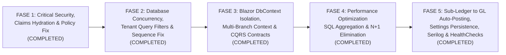

# IMPLEMENTATION PLAN & ENGINEERING ROADMAP — Enterprise ERP Remediation Plan

> **Tanggal Penyusunan:** 12 November 2026  
> **Tanggal Penyelesaian Implementasi:** 12 November 2026  
> **Status Eksekusi:** **100% COMPLETED (Fase 1 s/d Fase 5 Selesai & Terverifikasi)**  
> **Tujuan:** Pedoman rekayasa terstruktur, bertahap (*phased*), dan *non-destructive* untuk memperbaiki seluruh temuan audit teknis hingga mencapai kesiapan produksi 100% (*Production-Ready*).  
> **Prinsip Pelaksanaan:**
> 1. **Zero Data Loss & Non-Destructive Migration:** Tidak menghapus data yang sudah ada; seluruh perubahan skema bersifat aditif (`ADD COLUMN` / `CREATE INDEX` / pemetaan kolom sistem `xmin`).
> 2. **No Overengineering:** Tetap mempertahankan arsitektur Modular Monolith + Clean Architecture + MediatR CQRS yang sudah ada.
> 3. **Incremental Verification:** Seluruh fase terverifikasi dengan kompilasi `TreatWarningsAsErrors=true` (0 Warning, 0 Error) dan eksekusi pengujian otomatis (`dotnet test` — 54/54 Passed).

---

## Ringkasan Status Eksekusi per Fase

| Fase | Fokus Utama | Kode Temuan yang Diselesaikan | Status |
|---|---|---|---|
| **Fase 1** | Critical Security, Claims Hydration & Policy Fix | `SEC-CRIT-01..03`, `SEC-HIGH-01..02`, `SEC-MED-01..04` | **Completed** |
| **Fase 2** | Database Concurrency (`xmin`), Tenant Query Filters & Atomic Sequence | `DB-CRIT-01`, `ARCH-CRIT-02`, `DB-HIGH-01..02` | **Completed** |
| **Fase 3** | Blazor Circuit Isolation, Multi-Branch Context & CQRS Contracts | `ARCH-CRIT-01`, `ARCH-HIGH-01`, `ARCH-MED-01`, `API-MED-01..02` | **Completed** |
| **Fase 4** | Performance Optimization, SQL Aggregation & N+1 Elimination | `PERF-CRIT-01`, `PERF-HIGH-01..02`, `PERF-MED-02` | **Completed** |
| **Fase 5** | Sub-Ledger to GL Auto-Posting, Closed Fiscal Period, Settings, Serilog & HealthChecks | `ARCH-HIGH-02`, `ARCH-MED-02`, `OPS-HIGH-01..02` | **Completed** |

---

## Peta Urutan Fase Implementasi (Roadmap Overview)

---

## FASE 1: Perbaikan Kritis Keamanan, Hidrasi Klaim Identity & Policy Otorisasi (Prioritas 1 — Blocker Utama)

### Task 1.1 — Implementasi `ApplicationUserClaimsPrincipalFactory` (`SEC-CRIT-01`)
- **Status:** **Completed**
- **Severity:** `Critical`
- **File yang Dibuat / Dimodifikasi:**
  - Dibuat: `src/ERP.Infrastructure/Identity/ApplicationUserClaimsPrincipalFactory.cs`
  - Dimodifikasi: `src/ERP.Infrastructure/DependencyInjection.cs`
  - Dimodifikasi: `src/ERP.Infrastructure/Persistence/Seeders/DatabaseSeeder.cs` (Matriks izin lengkap untuk seluruh 11 role termasuk izin `*View`)
  - Dimodifikasi: `src/ERP.Web/Components/Pages/Security/RolesPage.razor` & `UsersPage.razor` (Refresh `ConcurrencyStamp` / `SecurityStamp` dan `CurrentUserService.OverridePermissions` saat izin role diubah)
- **Hasil Verifikasi:**
  - Login menghidrasi klaim `"CompanyId"`, `"BranchId"`, `"IsHeadOffice"`, `"AllowedBranchId"`, `"FullName"`, dan `"Permission"`.
  - `SecurityStampValidatorOptions.ValidationInterval` diset ke 1 menit agar perubahan role/permission segera menyegarkan klaim pengguna.

---

### Task 1.2 — Implementasi Dynamic `PermissionAuthorizationPolicyProvider` & Handler (`SEC-CRIT-02`)
- **Status:** **Completed**
- **Severity:** `Critical`
- **File yang Dibuat / Dimodifikasi:**
  - Dibuat: `src/ERP.Web/Security/PermissionAuthorizationPolicyProvider.cs` (`PermissionRequirement`, `PermissionAuthorizationHandler`, `PermissionAuthorizationPolicyProvider`)
  - Dimodifikasi: `src/ERP.Web/Program.cs`
- **Hasil Verifikasi:**
  - Seluruh halaman yang menggunakan `@attribute [Authorize(Policy = Permissions.*)]` terotorisasi secara dinamis tanpa melempar `InvalidOperationException`.

---

### Task 1.3 — Penegakan `@attribute [Authorize]` Global & Proteksi Halaman Security, Master, dan Inventory (`SEC-CRIT-03`)
- **Status:** **Completed**
- **Severity:** `Critical`
- **File yang Dimodifikasi:**
  - `src/ERP.Web/Components/_Imports.razor` (`@attribute [Authorize]` global)
  - `src/ERP.Web/Components/Routes.razor` (`AuthorizeRouteView` dengan redirect ke `/login`)
  - `src/ERP.Web/Components/Pages/Error.razor` & `NotFound.razor` (`@attribute [AllowAnonymous]`)
  - `src/ERP.Web/Components/Pages/Security/UsersPage.razor`, `RolesPage.razor`, `AuditLogsPage.razor`
  - `src/ERP.Web/Components/Pages/Master/CompaniesPage.razor`, `BranchesPage.razor`, `DepartmentsPage.razor`, `ProductsPage.razor`, `CustomersPage.razor`, `SuppliersPage.razor`
  - `src/ERP.Web/Components/Pages/Inventory/StockBalancesPage.razor`, `StockTransfersPage.razor`, `StockAdjustmentsPage.razor`
- **Hasil Verifikasi:**
  - Tidak ada lagi halaman yang dapat diakses secara anonim; setiap halaman dilindungi oleh policy izin granular yang sesuai.

---

### Task 1.4 — Penambahan `[RequirePermission]` pada Seluruh Request MediatR & Hardening `AuthorizationPipelineBehavior` (`SEC-HIGH-01`, `SEC-MED-03`)
- **Status:** **Completed**
- **Severity:** `High`
- **File yang Dimodifikasi:**
  - `src/ERP.Application/Common/Behaviors/AuthorizationPipelineBehavior.cs`
  - `src/ERP.Application/DependencyInjection.cs` (`AuthorizationPipelineBehavior` dieksekusi sebelum `ValidationPipelineBehavior`)
  - 18+ Command/Query di `Features/Hr/`, `Features/Reports/`, `Features/Inventory/`, `Features/Procurement/`, dan `Features/Master/Companies/`
  - `tests/ERP.Architecture.Tests/CleanArchitectureTests.cs` (`All_MediatR_Requests_In_Application_Should_Have_RequirePermissionAttribute`)
- **Hasil Verifikasi:**
  - 100% (69 dari 69) request `IRequest<T>` di `ERP.Application` memiliki `[RequirePermission]` dan diverifikasi secara otomatis oleh pengujian arsitektur.

---

### Task 1.5 — Perbaikan Rate Limiter per IP, Anti-CSRF Logout, Pencatatan IP AuditLog & Pembersihan Kredensial (`SEC-HIGH-02`, `SEC-MED-01`, `SEC-MED-02`, `SEC-MED-04`)
- **Status:** **Completed**
- **Severity:** `High` / `Medium`
- **File yang Dimodifikasi:**
  - `src/ERP.Web/Program.cs` (Rate limiter `LoginPolicy` dipartisi per alamat IP klien; validasi antiforgery pada `/api/auth/logout`)
  - `src/ERP.Web/Components/Layout/MainLayout.razor` (`<AntiforgeryToken />` pada form logout)
  - `src/ERP.Web/Components/Pages/Auth/Login.razor` (Kredensial demo hanya ditampilkan saat `Env.IsDevelopment()`)
  - `src/ERP.Web/appsettings.json` & `src/ERP.Web/appsettings.Development.json` (`Include Error Detail=true` dihapus dari konfigurasi produksi)
  - `src/ERP.Application/Common/Interfaces/ICurrentUserService.cs`, `src/ERP.Infrastructure/Services/CurrentUserService.cs`, `src/ERP.Infrastructure/Persistence/Interceptors/AuditSaveChangesInterceptor.cs` (Pencatatan `IpAddress` pada `AuditLog`)

---

## FASE 2: Konkurensi Database (`xmin`), Atomisitas Nomor Dokumen & Isolasi Query Multi-Tenant (Prioritas 2)

### Task 2.1 — Penambahan Concurrency Token (`xmin`) pada `StockBalance` dan `DocumentSequence` (`DB-CRIT-01`)
- **Status:** **Completed**
- **Severity:** `Critical`
- **File yang Dimodifikasi:**
  - `src/ERP.Domain/Entities/Inventory/StockBalance.cs` (`public uint Version { get; private set; }`)
  - `src/ERP.Domain/Entities/Master/DocumentSequence.cs` (`public uint Version { get; private set; }`)
  - `src/ERP.Infrastructure/Persistence/Context/ApplicationDbContext.cs` (`IsConcurrencyToken()` menggunakan kolom sistem PostgreSQL `xmin`)
- **Hasil Verifikasi:**
  - Terverifikasi melalui integration test `StockBalance_And_DocumentSequence_ShouldEnforce_XminOptimisticConcurrency` terhadap PostgreSQL 18 bahwa konflik update paralel terdeteksi dengan `DbUpdateConcurrencyException`.

---

### Task 2.2 — Perbaikan Atomisitas Transaksi pada `DocumentSequenceService` (`ARCH-CRIT-02`)
- **Status:** **Completed**
- **Severity:** `Critical`
- **File yang Dimodifikasi:**
  - `src/ERP.Infrastructure/Services/DocumentSequenceService.cs`
- **Hasil Verifikasi:**
  - `NextDocumentNumberAsync` memeriksa `ChangeTracker.Entries<DocumentSequence>()` terlebih dahulu dan tidak memanggil `SaveChangesAsync` secara prematur, sehingga nomor urut tersimpan secara atomik bersama transaksi utama pemanggil. Terverifikasi oleh integration test `DocumentSequenceService_ShouldBeAtomic_WithCallerUnitOfWork`.

---

### Task 2.3 — Pelengkapan Global Query Filter (`HasQueryFilter`) Tanpa Bypass `Guid.Empty` & Indeks Komposit Database (`DB-HIGH-01`, `DB-HIGH-02`)
- **Status:** **Completed**
- **Severity:** `High`
- **File yang Dibuat / Dimodifikasi:**
  - `src/ERP.Infrastructure/Persistence/Context/ApplicationDbContext.cs`
  - `src/ERP.Infrastructure/Persistence/Migrations/20261112040546_AddConcurrencySettingsAndIndexes.cs`
- **Hasil Verifikasi:**
  - Seluruh entitas tenant utama dan 11 entitas anak (*child line entities*) memiliki `HasQueryFilter` ketat (`x.CompanyId == currentUserService.CompanyId` tanpa bypass `Guid.Empty`).
  - Indeks komposit ditambahkan pada `AuditLog`, `JournalEntry`, `SalesInvoice`, dan `VendorBill`.
  - Migrasi `20261112040546_AddConcurrencySettingsAndIndexes` berhasil diterapkan ke PostgreSQL 18 tanpa kehilangan data.

---

## FASE 3: Isolasi Konkurensi Blazor Circuit, Konteks Multi-Cabang & Konsistensi Kontrak CQRS (Prioritas 3)

### Task 3.1 — Penyeragaman Kontrak `Result<PagedResult<T>>` & Penambahan `ExceptionHandlingPipelineBehavior` (`ARCH-MED-01`, `API-MED-01`, `API-MED-02`)
- **Status:** **Completed**
- **Severity:** `High` / `Medium`
- **File yang Dibuat / Dimodifikasi:**
  - Dibuat: `src/ERP.Application/Common/Behaviors/ExceptionHandlingPipelineBehavior.cs`
  - Dimodifikasi: `src/ERP.Application/DependencyInjection.cs`
  - Dimodifikasi: `src/ERP.Application/Features/Procurement/GoodsReceipts/GetGoodsReceiptsQuery.cs` & `src/ERP.Web/Components/Pages/Procurement/GoodsReceiptsPage.razor`
  - Dimodifikasi: `src/ERP.Application/Features/Procurement/VendorBills/GetVendorBillsQuery.cs` & `src/ERP.Web/Components/Pages/Procurement/VendorBillsPage.razor`
  - Dimodifikasi: `src/ERP.Web/Components/Layout/MainLayout.razor` (`<ErrorBoundary>` membungkus `@Body`)

---

### Task 3.2 — Perbaikan State Multi-Company / Multi-Branch (`Branch Switcher`) per Blazor Circuit (`ARCH-HIGH-01`, `ARCH-CRIT-01`)
- **Status:** **Completed**
- **Severity:** `Critical` / `High`
- **File yang Dibuat / Dimodifikasi:**
  - Dibuat: `src/ERP.Web/Security/UserCircuitHandler.cs`
  - Dimodifikasi: `src/ERP.Application/Common/Interfaces/ICurrentUserService.cs` & `src/ERP.Infrastructure/Services/CurrentUserService.cs`
  - Dimodifikasi: `src/ERP.Web/Components/Layout/MainLayout.razor` & `src/ERP.Web/Components/Pages/Home.razor`
- **Hasil Verifikasi:**
  - `UserCircuitHandler` menyinkronkan `ClaimsPrincipal` ke `ICurrentUserService` yang bersifat `Scoped` per Blazor Circuit.
  - `SwitchBranch` di `MainLayout.razor` memvalidasi `AllowedBranchIds` dan memperbarui konteks cabang aktif secara reaktif.

---

## FASE 4: Optimasi Performa Query Database, Eliminasi In-Memory Materialization & N+1 Loops (Prioritas 4)

### Task 4.1 — Refactoring Query Laporan Keuangan, Analitik Penjualan, Valuasi Inventori & Dashboard ke Agregasi SQL (`PERF-CRIT-01`, `PERF-HIGH-02`)
- **Status:** **Completed**
- **Severity:** `Critical`
- **File yang Dimodifikasi:**
  - `src/ERP.Application/Features/Reports/GetFinancialReportsQuery.cs`
  - `src/ERP.Application/Features/Reports/GetSalesAnalyticsQuery.cs`
  - `src/ERP.Application/Features/Reports/GetInventoryValuationQuery.cs`
  - `src/ERP.Application/Features/Hr/Payroll/GetPayrollPeriodsQuery.cs`
  - `src/ERP.Web/Components/Pages/Home.razor`
- **Hasil Verifikasi:**
  - Seluruh perhitungan laporan keuangan (`BalanceSheet`, `ProfitAndLoss`, `TrialBalance`), analitik penjualan, valuasi inventori, dan KPI dashboard dieksekusi di level SQL (`GroupBy`, `SumAsync`, `CountAsync`, `.AsNoTracking()`) tanpa menarik seluruh isi tabel ke memori C#.

---

### Task 4.2 — Eliminasi Query N+1 di 8 Command Handler Transaksi, `UsersPage.razor`, dan Refleksi `AuditSaveChangesInterceptor` (`PERF-HIGH-01`, `PERF-MED-02`)
- **Status:** **Completed**
- **Severity:** `High`
- **File yang Dimodifikasi:**
  - `src/ERP.Application/Features/Sales/SalesOrders/CreateSalesOrderCommand.cs` (`ConfirmSalesOrderCommandHandler`)
  - `src/ERP.Application/Features/Inventory/StockTransfers/CreateStockTransferCommand.cs` (`Dispatch` & `Receive`)
  - `src/ERP.Application/Features/Inventory/StockAdjustments/CreateStockAdjustmentCommand.cs` (`Create` & `Approve`)
  - `src/ERP.Application/Features/Procurement/GoodsReceipts/CreateGoodsReceiptCommand.cs` (`ReceiveGoodsReceiptCommandHandler`)
  - `src/ERP.Application/Features/Sales/Deliveries/CreateDeliveryCommand.cs` (`DispatchDeliveryCommandHandler`)
  - `src/ERP.Application/Features/Finance/Payments/CreatePaymentCommand.cs` (`PostPaymentCommandHandler`)
  - `src/ERP.Web/Components/Pages/Security/UsersPage.razor`
  - `src/ERP.Infrastructure/Persistence/Interceptors/AuditSaveChangesInterceptor.cs`

---

## FASE 5: Integrasi Jurnal GL Otomatis, Validasi Periode Tutup, Observability & Production Hardening (Prioritas 5)

### Task 5.1 — Otomasi Sub-Ledger ke General Ledger (GL) & Penegakan Periode Fiskal Tutup (`ARCH-HIGH-02`)
- **Status:** **Completed**
- **Severity:** `High`
- **File yang Dibuat / Dimodifikasi:**
  - Dibuat: `src/ERP.Application/Common/Interfaces/IAccountingPostingService.cs`
  - Dibuat: `src/ERP.Infrastructure/Services/AccountingPostingService.cs`
  - Dimodifikasi: `PostJournalEntryCommandHandler`, `ReceiveGoodsReceiptCommandHandler`, `PostVendorBillCommandHandler`, `DispatchDeliveryCommandHandler`, `PostSalesInvoiceCommandHandler`, `PostPaymentCommandHandler`, `PayPayrollCommandHandler`
- **Hasil Verifikasi:**
  - Setiap posting dokumen Sub-Ledger secara otomatis memvalidasi periode fiskal (`EnsureFiscalPeriodOpenAsync` — `BR-ACC-002`) dan menghasilkan `JournalEntry` penyeimbang yang idempoten dan seimbang (`TotalDebit == TotalCredit`) dalam satu transaksi database.

---

### Task 5.2 — Konfigurasi `Serilog`, Health Checks (`/health`), Persistensi Pengaturan & Migrasi Produksi (`ARCH-MED-02`, `OPS-HIGH-01`, `OPS-HIGH-02`)
- **Status:** **Completed**
- **Severity:** `High` / `Medium`
- **File yang Dibuat / Dimodifikasi:**
  - Dibuat: `src/ERP.Application/Features/Master/Companies/UpdateCompanySettingsCommand.cs` (`GetCompanySettingsQuery` & `UpdateCompanySettingsCommand`)
  - Dimodifikasi: `src/ERP.Domain/Entities/Master/Company.cs`
  - Dimodifikasi: `src/ERP.Web/Components/Pages/Settings/SettingsPage.razor`
  - Dimodifikasi: `src/ERP.Web/Program.cs` (Integrasi `Serilog` Console + Rolling File `logs/erp-.log`, endpoint `/health` dengan `PostgresDatabaseHealthCheck`, serta dukungan `Database:AutoMigrate` & `Database:SeedDemoData`)
