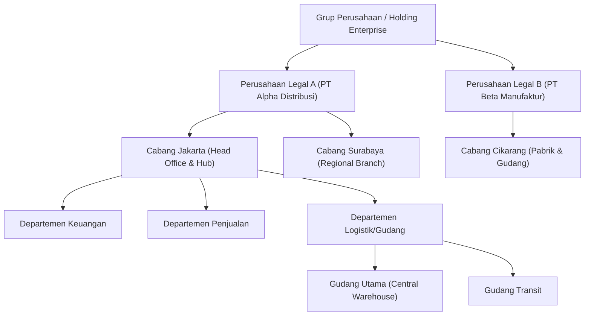

# Business Requirements Document (BRD) — Enterprise ERP System

> **Document Version:** 1.0.0  
> **Target Platform:** .NET 10 LTS | PostgreSQL 16+ | Clean Architecture  
> **Related Documents:** [PROJECT_OVERVIEW.md](./PROJECT_OVERVIEW.md) | [PRODUCT_REQUIREMENTS.md](./PRODUCT_REQUIREMENTS.md) | [BUSINESS_RULES.md](./BUSINESS_RULES.md) | [BUSINESS_WORKFLOWS.md](./BUSINESS_WORKFLOWS.md)

---

## 1. Konteks Bisnis & Pendorong Strategis (Business Drivers)

Pertumbuhan bisnis modern menuntut integrasi rantai nilai operasional yang cepat dan akurat. Organisasi menghadapi empat pendorong bisnis utama (*key business drivers*):

1. **Efisiensi Modal Kerja (Working Capital Optimization):**  
   Persediaan barang dan piutang dagang merupakan komponen aset lancar terbesar. Ketidakmampuan memantau umur piutang (*AR aging*) dan perputaran persediaan (*inventory turnover*) secara harian berdampak langsung pada likuiditas kas perusahaan.
2. **Kepatuhan Akuntansi & Regulasi Perpajakan (Financial Compliance & Governance):**  
   Pencatatan keuangan wajib mematuhi Standar Akuntansi Keuangan (SAK/IFRS) dengan sistem pembukuan berpasangan (*double-entry bookkeeping*) serta mendukung perhitungan Pajak Pertambahan Nilai (PPN) dan Pajak Penghasilan (PPh).
3. **Skalabilitas Organisasi Multi-Cabang (Multi-Branch Scalability):**  
   Perusahaan membutuhkan sistem yang mampu mengakomodasi penambahan cabang atau anak perusahaan baru dalam hitungan menit tanpa perlu penginstalan server terpisah di setiap lokasi fisik.
4. **Resiliensi Operasional & Pengambilan Keputusan Berbasis Data:**  
   Pimpinan perusahaan memerlukan laporan real-time tanpa ketergantungan pada pembuatan laporan manual di akhir bulan.

---

## 2. Struktur Hierarki Entitas Bisnis (Enterprise Organizational Hierarchy)

Sistem ERP ini secara arsitektural mendukung model organisasi korporasi berjenjang (*Multi-Tier Enterprise Hierarchy*):

### Aturan Bisnis Hierarki Organisasi:
- **Tingkat Entitas Legal (Company):** Memiliki NPWP terpisah, neraca keuangan independen, bagan akun (*Chart of Accounts*), dan periode penutupan buku mandiri.
- **Tingkat Unit Operasional (Branch):** Menjadi pusat pertanggungjawaban transaksi fisik (gudang, penagihan, pengiriman). Seluruh transaksi operasional wajib memiliki tag `company_id` dan `branch_id`.
- **Tingkat Departemen:** Mengelompokkan anggaran belanja, struktur pelaporan karyawan, dan unit persetujuan pengadaan (*cost center*).

---

## 3. Analisis Kebutuhan Bisnis Lintas Fungsi (Cross-Functional Business Requirements)

### BR-01: Isolasi dan Agregasi Data Multi-Perusahaan
- **Kebutuhan:** Pengguna di Cabang Surabaya PT Alpha dilarang melihat atau mengubah transaksi Cabang Cikarang PT Beta. Namun, Direksi di level Holding dapat melihat laporan konsolidasi seluruh grup perusahaan.
- **Nilai Bisnis:** Keamanan data internal dan kerahasiaan operasional antar unit bisnis terjamin penuh.

### BR-02: Otomasi Siklus Order-to-Cash (O2C)
- **Kebutuhan:** Setiap transaksi penjualan harus melewati validasi limit kredit pelanggan dan reservasi stok fisik. Pengiriman barang (*Surat Jalan*) secara otomatis mengurangi saldo persediaan fisik dan membukukan mutasi stok keluar.
- **Nilai Bisnis:** Mencegah piutang macet akibat penjualan melebihi limit kredit dan menghilangkan insiden *overselling*.

### BR-03: Otomasi Siklus Procure-to-Pay (P2P) dengan 3-Way Matching
- **Kebutuhan:** Pembayaran kepada pemasok (*Vendor Payment*) hanya dapat diproses apabila kuantitas dan harga pada Faktur Pemasok cocok (*matched*) dengan Pesanan Pembelian (*Purchase Order*) dan Bukti Penerimaan Barang (*Goods Receipt Note*).
- **Nilai Bisnis:** Mengeliminasi pembayaran atas barang yang belum diterima atau selisih harga sepihak dari vendor (efisiensi pengeluaran hingga 5–10%).

### BR-04: Akuntansi Berpasangan (Double-Entry Bookkeeping) Real-Time
- **Kebutuhan:** Setiap transaksi operasional yang memiliki dampak moneter (penerimaan barang, surat jalan, faktur, pembayaran, dan beban gaji) wajib secara otomatis membentuk draf/posted jurnal akuntansi dengan prinsip debit = kredit.
- **Nilai Bisnis:** Menghilangkan rekonsiliasi manual akhir bulan; Neraca Saldo (*Trial Balance*) dan Laba Rugi (*P&L*) dapat ditarik sewaktu-waktu secara real-time.

### BR-05: Valuasi Persediaan Menggunakan Rata-Rata Tertimbang (Weighted Average Cost)
- **Kebutuhan:** Harga Pokok Penjualan (HPP) dihitung secara dinamis setiap kali terjadi penerimaan barang baru dengan harga pembelian berbeda:
  $$\text{Biaya Rata-Rata Baru} = \frac{(\text{Stok Lama} \times \text{Biaya Lama}) + (\text{Qty Masuk} \times \text{Harga Beli Baru})}{\text{Stok Lama} + \text{Qty Masuk}}$$
- **Nilai Bisnis:** Menjamin akurasi perhitungan laba kotor (*gross margin*) yang realistis di tengah fluktuasi harga pasar.

### BR-06: Tata Kelola Dokumen & Anti-Repudiasi (Auditability & Non-Repudiation)
- **Kebutuhan:** Setiap transaksi memiliki nomor dokumen urut yang tidak boleh bolong (*sequential without gaps*). Transaksi yang sudah diposting berstatus *Final/Posted* dilarang dihapus (*no hard deletes*). Jika terjadi kesalahan, harus diterbitkan dokumen pembatalan (*Void/Cancellation*) beserta jurnal pembalik (*Reversal Entry*).
- **Nilai Bisnis:** Memenuhi standar audit kepatuhan internal dan eksternal (KAP / Dirjen Pajak).

---

## 4. Analisis Return on Investment (ROI) & Estimasi Penghematan Biaya

| Aspek Operasional | Kondisi Sebelum ERP (Manual/Legacy) | Target Setelah Implementasi ERP | Estimasi Penghematan & Peningkatan |
| :--- | :--- | :--- | :--- |
| **Waktu Siklus Penagihan Piutang** | Rata-rata 45–60 hari (DSO) | 30–35 hari melalui reminder & kontrol faktur | Peningkatan likuiditas kas hingga 25% |
| **Waktu Penutupan Buku Akhir Bulan** | 14–20 hari kerja setiap bulan | 2 hari kerja otomatis | Penghematan 80–90 jam kerja per akuntan/bulan |
| **Akurasi Persediaan Gudang** | 82%–88% (sering terjadi selisih fisik) | > 99.5% dengan perpetual ledger | Menurunkan kehilangan barang hingga 90% |
| **Kecepatan Proses Order Penjualan** | 1–2 hari kerja (menunggu cek stok fisik) | < 5 menit melalui pengecekan stok sistem | Peningkatan kapasitas pemrosesan order 300% |
| **Biaya Lisensi Perangkat Lunak** | Biaya tahunan lisensi ERP proprietary | Bebas lisensi (.NET 10, PostgreSQL open-source) | Menghemat ratusan juta rupiah per tahun |

---

## 5. Analisis Risiko Bisnis & Strategi Mitigasi

| Risiko Bisnis | Dampak | Probabilitas | Rencana Mitigasi Teknis & Prosedural |
| :--- | :---: | :---: | :--- |
| **Resistensi Pengguna terhadap Sistem Baru** | Tinggi | Sedang | Perancangan UI menggunakan MudBlazor yang intuitif, alur form yang konsisten, dan pelatihan pengguna bertahap per departemen. |
| **Data Korup Akibat Transaksi Bersamaan** | Tinggi | Rendah | Menggunakan isolasi transaksi PostgreSQL berskala serial/read-committed dan proteksi *Optimistic Concurrency Control* (`xmin`). |
| **Kehilangan Data Akibat Bencana Perangkat Keras** | Kritis | Sangat Rendah | Kebijakan backup otomatis harian, replikasi continuous WAL archiving PostgreSQL, dan pengujian berkala *Disaster Recovery*. |
| **Kebocoran Informasi Gaji atau Keuangan Cabang** | Tinggi | Rendah | Implementasi Permission-Based Access Control (PBAC) yang divalidasi ketat di level query server, bukan sekadar menyembunyikan tombol UI. |

