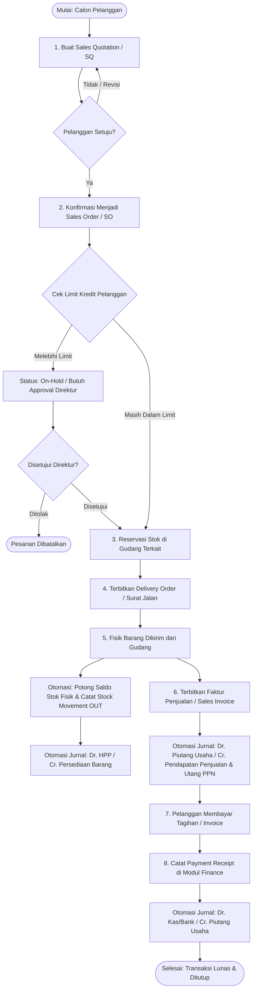
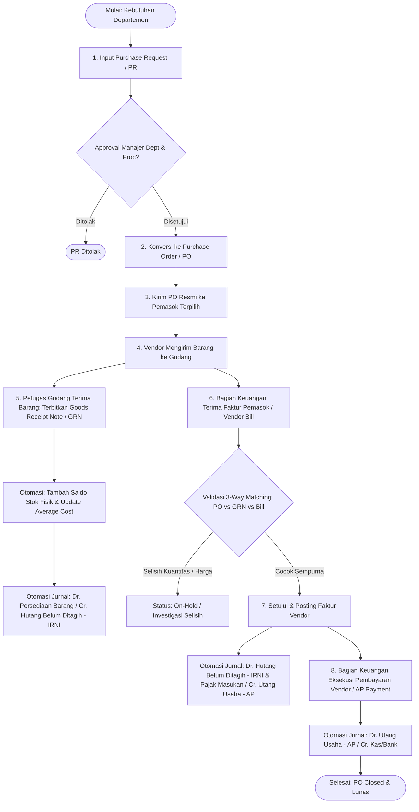
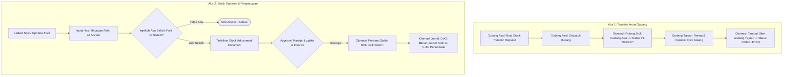
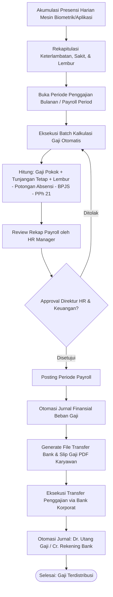
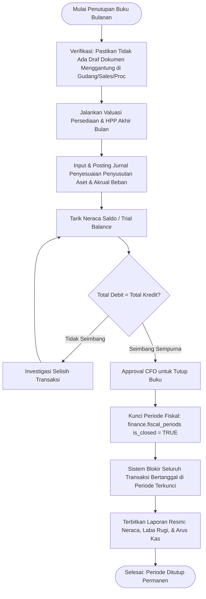

# Business Workflows Document — Enterprise ERP System

> **Document Version:** 1.0.0  
> **Related Documents:** [BUSINESS_RULES.md](./BUSINESS_RULES.md) | [FUNCTIONAL_REQUIREMENTS.md](./FUNCTIONAL_REQUIREMENTS.md) | [MODULE_SPECIFICATIONS.md](./MODULE_SPECIFICATIONS.md) | [DATABASE_SCHEMA.md](./DATABASE_SCHEMA.md)

---

## 1. Ikhtisar Alur Kerja Lintas Modul (End-to-End Enterprise Workflows)

Sistem ERP ini mengintegrasikan seluruh transaksi bisnis melalui 5 alur kerja operasional utama:
1. **Siklus Penjualan & Penerimaan Kas (Order-to-Cash / O2C)**
2. **Siklus Pengadaan & Pembayaran Utang (Procure-to-Pay / P2P)**
3. **Siklus Manajemen Persediaan & Transfer Logistik (Inventory & Logistics)**
4. **Siklus Kehadiran & Penggajian Karyawan (Hire-to-Payroll / H2P)**
5. **Siklus Penutupan Buku Akhir Periode (Record-to-Report / Month-End Close)**

---

## 2. Siklus Order-to-Cash (O2C) — Penjualan & Piutang

Alur penjualan mengatur proses dari permohonan harga pelanggan hingga penerimaan kas dan pembukuan jurnal akuntansi:

### Rincian Tahapan & Efek Samping Database (O2C):
1. **Penerbitan Sales Order:** Status menjadi `Confirmed`. Kolom `reserved_quantity` pada tabel `inventory.stock_balances` bertambah sesuai kuantitas pesanan.
2. **Pengiriman Barang (Delivery Order Dispatched):**
   - Saldo fisik `physical_quantity` berkurang, `reserved_quantity` dilepaskan.
   - Tabel `inventory.stock_movements` mencatat baris baru berarah `OUT` dengan `movement_type = 'SalesDelivery'`.
   - Modul Finance membentuk ayat jurnal:
     - **Debit:** Beban Pokok Penjualan (HPP)
     - **Kredit:** Persediaan Barang Dagang
3. **Penerbitan Faktur Penjualan (Sales Invoice Posted):**
   - Menghasilkan piutang baru pada tabel `sales.sales_invoices`.
   - Modul Finance membentuk ayat jurnal komersial:
     - **Debit:** Piutang Usaha (AR)
     - **Kredit:** Pendapatan Penjualan
     - **Kredit:** Utang PPN Keluaran (11%/12%)
4. **Penerimaan Pembayaran (Customer Payment Receipt):**
   - Menghasilkan record di `finance.payments` dan `finance.payment_allocations`.
   - Mengurangi saldo `paid_amount` pada faktur.
   - Modul Finance membentuk ayat jurnal pelunasan:
     - **Debit:** Kas / Rekening Giro Bank
     - **Kredit:** Piutang Usaha

---

## 3. Siklus Procure-to-Pay (P2P) — Pengadaan & Utang

Alur pengadaan menjamin setiap pembelian barang memiliki otorisasi yang sah serta diverifikasi melalui pencocokan 3-arah (*3-Way Matching*):

### Jurnal Akuntansi Standar Pengadaan (P2P):
1. **Saat Penerimaan Fisik Barang di Gudang (Goods Receipt Note):**
   - **Debit:** Persediaan Barang Dagang
   - **Kredit:** Persediaan Diterima Belum Ditagih (*Inventory Received Not Invoiced / IRNI*)
2. **Saat Penerimaan Faktur Tagihan Vendor (Vendor Bill Posted):**
   - **Debit:** Persediaan Diterima Belum Ditagih (*IRNI*)
   - **Debit:** PPN Masukan
   - **Kredit:** Utang Usaha (Account Payable)
3. **Saat Pembayaran Tagihan Vendor (Vendor Bill Paid):**
   - **Debit:** Utang Usaha (Account Payable)
   - **Kredit:** Rekening Bank / Kas Operasional

---

## 4. Siklus Mutasi & Penyesuaian Persediaan (Inventory & Logistics)

---

## 5. Siklus Kehadiran & Penggajian Karyawan (Hire-to-Payroll)

### Jurnal Akuntansi Penggajian:
- **Debit:** Beban Gaji Karyawan
- **Debit:** Beban Tunjangan Karyawan
- **Debit:** Beban BPJS Ketenagakerjaan Porsi Perusahaan
- **Kredit:** Utang Gaji Karyawan (*Net Payroll Payable*)
- **Kredit:** Utang Pajak PPh 21 Karyawan
- **Kredit:** Utang Iuran BPJS Ketenagakerjaan/Kesehatan

---

## 6. Siklus Penutupan Buku Akhir Periode (Month-End Close)

