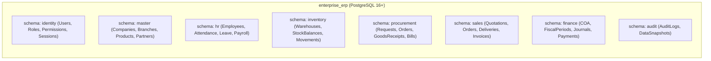
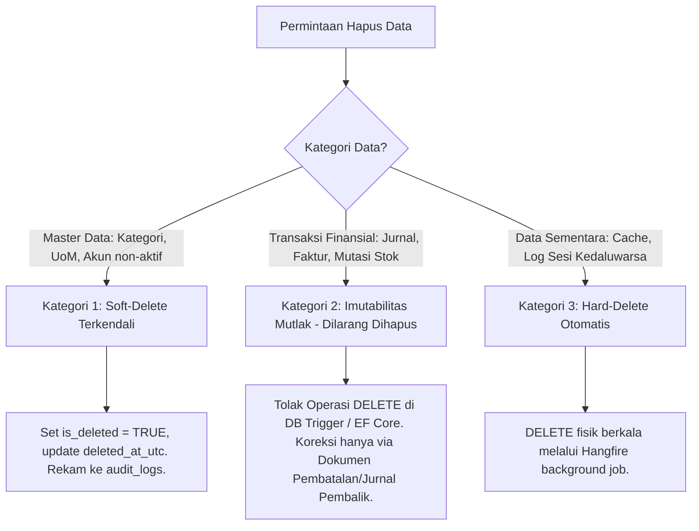

# Database Design Document — Enterprise ERP System

> **Document Version:** 1.0.0  
> **Target Database Engine:** PostgreSQL 16+  
> **Related Documents:** [DATABASE_SCHEMA.md](./DATABASE_SCHEMA.md) | [ENTITY_RELATIONSHIP_DIAGRAM.md](./ENTITY_RELATIONSHIP_DIAGRAM.md) | [DATA_DICTIONARY.md](./DATA_DICTIONARY.md) | [BUSINESS_RULES.md](./BUSINESS_RULES.md)

---

## 1. Filosofi & Prinsip Desain Basis Data (Database Architecture Principles)

Perancangan basis data untuk Enterprise ERP System ini didasarkan pada prinsip-prinsip arsitektur enterprise berikut:

1. **Integritas Referensial Absolut (Foreign Key Constraints Enforced):**  
   Seluruh relasi antar entitas bisnis wajib ditegakkan pada tingkat mesin database menggunakan *Foreign Key Constraints* dengan aturan `ON DELETE RESTRICT` untuk mencegah terhapusnya data induk yang masih menjadi referensi transaksi.
2. **Kedaulatan & Presisi Moneter (Financial Precision):**  
   Dilarang keras menggunakan tipe data floating-point (`float`, `real`, `double precision`) untuk nominal uang atau kuantitas barang, demi menghindari kesalahan pembulatan komputasi biner. Seluruh kalkulasi finansial menggunakan `numeric(18,4)` untuk harga satuan dan `numeric(18,2)` untuk nominal total.
3. **Penggunaan UUID Berurutan (Sequential UUID / UUIDv7):**  
   Seluruh primary key menggunakan tipe `uuid`. Untuk mencegah fragmentasi indeks B-Tree pada tabel berbobot transaksi tinggi, diimplementasikan UUIDv7 (berbasis timestamp UNIX 48-bit di awal) sehingga indeks tersusun secara sekuensial secara alami di disk.
4. **Waktu Terstandarisasi UTC (UTC Timestamps Only):**  
   Seluruh kolom penanda waktu wajib menggunakan tipe data `timestamptz` (*timestamp with time zone*) dan disimpan dalam zona waktu UTC. Konversi ke waktu lokal (misal: WIB/WITA/WIT) dilakukan pada lapisan presentasi pengguna.
5. **Pemisahan Domain Melalui Database Schema:**  
   Menghindari penumpukan seluruh tabel ke dalam schema `public`. Database dipartisi menjadi 8 schema domain: `identity`, `master`, `hr`, `inventory`, `procurement`, `sales`, `finance`, dan `audit`.

---

## 2. Struktur Schema Domain PostgreSQL



---

## 3. Strategi Standar Kolom Entitas (Audit & Concurrency Fields)

Setiap tabel transaksional dan master data wajib mengimplementasikan sekumpulan kolom standar berikut:

| Nama Kolom | Tipe Data PostgreSQL | Nullable | Nilai Default | Deskripsi & Fungsi |
| :--- | :--- | :---: | :--- | :--- |
| `id` | `uuid` | NO | `gen_random_uuid()` | Primary Key unik (mengadopsi UUIDv7). |
| `company_id` | `uuid` | NO | - | Foreign Key ke `master.companies(id)` untuk isolasi data multi-perusahaan. |
| `branch_id` | `uuid` | NO | - | Foreign Key ke `master.branches(id)` untuk isolasi data tingkat cabang operasional. |
| `created_at_utc` | `timestamptz` | NO | `CURRENT_TIMESTAMP` | Waktu pencatatan data pertama kali (UTC). |
| `created_by_user_id`| `uuid` | NO | - | Pengguna yang menerbitkan rekaman data. |
| `updated_at_utc` | `timestamptz` | YES | NULL | Waktu pembaruan data terakhir (UTC). |
| `updated_by_user_id`| `uuid` | YES | NULL | Pengguna terakhir yang memperbarui data. |
| `is_deleted` | `boolean` | NO | `FALSE` | Penanda soft-delete (*Active vs Archived*). |
| `deleted_at_utc` | `timestamptz` | YES | NULL | Waktu penghapusan logis data (UTC). |
| `deleted_by_user_id`| `uuid` | YES | NULL | Pengguna yang melakukan soft-delete data. |
| `xmin` | `xid` *(system column)*| NO | PostgreSQL internal | Concurrency token bawaan PostgreSQL untuk *Optimistic Concurrency Control*. |

---

## 4. Kebijakan Penghapusan Data (Data Deletion Policy)

Sistem ERP membedakan 3 kategori perlakuan penghapusan data secara tegas:



### Aturan Imutabilitas Finansial:
- Tabel `finance.journal_entries`, `finance.journal_lines`, `inventory.stock_movements`, dan `sales.sales_invoices` yang berstatus `Posted` **DILARANG DIHAPUS SECARA FISIK MAUPUN SOFT-DELETE**.
- Jika terjadi kesalahan administratif, pengguna berwenang harus membuat transaksi pembalik (*Reversal Entry* / *Credit Note*) yang mengoffset saldo buku besar.

---

## 5. Kontrol Konkurensi Optimistik (Optimistic Concurrency Control)

Untuk mencegah insiden *Lost Update* saat dua pengguna mengedit transaksi yang sama secara simultan:
- Menggunakan kolom sistem PostgreSQL bawaan: **`xmin`**.
- Kolom `xmin` adalah nomor transaksi 32-bit yang secara otomatis diubah oleh mesin PostgreSQL setiap kali sebuah baris mengalami operasi `UPDATE`.
- Pada EF Core 10, dikonfigurasikan dengan:
  ```csharp
  builder.UseXminAsConcurrencyToken();
  ```
- Saat pengguna menyimpan perubahan:
  ```sql
  UPDATE sales.sales_orders 
  SET status = 'Confirmed', ... 
  WHERE id = '...' AND xmin = 12948293;
  ```
  Jika baris telah diubah oleh orang lain sebelum transaksi selesai, `xmin` tidak akan cocok. EF Core akan menangkap kondisi ini dan melempar `DbUpdateConcurrencyException`, sehingga data pengguna pertama tidak tertimpa secara buta.

---

## 6. Manajemen Transaksi & Tingkat Isolasi (Transaction & ACID Isolation)

| Skenario Operasional | Tingkat Isolasi PostgreSQL | Teknik Penguncian (Locking Mechanism) | Alasan Bisnis |
| :--- | :--- | :--- | :--- |
| **Transaksi Bisnis Umum** (Input Pesanan, Permohonan Cuti) | `READ COMMITTED` (Default) | *Row-level MVCC non-blocking* | Memberikan throughput tinggi dan tidak memblokir pembacaan data. |
| **Pembaruan Saldo Persediaan Gudang** (`stock_balances`) | `READ COMMITTED` | `SELECT ... FOR UPDATE` | Menghindari *race condition* saat beberapa pesanan memotong stok barang yang sama pada detik yang sama. |
| **Penerbitan Nomor Dokumen Sekuensial** (`document_sequences`)| `READ COMMITTED` | `SELECT ... FOR UPDATE` | Menjamin nomor transaksi urut sempurna tanpa celah (*gapless*) dan anti nomor kembar. |
| **Proses Penutupan Buku Akhir Periode** (*Month-End Close*) | `SERIALIZABLE` | *Strict Serializable Snapshot Isolation (SSI)* | Mencegah anomali *phantom read* atau perubahan nilai akun saat rekonsiliasi total neraca saldo sedang berlangsung. |

---

## 7. Strategi Pengindeksan & Kinerja Query (Indexing Strategy)

Untuk menjamin waktu respon query $\le 50\text{ ms}$:

1. **Indeks B-Tree Standar pada Foreign Keys:**  
   Seluruh kolom foreign key (`company_id`, `branch_id`, `customer_id`, `product_id`, dll.) wajib diberi indeks B-Tree untuk mempercepat operasi `JOIN`.
2. **Partial Indexes untuk Soft-Delete:**  
   Karena mayoritas query hanya mencari data aktif, indeks unik dan pencarian dibuat menggunakan filter kondisi:
   ```sql
   CREATE UNIQUE INDEX uq_products_company_sku 
   ON master.products (company_id, sku) 
   WHERE is_deleted = FALSE;
   ```
3. **Composite Indexes untuk Query Transaksi:**  
   Pencarian transaksi berdasarkan rentang tanggal dan cabang menggunakan indeks gabungan:
   ```sql
   CREATE INDEX idx_sales_orders_branch_date 
   ON sales.sales_orders (branch_id, order_date DESC) 
   WHERE is_deleted = FALSE;
   ```
4. **Indeks JSONB (GIN Index):**  
   Tabel `audit.audit_logs` yang menyimpan payload perubahan nilai data menggunakan indeks Generalized Inverted Index (GIN) pada kolom JSONB:
   ```sql
   CREATE INDEX idx_audit_logs_new_values_gin 
   ON audit.audit_logs USING gin (new_values);
   ```

---

## 8. Strategi Partisi Tabel Skala Besar (Table Partitioning Strategy)

Tabel yang diperkirakan memiliki jutaan baris per tahun dibagi menggunakan **PostgreSQL Declarative Table Partitioning**:

### Partisi Tabel `audit.audit_logs` (Range Partition by Year)
```sql
CREATE TABLE audit.audit_logs (
    id uuid NOT NULL,
    company_id uuid NOT NULL,
    entity_name varchar(100) NOT NULL,
    entity_id uuid NOT NULL,
    action varchar(20) NOT NULL,
    old_values jsonb,
    new_values jsonb,
    user_id uuid NOT NULL,
    ip_address varchar(45),
    created_at_utc timestamptz NOT NULL,
    PRIMARY KEY (id, created_at_utc)
) PARTITION BY RANGE (created_at_utc);

-- Partisi Tahunan Otomatis
CREATE TABLE audit.audit_logs_y2026 PARTITION OF audit.audit_logs
    FOR VALUES FROM ('2026-01-01 00:00:00+00') TO ('2027-01-01 00:00:00+00');

CREATE TABLE audit.audit_logs_y2027 PARTITION OF audit.audit_logs
    FOR VALUES FROM ('2027-01-01 00:00:00+00') TO ('2028-01-01 00:00:00+00');
```
Manfaat: Pemeliharaan, pencarian audit, dan pengarsipan data lama (*cold storage archiving*) dapat dilakukan dengan cepat per partisi tabel tanpa membebani tabel aktif.

