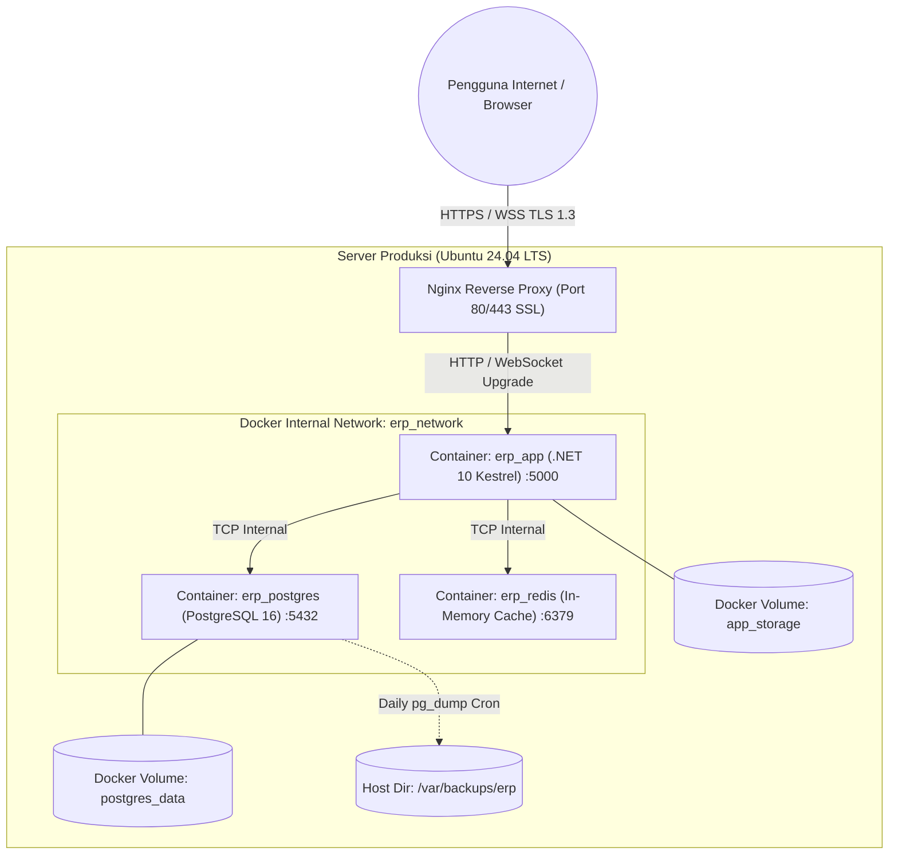

# Deployment & Infrastructure Guide — Enterprise ERP System

> **Document Version:** 1.0.0  
> **Deployment Model:** Containerized Architecture (Docker Compose / Linux VPS)  
> **Target OS:** Ubuntu Server 24.04 LTS | Alpine Linux Containers  
> **Related Documents:** [SYSTEM_DESIGN.md](./SYSTEM_DESIGN.md) | [NON_FUNCTIONAL_REQUIREMENTS.md](./NON_FUNCTIONAL_REQUIREMENTS.md) | [SECURITY_DESIGN.md](./SECURITY_DESIGN.md)

---

## 1. Topologi Lingkungan Produksi (Production Deployment Topology)

Sistem dirancang untuk penerapan yang tangguh dan terjangkau di lingkungan Linux Server (Cloud VM / Bare-Metal) menggunakan kontainer Docker yang dilindungi oleh Reverse Proxy Nginx:



---

## 2. Definisi Kontainer Docker Produksi

### 2.1 Multi-Stage `Dockerfile` (.NET 10 LTS)

```dockerfile
# Stage 1: Build & Publish
FROM mcr.microsoft.com/dotnet/sdk:10.0-preview AS build
WORKDIR /src

# Salin solution dan file deklarasi proyek untuk caching layer restore
COPY ["Directory.Build.props", "./"]
COPY ["Directory.Packages.props", "./"]
COPY ["EnterpriseERP.sln", "./"]
COPY ["src/ERP.Domain/ERP.Domain.csproj", "src/ERP.Domain/"]
COPY ["src/ERP.Application/ERP.Application.csproj", "src/ERP.Application/"]
COPY ["src/ERP.Infrastructure/ERP.Infrastructure.csproj", "src/ERP.Infrastructure/"]
COPY ["src/ERP.Shared/ERP.Shared.csproj", "src/ERP.Shared/"]
COPY ["src/ERP.Web/ERP.Web.csproj", "src/ERP.Web/"]

RUN dotnet restore "src/ERP.Web/ERP.Web.csproj"

# Salin seluruh kode sumber dan kompilasi
COPY . .
WORKDIR "/src/src/ERP.Web"
RUN dotnet publish "ERP.Web.csproj" -c Release -o /app/publish \
    --no-restore \
    /p:UseAppHost=false

# Stage 2: Runtime Container
FROM mcr.microsoft.com/dotnet/aspnet:10.0-alpine AS final
WORKDIR /app
EXPOSE 5000

ENV ASPNETCORE_URLS=http://+:5000 \
    DOTNET_RUNNING_IN_CONTAINER=true \
    ASPNETCORE_ENVIRONMENT=Production

# Install timezone data & buat non-root user demi keamanan
RUN apk add --no-cache tzdata icu-libs
ENV TZ=Asia/Jakarta

USER app
COPY --from=build --chown=app:app /app/publish .
ENTRYPOINT ["dotnet", "ERP.Web.dll"]
```

---

### 2.2 Orchestration `docker-compose.yml`

```yaml
version: '3.8'

services:
  erp_postgres:
    image: postgres:16-alpine
    container_name: erp_postgres
    restart: always
    environment:
      POSTGRES_DB: enterprise_erp
      POSTGRES_USER: erp_admin
      POSTGRES_PASSWORD: ${POSTGRES_PASSWORD}
    volumes:
      - postgres_data:/var/lib/postgresql/data
      - ./docker/init-scripts:/docker-entrypoint-initdb.d
    networks:
      - erp_network
    healthcheck:
      test: ["CMD-SHELL", "pg_isready -U erp_admin -d enterprise_erp"]
      interval: 10s
      timeout: 5s
      retries: 5

  erp_redis:
    image: redis:7-alpine
    container_name: erp_redis
    restart: always
    command: ["redis-server", "--appendonly", "yes"]
    volumes:
      - redis_data:/data
    networks:
      - erp_network

  erp_app:
    build:
      context: .
      dockerfile: docker/Dockerfile
    container_name: erp_app
    restart: always
    depends_on:
      erp_postgres:
        condition: service_healthy
    environment:
      - ASPNETCORE_ENVIRONMENT=Production
      - ConnectionStrings__DefaultConnection=Host=erp_postgres;Port=5432;Database=enterprise_erp;Username=erp_admin;Password=${POSTGRES_PASSWORD};
      - ConnectionStrings__Redis=erp_redis:6379
      - AppSettings__JwtSecret=${JWT_SECRET}
    volumes:
      - app_storage:/app/storage
    networks:
      - erp_network
    ports:
      - "127.0.0.1:5000:5000"

volumes:
  postgres_data:
  redis_data:
  app_storage:

networks:
  erp_network:
    driver: bridge
```

---

## 3. Konfigurasi Nginx Reverse Proxy & WebSocket SignalR

Konfigurasi Nginx di host server untuk mendukung koneksi WebSocket persisten Blazor Server:

```nginx
server {
    listen 80;
    server_name erp.perusahaan.co.id;
    return 301 https://$host$request_uri;
}

server {
    listen 443 ssl http2;
    server_name erp.perusahaan.co.id;

    ssl_certificate /etc/letsencrypt/live/erp.perusahaan.co.id/fullchain.pem;
    ssl_certificate_key /etc/letsencrypt/live/erp.perusahaan.co.id/privkey.pem;
    ssl_protocols TLSv1.3 TLSv1.2;
    ssl_ciphers HIGH:!aNULL:!MD5;

    # Pengaturan Ukuran Upload Maksimal
    client_max_body_size 10M;

    # Security Headers
    add_header X-Frame-Options "DENY" always;
    add_header X-Content-Type-Options "nosniff" always;
    add_header Referrer-Policy "strict-origin-when-cross-origin" always;
    add_header Strict-Transport-Security "max-age=31536000; includeSubDomains" always;

    location / {
        proxy_pass http://127.0.0.1:5000;
        proxy_http_version 1.1;

        # Konfigurasi Wajib untuk WebSocket SignalR Blazor Server
        proxy_set_header Upgrade $http_upgrade;
        proxy_set_header Connection "upgrade";
        proxy_set_header Host $host;
        proxy_cache_bypass $http_upgrade;
        
        # Meneruskan Alamat IP Client Sebenarnya
        proxy_set_header X-Forwarded-For $proxy_add_x_forwarded_for;
        proxy_set_header X-Forwarded-Proto $scheme;

        # Timeout Panjang untuk Mencegah Circuit Terputus
        proxy_read_timeout 3600s;
        proxy_send_timeout 3600s;
    }
}
```

---

## 4. Strategi Backup & Pemulihan Bencana (Backup & Disaster Recovery)

### 4.1 Script Backup Otomatis Harian (`backup.sh` & `backup_db.ps1`)
Dijalankan setiap hari pukul 02:00 WIB via Linux Cron atau Windows Task Scheduler:

#### Linux Bash (`backup.sh`):
```bash
#!/bin/bash
BACKUP_DIR="/var/backups/erp"
TIMESTAMP=$(date +"%Y%m%d_%H%M%S")
FILENAME="$BACKUP_DIR/erp_db_$TIMESTAMP.sql.gz"

mkdir -p $BACKUP_DIR

# Eksekusi pg_dump terkompresi dari dalam kontainer
docker exec erp_postgres pg_dump -U erp_admin -d enterprise_erp | gzip > $FILENAME

# Enkripsi arsip backup dengan GPG (Opsional)
# gpg --symmetric --cipher-algo AES256 $FILENAME

# Hapus backup yang berusia lebih dari 30 hari
find $BACKUP_DIR -type f -name "*.sql.gz" -mtime +30 -delete

echo "Backup basis data selesai: $FILENAME"
```

#### Windows PowerShell (`scripts/backup_db.ps1`):
```powershell
# Jalankan backup database terkompresi dengan retensi otomatis 30 hari:
& "scripts/backup_db.ps1" -Hostname "127.0.0.1" -Port 5432 -DatabaseName "enterprise_erp" -Username "erp_admin" -RetentionDays 30
```

### 4.2 Prosedur Pemulihan (Restoration Drill - RTO < 2 Jam)

#### Linux Bash:
```bash
# 1. Hentikan aplikasi untuk mencegah mutasi data baru
docker compose stop erp_app

# 2. Pulihkan basis data dari arsip terkompresi
gunzip -c /var/backups/erp/erp_db_YYYYMMDD_HHMMSS.sql.gz | docker exec -i erp_postgres psql -U erp_admin -d enterprise_erp

# 3. Jalankan kembali aplikasi
docker compose start erp_app
```

#### Windows PowerShell (`scripts/restore_db.ps1`):
```powershell
# Pulihkan database secara otomatis dari arsip terbaru (atau path tertentu):
& "scripts/restore_db.ps1" -Hostname "127.0.0.1" -Port 5432 -DatabaseName "enterprise_erp" -Username "erp_admin"
```

---

## 5. Checklist Kesiapan Produksi (Production Readiness Checklist)

Sebelum sistem dinyatakan siap *Go-Live*, seluruh parameter berikut wajib bernilai **TERPENUHI (PASS)**:

- [ ] Seluruh tabel database memiliki primary key, foreign key, dan indeks yang telah diuji performanya.
- [ ] Role dan Permission PBAC divalidasi ketat di sisi server (bukan hanya visual UI).
- [ ] Jurnal akuntansi terbukti menolak entri yang tidak seimbang ($\sum \text{Debit} \ne \sum \text{Kredit}$).
- [ ] Mutasi stok fisik terbukti menolak saldo persediaan menjadi negatif ($< 0$).
- [ ] Filter query multi-cabang aktif pada seluruh entitas bisnis di EF Core.
- [ ] Koneksi WebSocket dan HTTPS telah terkonfigurasi dengan TLS 1.3 dan sertifikat SSL aktif.
- [ ] Secret kredensial (database password, SMTP) tersimpan aman di environment variables (tidak ada plain-text di repositori).
- [ ] Perekaman jejak audit (*Audit Trail*) aktif dan izin DELETE/UPDATE pada tabel audit dicabut.
- [ ] Uji pemulihan data (*Disaster Recovery restoration test*) berhasil dilakukan di server staging.
- [ ] Pengujian beban (*Load Testing*) berhasil melayani 500 pengguna konkuren dengan waktu respon $< 200\text{ ms}$.
- [ ] Background job Hangfire berjalan stabil dan memproses recurring job tepat waktu.
- [ ] Mekanisme graceful reconnection Blazor Server terkonfigurasi untuk mengatasi jaringan client yang tidak stabil.
- [ ] Dokumentasi sistem di folder `/docs` lengkap dan telah disetujui oleh seluruh pemangku kepentingan.

