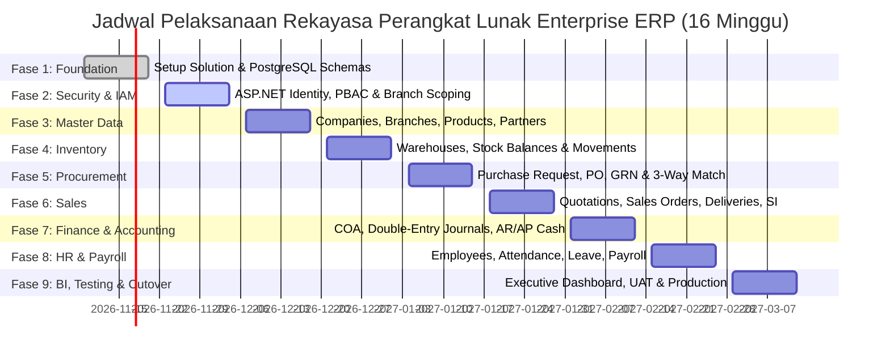

# Strategic Development Roadmap (16-Week Plan) — Enterprise ERP System

> **Document Version:** 1.0.0  
> **Target Release:** v1.0.0-LTS  
> **Timeline:** 16 Minggu (4 Bulan / 8 Sprint Dua Mingguan)  
> **Related Documents:** [IMPLEMENTATION_PLAN.md](./IMPLEMENTATION_PLAN.md) | [PROJECT_OVERVIEW.md](./PROJECT_OVERVIEW.md) | [PRODUCT_REQUIREMENTS.md](./PRODUCT_REQUIREMENTS.md)

---

## 1. Visualisasi Roadmap Garis Waktu (Timeline Roadmap)

---

## 2. Rincian Fase & Deliverables per Milestone

### Fase 1: Arsitektur Fondasi & Konfigurasi Basis Data (Minggu 1–2 / Sprint 1)
- **Tujuan:** Menyiapkan struktur solution, konfigurasi database PostgreSQL multi-skema, dan perpipaan dasar Clean Architecture.
- **Deliverables:**
  - `EnterpriseERP.sln` terkonfigurasi dengan 5 proyek inti dan 5 proyek pengujian.
  - Skrip inisialisasi 8 skema PostgreSQL (`identity`, `master`, `hr`, `inventory`, `procurement`, `sales`, `finance`, `audit`).
  - Implementasi `ApplicationDbContext`, konfigurasi entity via Fluent API, dan interceptor audit trail otomatis.
  - Setup CI/CD build & static analysis pipeline di GitHub Actions.
- **Kriteria Kelulusan (Gate 1):** Migrasi EF Core berhasil dieksekusi pada basis data PostgreSQL kontainer tanpa error.

---

### Fase 2: Keamanan, Identitas & Otorisasi PBAC (Minggu 3–4 / Sprint 2)
- **Tujuan:** Membangun fondasi autentikasi pengguna dan kontrol akses berbasis izin granuler.
- **Deliverables:**
  - Login form MudBlazor dengan proteksi brute-force dan kebijakan lockout.
  - Layanan ASP.NET Core Identity dengan password hashing PBKDF2.
  - Mesin Permission-Based Access Control (PBAC) dengan registrasi permission otomatis.
  - Fitur data scoping berbasis cabang aktif pengguna (`identity.user_branches`).
- **Kriteria Kelulusan (Gate 2):** Seluruh pengujian otorisasi lolos; staf cabang tidak dapat mengakses data cabang lain.

---

### Fase 3: Master Data Management (Minggu 5–6 / Sprint 3)
- **Tujuan:** Menyediakan antarmuka pengelolaan data induk organisasi, mitra dagang, dan produk.
- **Deliverables:**
  - CRUD Perusahaan Legal (*Companies*) dan Kantor Cabang (*Branches*).
  - CRUD Satuan Ukur (UoM) beserta faktor konversi dan Kategori Produk hierarkis.
  - CRUD Master Produk (SKU unik, barcode, harga beli standar, harga jual standar).
  - CRUD Pelanggan (dengan kontrol limit kredit) dan Pemasok/Vendor.
- **Kriteria Kelulusan (Gate 3):** Master data dapat diinput secara valid dengan penegakan unik SKU dan penanganan soft-delete yang konsisten.

---

### Fase 4: Persediaan & Pergudangan Logistik (Minggu 7–8 / Sprint 4)
- **Tujuan:** Membangun sistem kontrol saldo stok fisik perpetual dan penanganan mutasi barang.
- **Deliverables:**
  - Master Gudang per cabang operasional.
  - Tabel saldo stok real-time (`inventory.stock_balances`) dengan proteksi stok negatif.
  - Perekaman mutasi stok otomatis ke tabel buku besar imutabel (`inventory.stock_movements`).
  - Fitur Transfer Stok Antar-Gudang (status In-Transit) dan Stock Opname (Stock Adjustment).
- **Kriteria Kelulusan (Gate 4):** Valuasi persediaan rata-rata tertimbang (*Moving Weighted Average*) terbukti akurat dalam simulasi mutasi masuk dan keluar.

---

### Fase 5: Pengadaan & Rantai Pasok (P2P) (Minggu 9–10 / Sprint 5)
- **Tujuan:** Mengotomasi alur pengadaan dari permintaan departemen hingga tagihan pemasok.
- **Deliverables:**
  - Fitur input Purchase Request (PR) dan alur persetujuan bertingkat (*Approval Matrix*).
  - Konversi PR ke Purchase Order (PO) resmi dan cetak dokumen PO format PDF.
  - Penerimaan Fisik Barang Gudang (Goods Receipt Note) yang otomatis menambah stok persediaan.
  - Verifikasi Faktur Pemasok (Vendor Bill) dengan pencocokan 3-arah (*3-Way Matching*).
- **Kriteria Kelulusan (Gate 5):** GRN berhasil menambah stok gudang dan Vendor Bill mencatat utang dagang secara konsisten.

---

### Fase 6: Penjualan & Distribusi Komersial (O2C) (Minggu 11–12 / Sprint 6)
- **Tujuan:** Mengelola siklus komersial dari penawaran harga hingga faktur penjualan pelanggan.
- **Deliverables:**
  - Pembuatan Sales Quotation dan konversi 1-klik ke Sales Order (SO).
  - Pengecekan limit kredit dan alokasi reservasi stok gudang saat SO dikonfirmasi.
  - Penerbitan Surat Jalan (Delivery Order) yang mengurangi saldo stok fisik gudang.
  - Penerbitan Faktur Penjualan (Sales Invoice) beserta kalkulasi PPN.
- **Kriteria Kelulusan (Gate 6):** Siklus penjualan berhasil dieksekusi tanpa insiden *overselling* barang.

---

### Fase 7: Keuangan, Buku Besar & Kas/Bank (Minggu 13–14 / Sprint 7)
- **Tujuan:** Menegakkan pencatatan akuntansi berpasangan (*double-entry*) dan rekonsiliasi kas/bank.
- **Deliverables:**
  - Pemeliharaan Bagan Akun (Chart of Accounts) 5 level.
  - Modul Jurnal Umum dengan validasi otomatis mutlak: Total Debit = Total Kredit.
  - Pembentukan jurnal otomatis dari transaksi harian (penjualan, pembelian, stok).
  - Modul Kas & Bank: Pencatatan mutasi kas dan pelunasan piutang/utang (Payment Allocations).
  - Penguncian Periode Fiskal Bulanan (*Fiscal Period Closing*).
- **Kriteria Kelulusan (Gate 7):** Neraca Saldo (*Trial Balance*) seimbang sempurna; periode yang terkunci menolak transaksi baru.

---

### Fase 8: Sumber Daya Manusia & Penggajian (Minggu 15 / Sprint 8A)
- **Tujuan:** Mengelola data karyawan, kehadiran, cuti, dan pemrosesan gaji bulanan terintegrasi.
- **Deliverables:**
  - Data Induk Karyawan & rekapitulasi kehadiran harian.
  - Pengajuan dan persetujuan cuti online.
  - Batch kalkulasi penggajian bulanan (Payroll) dengan integrasi jurnal otomatis ke buku besar.
  - Pembuatan slip gaji karyawan format PDF.
- **Kriteria Kelulusan (Gate 8):** Jurnal beban gaji terbentuk secara otomatis dan seimbang di modul finance.

---

### Fase 9: Executive BI Dashboard, UAT & Peluncuran Produksi (Minggu 16 / Sprint 8B)
- **Tujuan:** Visualisasi analitik eksekutif, pengujian penerimaan pengguna (*User Acceptance Testing*), dan cutover produksi.
- **Deliverables:**
  - Executive Dashboard dengan visualisasi grafik MudBlazor dan kartu KPI real-time.
  - Laporan keuangan resmi (Neraca, Laba Rugi, Kartu Stok, Aging AR/AP) dengan fitur ekspor Excel/PDF.
  - Pelaksanaan UAT bersama key business users dari seluruh departemen.
  - Penerapan ke server produksi Linux VPS via Docker Compose dan konfigurasi backup harian.
- **Kriteria Kelulusan (Gate 9):** Seluruh checklist kesiapan produksi (*Production Readiness Checklist*) terpenuhi 100%. Sistem resmi **Go-Live**.

