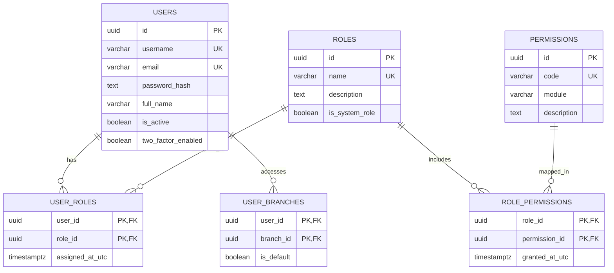
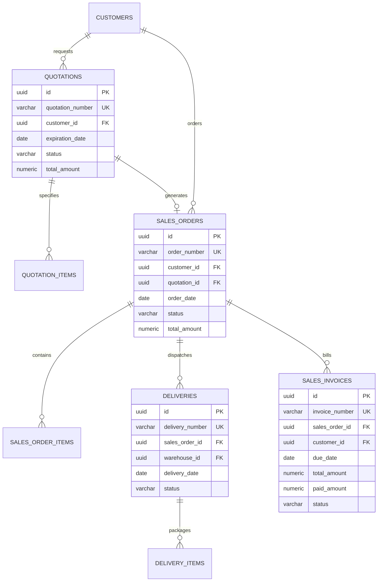
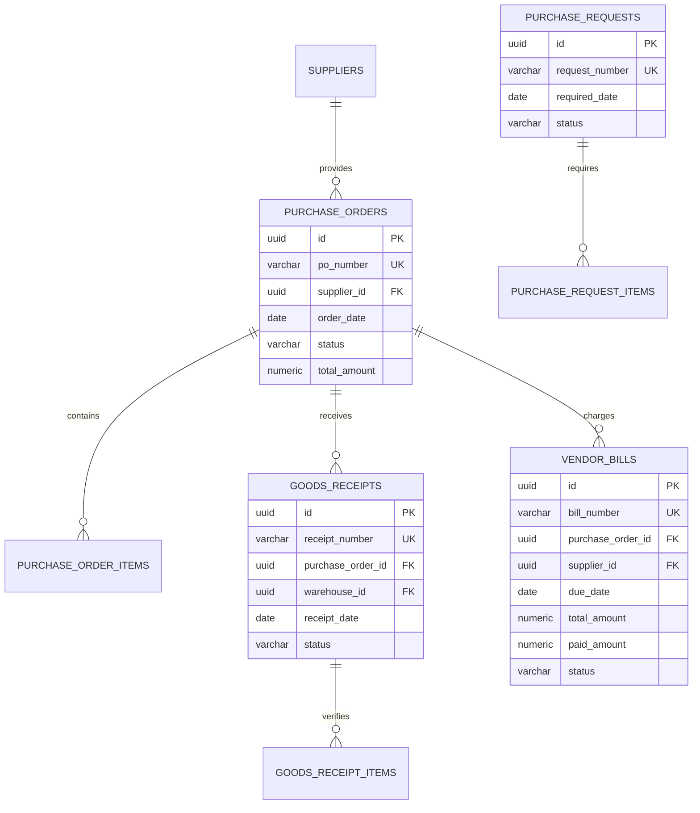
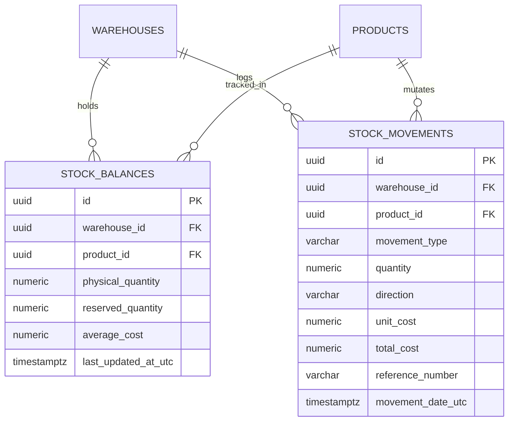
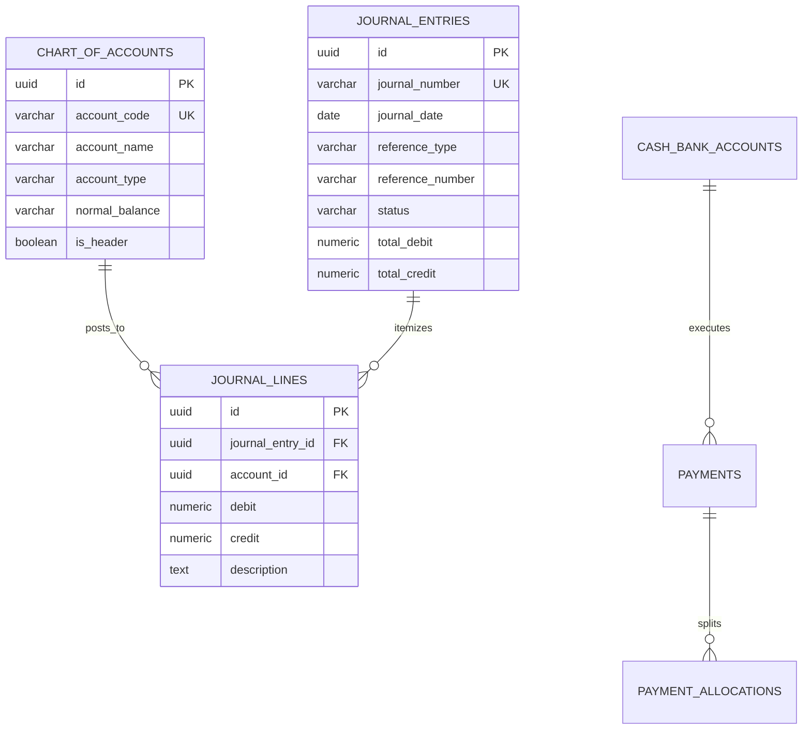

# Entity Relationship Diagram (ERD) — Enterprise ERP System

> **Document Version:** 1.0.0  
> **Target Database Engine:** PostgreSQL 16+  
> **Related Documents:** [DATABASE_DESIGN.md](./DATABASE_DESIGN.md) | [DATABASE_SCHEMA.md](./DATABASE_SCHEMA.md) | [DATA_DICTIONARY.md](./DATA_DICTIONARY.md)

---

## 1. Diagram Relasi Entitas Inti Global (Global Enterprise ERD)

Diagram berikut merepresentasikan relasi relasional lintas domain sistem ERP, mencakup struktur korporasi, rantai pasok, penjualan, persediaan, penggajian, dan akuntansi berpasangan (*double-entry*):

```mermaid
erDiagram
    COMPANIES ||--o{ BRANCHES : "operates"
    COMPANIES ||--o{ DEPARTMENTS : "contains"
    COMPANIES ||--o{ PRODUCTS : "owns"
    COMPANIES ||--o{ CUSTOMERS : "serves"
    COMPANIES ||--o{ SUPPLIERS : "purchases_from"
    COMPANIES ||--o{ CHART_OF_ACCOUNTS : "maintains"

    BRANCHES ||--o{ WAREHOUSES : "controls"
    BRANCHES ||--o{ EMPLOYEES : "employs"
    BRANCHES ||--o{ SALES_ORDERS : "issues"
    BRANCHES ||--o{ PURCHASE_ORDERS : "issues"

    USERS ||--o{ USER_ROLES : "assigned"
    ROLES ||--o{ USER_ROLES : "groups"
    ROLES ||--o{ ROLE_PERMISSIONS : "contains"
    PERMISSIONS ||--o{ ROLE_PERMISSIONS : "grants"
    USERS ||--o{ USER_BRANCHES : "scoped_to"
    BRANCHES ||--o{ USER_BRANCHES : "accessible_by"

    DEPARTMENTS ||--o{ EMPLOYEES : "places"
    EMPLOYEES ||--o{ ATTENDANCE_RECORDS : "records"
    EMPLOYEES ||--o{ LEAVE_REQUESTS : "requests"
    EMPLOYEES ||--o{ PAYROLL_ITEMS : "receives"
    PAYROLL_PERIODS ||--o{ PAYROLL_ITEMS : "aggregates"

    PRODUCT_CATEGORIES ||--o{ PRODUCTS : "classifies"
    UNITS_OF_MEASURE ||--o{ PRODUCTS : "quantifies"
    PRODUCTS ||--o{ STOCK_BALANCES : "stocked_in"
    WAREHOUSES ||--o{ STOCK_BALANCES : "stores"
    PRODUCTS ||--o{ STOCK_MOVEMENTS : "tracks"
    WAREHOUSES ||--o{ STOCK_MOVEMENTS : "originates_from"

    CUSTOMERS ||--o{ QUOTATIONS : "requests"
    QUOTATIONS ||--o{ QUOTATION_ITEMS : "details"
    QUOTATIONS ||--o| SALES_ORDERS : "converted_to"
    CUSTOMERS ||--o{ SALES_ORDERS : "places"
    SALES_ORDERS ||--o{ SALES_ORDER_ITEMS : "contains"
    SALES_ORDERS ||--o{ DELIVERIES : "fulfilled_by"
    DELIVERIES ||--o{ DELIVERY_ITEMS : "ships"
    SALES_ORDERS ||--o{ SALES_INVOICES : "billed_by"

    SUPPLIERS ||--o{ PURCHASE_ORDERS : "supplies"
    PURCHASE_REQUESTS ||--o{ PURCHASE_REQUEST_ITEMS : "details"
    PURCHASE_REQUESTS ||--o| PURCHASE_ORDERS : "converts_to"
    PURCHASE_ORDERS ||--o{ PURCHASE_ORDER_ITEMS : "contains"
    PURCHASE_ORDERS ||--o{ GOODS_RECEIPTS : "received_by"
    GOODS_RECEIPTS ||--o{ GOODS_RECEIPT_ITEMS : "inspects"
    PURCHASE_ORDERS ||--o{ VENDOR_BILLS : "billed_by"

    SALES_INVOICES ||--o{ PAYMENT_ALLOCATIONS : "settled_by"
    VENDOR_BILLS ||--o{ PAYMENT_ALLOCATIONS : "settled_by"
    PAYMENTS ||--o{ PAYMENT_ALLOCATIONS : "allocates"
    CASH_BANK_ACCOUNTS ||--o{ PAYMENTS : "funds"

    CHART_OF_ACCOUNTS ||--o{ JOURNAL_LINES : "categorizes"
    JOURNAL_ENTRIES ||--o{ JOURNAL_LINES : "contains"
```

---

## 2. Diagram Domain Relasional Spesifik

### 2.1 Domain Identitas & Keamanan (`identity`)

---

### 2.2 Domain Rantai Pasok Penjualan (Sales: O2C)

---

### 2.3 Domain Pengadaan & Pembelian (Procurement: P2P)

---

### 2.4 Domain Persediaan & Logistik Gudang (`inventory`)

---

### 2.5 Domain Akuntansi & Buku Besar (`finance`)

