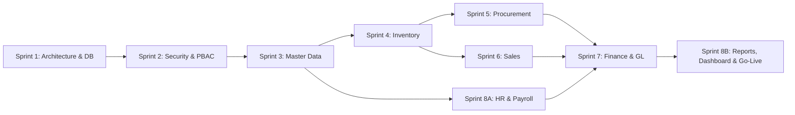

# Engineering Implementation Plan & Work Breakdown Structure (WBS)

> **Document Version:** 1.0.0  
> **Target Release:** v1.0.0-LTS  
> **Framework:** Agile/Scrum (8 Sprints x 2 Minggu)  
> **Related Documents:** [DEVELOPMENT_ROADMAP.md](./DEVELOPMENT_ROADMAP.md) | [PROJECT_STRUCTURE.md](./PROJECT_STRUCTURE.md) | [CODING_STANDARDS.md](./CODING_STANDARDS.md)

---

## 1. Rincian Work Breakdown Structure (WBS) per Sprint

Setiap tugas rekayasa perangkat lunak diberi kode unik dan memiliki kriteria penerimaan teknis yang terukur:

### Sprint 1 (Minggu 1–2): Fondasi Arsitektur, Basis Data & Perpipaan CI/CD
- **WBS-01.01:** Inisialisasi solution `EnterpriseERP.sln` dan pembuatan 5 proyek inti serta 5 proyek pengujian menggunakan .NET CLI.
- **WBS-01.02:** Penulisan script DDL PostgreSQL untuk inisialisasi 8 schema (`identity`, `master`, `hr`, `inventory`, `procurement`, `sales`, `finance`, `audit`).
- **WBS-01.03:** Konfigurasi `ApplicationDbContext` dengan mapping Fluent API terpisah per schema dan integrasi provider Npgsql.
- **WBS-01.04:** Pembuatan `AuditSaveChangesInterceptor` untuk mencatat mutasi entitas otomatis ke tabel `audit.audit_logs`.
- **WBS-01.05:** Pembuatan `SoftDeleteInterceptor` dan registrasi Global Query Filter untuk penyaringan data multi-cabang.
- **WBS-01.06:** Setup GitHub Actions workflow untuk otomatisasi build, pengujian unit, dan static analysis.

---

### Sprint 2 (Minggu 3–4): Identitas, Autentikasi & Mesin PBAC
- **WBS-02.01:** Integrasi ASP.NET Core Identity dengan penyimpanan tabel `identity.users` dan `identity.roles`.
- **WBS-02.02:** Implementasi antarmuka Login MudBlazor, penanganan gagal login, dan kebijakan lockout.
- **WBS-02.03:** Implementasi mesin Permission-Based Access Control (PBAC):
  - Registrasi daftar permission statis dari seluruh modul.
  - Custom `IAuthorizationPolicyProvider` dan `AuthorizationHandler`.
- **WBS-02.04:** Implementasi manajemen cabang pengguna (`identity.user_branches`) dan injeksi `CurrentUserService` ke Blazor circuit.
- **WBS-02.05:** Penulisan unit tests dan integration tests untuk verifikasi izin akses dan isolasi data.

---

### Sprint 3 (Minggu 5–6): Master Data Management (MDM)
- **WBS-03.01:** Fitur Pengelolaan Perusahaan Legal (*Companies*) dan Kantor Cabang (*Branches*).
- **WBS-03.02:** Fitur Pengelolaan Satuan Ukur (UoM) dan Kategori Produk hierarkis.
- **WBS-03.03:** Fitur Pengelolaan Master Produk (SKU, tipe, harga beli/jual standar, minimum stok).
- **WBS-03.04:** Fitur Pengelolaan Master Pelanggan (NPWP, alamat kirim, limit kredit) dan Pemasok/Vendor.
- **WBS-03.05:** Pembuatan generator nomor dokumen otomatis sekuensial (`master.document_sequences`) dengan row locking.

---

### Sprint 4 (Minggu 7–8): Persediaan & Pergudangan Logistik
- **WBS-04.01:** Fitur Pengelolaan Master Gudang per cabang operasional.
- **WBS-04.02:** Tampilan Saldo Stok Real-Time (`inventory.stock_balances`) dengan fitur pencarian cepat SKU.
- **WBS-04.03:** Service mutasi stok persediaan (`inventory.stock_movements`) dengan kalkulasi Moving Weighted Average Cost.
- **WBS-04.04:** Fitur Transfer Stok Antar-Gudang (alur 2 tahap: Pengiriman $\rightarrow$ Penerimaan).
- **WBS-04.05:** Fitur Penyesuaian Stok (Stock Adjustment) hasil opname fisik dengan alur persetujuan selisih.

---

### Sprint 5 (Minggu 9–10): Pengadaan & Rantai Pasok (P2P)
- **WBS-05.01:** Fitur Purchase Request (PR) dan alur persetujuan berjenjang (*Approval Matrix*).
- **WBS-05.02:** Fitur konversi PR menjadi Purchase Order (PO) resmi dan generator dokumen cetak PDF.
- **WBS-05.03:** Fitur Penerimaan Barang (Goods Receipt Note - GRN) yang otomatis memperbarui saldo persediaan fisik.
- **WBS-05.04:** Fitur Verifikasi Faktur Pemasok (Vendor Bill) dengan validasi pencocokan 3-arah (*3-Way Matching*).
- **WBS-05.05:** Integrasi Domain Events untuk memicu pencatatan utang usaha dan penerimaan barang di modul akuntansi.

---

### Sprint 6 (Minggu 11–12): Penjualan & Distribusi Komersial (O2C)
- **WBS-06.01:** Fitur Sales Quotation (SQ) dengan perhitungan diskon dan estimasi pajak PPN.
- **WBS-06.02:** Fitur konversi Quotation ke Sales Order (SO) dengan pengecekan limit kredit dan alokasi reservasi stok.
- **WBS-06.03:** Fitur Penerbitan Surat Jalan (Delivery Order) yang mengurangi stok fisik gudang dan melepaskan reservasi.
- **WBS-06.04:** Fitur Penerbitan Faktur Penjualan (Sales Invoice) dan cetak faktur komersial PDF.
- **WBS-06.05:** Integrasi Domain Events ke modul akuntansi untuk pengakuan piutang usaha dan pendapatan.

---

### Sprint 7 (Minggu 13–14): Keuangan, Buku Besar & Kas/Bank
- **WBS-07.01:** Fitur Bagan Akun (Chart of Accounts) dengan visualisasi hierarkis MudTreeView.
- **WBS-07.02:** Fitur Jurnal Umum Manual dengan validasi mutlak: $\sum \text{Debit} = \sum \text{Kredit}$.
- **WBS-07.03:** Handlers otomatis pencatatan jurnal dari transaksi pengadaan, penjualan, dan penyesuaian stok.
- **WBS-07.04:** Fitur Kas & Bank: Pengelolaan rekening, transfer kas internal, dan pencatatan pembayaran (Payment Allocations).
- **WBS-07.05:** Fitur Penutupan Periode Fiskal Bulanan (*Fiscal Period Closing*) dengan validasi penguncian tanggal.

---

### Sprint 8 (Minggu 15–16): HR, Payroll, Executive Dashboard & Go-Live
- **WBS-08.01:** Fitur Biodata Karyawan, pencatatan presensi, dan permohonan cuti karyawan.
- **WBS-08.02:** Batch kalkulasi penggajian bulanan (Payroll) dan pembentukan jurnal beban gaji otomatis.
- **WBS-08.03:** Executive Dashboard: Visualisasi kartu KPI, grafik omset penjualan, dan rasio likuiditas kas.
- **WBS-08.04:** Laporan resmi standar (Neraca, Laba Rugi, Kartu Stok, Aging Piutang/Utang) dengan ekspor Excel/PDF.
- **WBS-08.05:** Pelaksanaan UAT menyeluruh, pengujian beban, penyiapan server produksi, dan cutover resmi sistem.

---

## 2. Manajemen Jalur Kritis & Ketergantungan (Critical Path Analysis)

### Analisis Jalur Kritis (Critical Path):
- Modul **Inventory** adalah dependensi mutlak bagi **Procurement** (penerimaan barang) dan **Sales** (pengiriman barang).
- Modul **Finance & General Ledger** membutuhkan data transaksi dari **Procurement**, **Sales**, **Inventory**, dan **HR Payroll** untuk memastikan seluruh alur jurnal otomatis terintegrasi.
- Keterlambatan pada penyelesaian fondasi arsitektur atau skema database pada Sprint 1 akan menggeser seluruh jadwal secara langsung.

---

## 3. Rencana Kontingensi & Mitigasi Risiko Teknis

| Risiko Teknis | Potensi Dampak | Rencana Kontingensi / Solusi Cepat |
| :--- | :---: | :--- |
| **Konflik Konkurensi pada Penomoran Dokumen** | Kritis | Generator nomor dokumen telah dirancang menggunakan `SELECT ... FOR UPDATE` pada tingkat row database PostgreSQL sehingga transaksi concurrent otomatis antre secara aman. |
| **Beban Memori Tinggi pada Sirkuit Blazor Server** | Tinggi | Batasi ukuran buffer sirkuit di `Program.cs`, implementasikan paginasi sisi server ketat (maks 50 baris per fetch), dan aktifkan pembersihan sirkuit idle setelah 30 menit. |
| **Keterlambatan Migrasi Data Historis Pelanggan** | Sedang | Siapkan template CSV/Excel standar dan parser bulk insert EF Core dengan validasi data sebelum cutover akhir pekan. |

