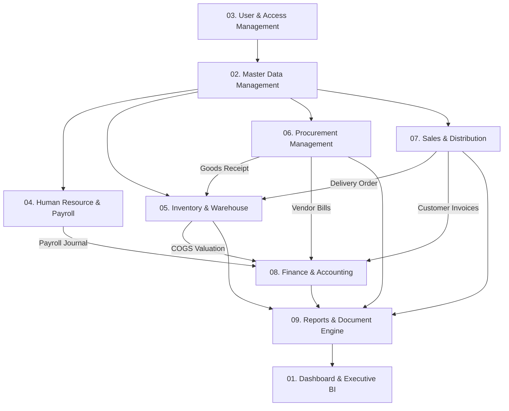

# Module Specifications Document — Enterprise ERP System

> **Document Version:** 1.0.0  
> **Target Release:** v1.0.0-LTS  
> **Related Documents:** [PRODUCT_REQUIREMENTS.md](./PRODUCT_REQUIREMENTS.md) | [BUSINESS_RULES.md](./BUSINESS_RULES.md) | [BUSINESS_WORKFLOWS.md](./BUSINESS_WORKFLOWS.md) | [USER_ROLES_AND_PERMISSIONS.md](./USER_ROLES_AND_PERMISSIONS.md)

---

## 1. Ikhtisar Modul Sistem (System Modules Overview)

Sistem ERP ini terdiri dari 9 modul bisnis terintegrasi yang beroperasi di bawah tata kelola arsitektur Modular Monolith:

---

## 2. Spesifikasi Detail per Modul

---

### Modul 01: Executive Dashboard & Business Intelligence
- **Tujuan:** Menyediakan visualisasi real-time performa bisnis perusahaan untuk mendukung pengambilan keputusan cepat level manajemen dan direksi.
- **Fitur Utama:**
  - Kartu Ringkasan KPI: Omset Penjualan Berjalan, Estimasi Laba Bersih, Posisi Kas/Bank, Nilai Total Stok Persediaan.
  - Grafik Tren: Penjualan 12 Bulan Terakhir, Arus Kas Masuk vs Keluar (*Cash Flow Velocity*).
  - Peringatan Operasional: Daftar Piutang Jatuh Tempo Minggu Ini, Tagihan Vendor Kritis, Item Stok di Bawah Minimum Reorder Point.
- **Submenu:**
  - `/dashboard/executive` — Ringkasan Kinerja Eksekutif Grup.
  - `/dashboard/sales` — Metrik Penjualan & Performa Tim Sales.
  - `/dashboard/inventory` — Utilisasi Gudang & Fast/Slow Moving Goods.
  - `/dashboard/finance` — Posisi Likuiditas & Rasio Keuangan.
- **Aktor:** Direktur Utama, CFO, COO, General Manager, Manajer Departemen.
- **Hak Akses:** `dashboard.executive.view`, `dashboard.sales.view`, `dashboard.finance.view`, `dashboard.inventory.view`.
- **Dependensi Modul:** Membaca data agregat dari Modul Sales, Inventory, Finance, dan Procurement.

---

### Modul 02: Master Data Management (MDM)
- **Tujuan:** Menjadi pusat repositori tunggal (*Single Source of Truth*) untuk seluruh data entitas inti organisasi, mitra bisnis, dan katalog produk.
- **Fitur Utama:**
  - Struktur Korporasi: Multi-Perusahaan (*Holding/Subsidiaries*), Cabang (*Branches*), Departemen, dan Divisi.
  - Mitra Bisnis: Master Pelanggan (termasuk batas kredit, termin bayar, NPWP) dan Master Pemasok (Vendor).
  - Katalog Produk: SKU, Barcode, Kategori Hierarkis, Satuan Ukur (UoM) beserta faktor konversi, dan parameter harga jual/beli standar.
  - Lokasi Fisik: Master Gudang (*Warehouses*), Area Rak/Bin Gudang.
- **Submenu:**
  - `/master/companies` — Struktur Perusahaan & Legalitas.
  - `/master/branches` — Kantor Cabang & Pusat Operasional.
  - `/master/customers` — Data Pelanggan & Penetapan Limit Kredit.
  - `/master/suppliers` — Data Vendor & Riwayat Kerjasama.
  - `/master/products` — Katalog Barang, Jasa, dan Bahan Baku.
  - `/master/uom` — Satuan Ukur & Konversi Satuan.
- **Aktor:** Master Data Administrator, Head of Logistics, Sales Manager.
- **Hak Akses:** `master.company.manage`, `master.product.view`, `master.product.create`, `master.product.edit`, `master.customer.manage`, `master.supplier.manage`.
- **Aturan Bisnis & Validasi:**
  - SKU produk harus unik di seluruh grup perusahaan.
  - Pelanggan yang telah memiliki transaksi piutang dilarang dihapus (*Hard Delete*), hanya boleh dinonaktifkan statusnya.
  - Rasio konversi satuan harus lebih besar dari nol.

---

### Modul 03: User & Access Management (Identity & Security)
- **Tujuan:** Mengamankan akses sistem, memverifikasi identitas pengguna, dan mengontrol otorisasi fungsi serta ruang lingkup data secara granular.
- **Fitur Utama:**
  - Otentikasi Terpusat: Login aman, proteksi brute-force, password expiration policy, dan dukungan Two-Factor Authentication (2FA/TOTP).
  - Permission-Based Access Control (PBAC): Penugasan peran (*Roles*) yang mengelompokkan ratusan permission spesifik.
  - Branch Data Scoping: Penugasan hak akses pengguna ke satu atau banyak cabang spesifik.
  - Manajemen Sesi: Pemantauan sesi login aktif dan pemutusan sesi mencurigakan (*Remote Session Invalidation*).
- **Submenu:**
  - `/security/users` — Daftar Pengguna & Status Akun.
  - `/security/roles` — Pemeliharaan Role & Matriks Izin (Permission Matrix).
  - `/security/user-branches` — Pemetaan Akses Pengguna ke Cabang.
  - `/security/sessions` — Sesi Login Aktif & Audit Percobaan Akses.
- **Aktor:** Super Administrator, Security Officer, IT Compliance.
- **Hak Akses:** `security.users.manage`, `security.roles.manage`, `security.audit.view`.
- **Status Akun:** `Active`, `Inactive`, `LockedOut`, `PendingActivation`.

---

### Modul 04: Human Resource Management (HRM) & Payroll
- **Tujuan:** Mengelola data kepegawaian, memantau kehadiran harian, memproses cuti, dan mengotomasi perhitungan payroll bulanan terintegrasi keuangan.
- **Fitur Utama:**
  - Biodata Kepegawaian: NIK, kontrak kerja, jabatan, golongan, data rekening bank, dan perpajakan PPh 21.
  - Kehadiran & Shift: Pencatatan jam masuk, jam pulang, akumulasi keterlambatan (*tardiness*), lembur (*overtime*).
  - Manajemen Cuti: Pengajuan cuti online, alur approval atasan langsung, kuota saldo cuti tahunan otomatis.
  - Penggajian Otomatis (Payroll): Perhitungan gaji pokok, tunjangan kehadiran, potongan keterlambatan, iuran BPJS Ketenagakerjaan/Kesehatan, dan pajak PPh 21.
  - Pembentukan Jurnal Payroll: Penerbitan slip gaji PDF dan pembentukan draf jurnal beban gaji ke Modul Finance secara otomatis.
- **Submenu:**
  - `/hr/employees` — Data Induk Karyawan & Dokumen Kontrak.
  - `/hr/attendance` — Rekapitulasi Presensi & Lembur.
  - `/hr/leaves` — Permohonan & Persetujuan Cuti.
  - `/hr/payroll-periods` — Pemrosesan Batch Penggajian Bulanan.
  - `/hr/salary-slips` — Cetak & Distribusi Slip Gaji Digital.
- **Aktor:** HR Manager, HR Officer, Karyawan, Finance Officer.
- **Hak Akses:** `hr.employee.view`, `hr.employee.manage`, `hr.attendance.manage`, `hr.leave.approve`, `hr.payroll.process`.
- **Alur Status Payroll:**
  $$\text{Draft} \longrightarrow \text{Calculated} \longrightarrow \text{Approved} \longrightarrow \text{Journaled} \longrightarrow \text{Paid}$$

---

### Modul 05: Inventory & Warehouse Logistics
- **Tujuan:** Menjaga keakuratan stok fisik dan nilai persediaan barang di seluruh jaringan gudang secara perpetual dan real-time.
- **Fitur Utama:**
  - Saldo & Kartu Stok Perpetual: Pencatatan setiap transaksi mutasi barang beserta nilai harga pokok perolehan (HPP).
  - Penerimaan Barang (*Goods Receipt*): Verifikasi barang masuk dari pemasok berdasarkan nomor Purchase Order.
  - Pengeluaran Barang (*Delivery Order Fulfillment*): Pengurangan fisik barang berdasarkan nomor Sales Order yang disetujui.
  - Transfer Antar-Gudang: Pemindahan barang 2 tahap (Pengiriman dari Gudang Asal $\rightarrow$ Status *In-Transit* $\rightarrow$ Penerimaan di Gudang Tujuan).
  - Penyesuaian Stok (Stock Adjustment): Rekonsiliasi hasil Stock Opname fisik terhadap sistem dengan pencatatan selisih lebih/kurang (*Variance*).
  - Valuasi Moving Weighted Average Cost: Pembaruan otomatis harga pokok setiap kali ada penerimaan dengan harga baru.
- **Submenu:**
  - `/inventory/stock-balances` — Saldo Stok Real-Time per Gudang.
  - `/inventory/stock-movements` — Buku Besar Kartu Stok (Mutasi Masuk/Keluar).
  - `/inventory/transfers` — Pengiriman & Penerimaan Antar Gudang.
  - `/inventory/adjustments` — Penyesuaian Stok Opname & Persetujuan Selisih.
  - `/inventory/reorder-alerts` — Daftar Produk Kritis Butuh Pembelian Ulang.
- **Aktor:** Warehouse Manager, Warehouse Supervisor, Inventory Clerk.
- **Hak Akses:** `inventory.stock.view`, `inventory.transfer.create`, `inventory.transfer.receive`, `inventory.adjustment.approve`.
- **Status Dokumen Transfer:** `Draft` $\rightarrow$ `Dispatched` $\rightarrow$ `Partially Received` $\rightarrow$ `Completed` $\rightarrow$ `Cancelled`.

---

### Modul 06: Procurement & Supply Chain Management
- **Tujuan:** Mengelola pengadaan barang dan jasa secara transparan, hemat biaya, dan terkontrol dari permintaan staf hingga penagihan pemasok.
- **Fitur Utama:**
  - Permintaan Pembelian (Purchase Request - PR): Pengajuan kebutuhan barang oleh departemen pengguna lengkap dengan tanggal target.
  - Approval Matrix PR: Persetujuan berjenjang berdasarkan departemen dan nominal belanja.
  - Pesanan Pembelian (Purchase Order - PO): Penerbitan kontrak pesanan resmi ke vendor dengan klausul harga, diskon, PPN, dan termin pembayaran.
  - Penerimaan Barang (Goods Receipt Note - GRN): Pencatatan kondisi dan jumlah barang yang tiba di gudang.
  - Pencocokan 3-Arah (3-Way Matching): Validasi konsistensi data antara PO, GRN, dan Vendor Bill sebelum pembayaran diproses.
- **Submenu:**
  - `/procurement/purchase-requests` — Pengajuan & Approval PR.
  - `/procurement/purchase-orders` — Penerbitan & Cetak Dokumen PO.
  - `/procurement/goods-receipts` — Bukti Penerimaan Barang Gudang.
  - `/procurement/vendor-bills` — Verifikasi Faktur Pemasok & Pajak.
- **Aktor:** Purchasing Staff, Purchasing Manager, Dept Head, Finance AP Officer.
- **Hak Akses:** `procurement.pr.create`, `procurement.pr.approve`, `procurement.po.create`, `procurement.po.approve`, `procurement.bill.verify`.
- **Status Siklus PO:**
  $$\text{Draft} \longrightarrow \text{Pending Approval} \longrightarrow \text{Approved/Issued} \longrightarrow \text{Partially Received} \longrightarrow \text{Fully Received} \longrightarrow \text{Billed} \longrightarrow \text{Closed}$$

---

### Modul 07: Sales & Commercial Operations
- **Tujuan:** Mengoptimasi proses penjualan dari penawaran harga hingga penagihan piutang, mencegah risiko penjualan barang kosong, dan mengontrol piutang pelanggan.
- **Fitur Utama:**
  - Penawaran Penjualan (Sales Quotation - SQ): Pembuatan surat penawaran harga resmi dengan masa kedaluwarsa penawaran.
  - Konfirmasi Pesanan (Sales Order - SO): Konversi SQ ke SO dengan alokasi otomatis reservasi stok persediaan gudang.
  - Kontrol Limit Kredit: Sistem secara otomatis menahan (*hold*) SO apabila piutang belum tertagih pelanggan melampaui limit kredit yang ditentukan.
  - Surat Jalan & Pengiriman (Delivery Order - DO): Surat jalan pengiriman fisik barang yang menjadi dasar pengakuan mutasi keluar stok gudang.
  - Faktur Penjualan (Sales Invoice - SI): Penerbitan faktur komersial penagihan piutang pelanggan beserta faktur pajak PPN.
- **Submenu:**
  - `/sales/quotations` — Penawaran Harga & Riwayat Negosiasi.
  - `/sales/orders` — Daftar Pesanan Penjualan Aktif.
  - `/sales/deliveries` — Surat Jalan Pengiriman Barang.
  - `/sales/invoices` — Faktur Penjualan Terbuka & Jatuh Tempo.
- **Aktor:** Sales Executive, Sales Manager, Logistics Staff, Finance AR Officer.
- **Hak Akses:** `sales.quotation.create`, `sales.order.create`, `sales.order.approve`, `sales.delivery.dispatch`, `sales.invoice.issue`.
- **Status Siklus SO:**
  $$\text{Draft} \longrightarrow \text{Confirmed (Reserved)} \longrightarrow \text{Partially Shipped} \longrightarrow \text{Fully Shipped} \longrightarrow \text{Invoiced} \longrightarrow \text{Paid} \longrightarrow \text{Closed}$$

---

### Modul 08: Finance & Double-Entry Accounting
- **Tujuan:** Menjamin tata kelola pencatatan keuangan yang akurat, transparan, dan patuh pada standar akuntansi SAK/IFRS melalui sistem pembukuan berpasangan.
- **Fitur Utama:**
  - Bagan Akun (Chart of Accounts - COA): Struktur akun 5 level (Aktiva, Kewajiban, Modal, Pendapatan, Biaya).
  - Jurnal Umum Terotomasi: Pencatatan jurnal otomatis dari transaksi harian (pembelian, penjualan, persediaan, penggajian) serta entri jurnal manual seimbang ($\sum Debit = \sum Credit$).
  - Kas & Bank: Pengelolaan rekening kas operasional, rekening bank giro, dan mutasi transfer kas internal.
  - Pelunasan Piutang & Pembayaran Utang: Pencatatan pembayaran uang masuk/keluar dengan alokasi fleksibel ke multi-faktur.
  - Penutupan Periode Fiskal (Fiscal Period Closing): Penguncian buku bulanan/tahunan untuk mencegah manipulasi data masa lalu.
- **Submenu:**
  - `/finance/coa` — Bagan Akun & Saldo Berjalan.
  - `/finance/journals` — Jurnal Umum & Entri Jurnal Penyesuaian.
  - `/finance/cash-bank` — Mutasi Kas & Rekening Bank.
  - `/finance/payments` — Pembayaran Utang & Pelunasan Piutang.
  - `/finance/fiscal-periods` — Penutupan Buku Periode Fiskal.
- **Aktor:** Cashier, Account Payable Staff, Account Receivable Staff, Chief Accountant, CFO.
- **Hak Akses:** `finance.coa.manage`, `finance.journal.create`, `finance.journal.post`, `finance.payment.process`, `finance.period.close`.
- **Aturan Integritas Finansial:**
  - Jurnal yang sudah diposting (*Posted*) dilarang dihapus atau diubah secara langsung. Koreksi hanya melalui Jurnal Pembalik (*Reversing Journal*).

---

### Modul 09: Reports & Document Analytics
- **Tujuan:** Menghasilkan dokumen laporan operasional dan keuangan resmi yang terstandarisasi untuk kebutuhan audit internal, perbankan, dan perpajakan.
- **Fitur Utama:**
  - Laporan Keuangan Wajib: Laba Rugi Komprehensif (*Income Statement*), Neraca Keuangan (*Balance Sheet*), Neraca Saldo (*Trial Balance*), dan Arus Kas (*Cash Flow Statement*).
  - Laporan Operasional Rantai Pasok: Kartu Stok Buku Besar, Laporan Penerimaan Barang vs PO, Laporan Pengiriman Barang Terbuka.
  - Laporan Manajemen Piutang & Utang: Aging Schedule AR (0-30, 31-60, 61-90, >90 hari) dan Aging Schedule AP.
  - Engine Ekspor Terintegrasi: Pengunduhan laporan langsung ke file Microsoft Excel (.xlsx) dan dokumen cetak PDF berformat kop resmi perusahaan.
- **Submenu:**
  - `/reports/financial` — Neraca, Laba Rugi, Buku Besar Umum.
  - `/reports/sales` — Analisis Omset Penjualan per Pelanggan & Produk.
  - `/reports/procurement` — Realisasi Pembelian & Pengeluaran Vendor.
  - `/reports/inventory` — Valuasi Stok Persediaan & Perputaran Barang.
  - `/reports/ar-ap-aging` — Analisis Umur Piutang & Utang Dagang.
- **Aktor:** Seluruh Manajer Departemen, Internal Auditor, Direksi.
- **Hak Akses:** `reports.financial.view`, `reports.sales.view`, `reports.inventory.view`, `reports.export.excel`, `reports.export.pdf`.

