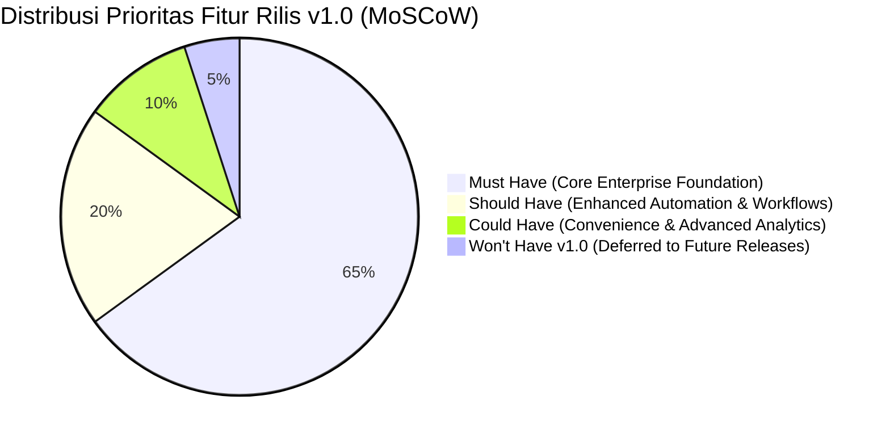

# Product Requirements Document (PRD) — Enterprise ERP System

> **Document Version:** 1.0.0  
> **Author:** Senior Product Manager & Enterprise Business Analyst  
> **Target Release:** v1.0.0-LTS  
> **Related Documents:** [PROJECT_OVERVIEW.md](./PROJECT_OVERVIEW.md) | [BUSINESS_REQUIREMENTS.md](./BUSINESS_REQUIREMENTS.md) | [FUNCTIONAL_REQUIREMENTS.md](./FUNCTIONAL_REQUIREMENTS.md) | [MODULE_SPECIFICATIONS.md](./MODULE_SPECIFICATIONS.md)

---

## 1. Ringkasan Eksekutif Produk (Executive Summary)

Enterprise Resource Planning (ERP) ini adalah sistem manajemen operasional dan finansial berskala korporat yang dirancang untuk mendukung operasional multi-perusahaan dan multi-cabang. Sistem ini menggantikan proses manual dan sistem terfragmentasi dengan menyediakan alur kerja yang terotomasi, kontrol keuangan berbasis *double-entry*, pelacakan persediaan berkelanjutan (*perpetual inventory*), serta kepatuhan tata kelola data yang ketat.

---

## 2. Personas Pengguna (User Personas)

Untuk memastikan sistem dirancang sesuai kebutuhan nyata operasional, berikut 7 personas pengguna utama:

### Persona 1: Hendra Wijaya — Direktur Utama / C-Level Executive
- **Latar Belakang:** Memimpin grup perusahaan dengan 3 entitas bisnis dan 8 kantor cabang.
- **Tujuan Utama:** Mendapatkan visibilitas menyeluruh dan real-time terhadap performa penjualan, margin laba, posisi arus kas, dan likuiditas grup perusahaan tanpa harus menunggu laporan bulanan.
- **Kebutuhan Utama:**
  - Executive Dashboard dengan visualisasi grafik interaktif.
  - Laporan konsolidasi laba rugi dan neraca multi-perusahaan.
  - Akses ringkasan eksekutif melalui perangkat tablet atau desktop kapan saja.
- **Pain Points:** Laporan keuangan sering terlambat 2–3 minggu; data antar cabang kerap bertentangan.

### Persona 2: Maya Sartika — Finance & Accounting Manager
- **Latar Belakang:** Akuntan profesional bersertifikat yang bertanggung jawab atas penutupan buku, perpajakan, dan kepatuhan akuntansi.
- **Tujuan Utama:** Memastikan seluruh transaksi bisnis tercatat ke dalam jurnal akuntansi yang seimbang, valid, serta dapat diaudit (*auditable*).
- **Kebutuhan Utama:**
  - Validasi ketat keseimbangan jurnal ($\sum Debit = \sum Credit$).
  - Rekonsiliasi otomatis faktur penjualan/pembelian terhadap kas/bank.
  - Penutupan periode fiskal (*locking fiscal period*) untuk mencegah modifikasi data masa lalu.
- **Pain Points:** Terjadinya selisih saldo antara kartu stok pergudangan dengan nilai persediaan di neraca.

### Persona 3: Budi Santoso — Sales & Commercial Manager
- **Latar Belakang:** Memimpin tim penjualan lapangan dan admin penjualan kantor.
- **Tujuan Utama:** Mempercepat siklus penjualan dari pembuatan penawaran harga (*quotation*) hingga penerbitan pesanan (*sales order*) tanpa resiko menjual barang yang stoknya kosong.
- **Kebutuhan Utama:**
  - Pengecekan ketersediaan stok fisik dan *available-to-promise* secara real-time.
  - Konversi 1-klik dari Quotation ke Sales Order.
  - Kontrol batas kredit (*credit limit*) dan jatuh tempo piutang pelanggan.
- **Pain Points:** Sering menjual produk yang ternyata sudah habis dipesan cabang lain (*overselling*).

### Persona 4: Rian Pratama — Procurement & SCM Officer
- **Latar Belakang:** Menangani pemesanan barang ke ratusan vendor lokal dan internasional.
- **Tujuan Utama:** Memastikan pengadaan barang efisien, transparan, tepat waktu, dan sesuai dengan anggaran (*budget*).
- **Kebutuhan Utama:**
  - Alur persetujuan bertingkat (*hierarchical approval workflow*) untuk Purchase Request.
  - Pencocokan 3-arah (*3-Way Matching*): Purchase Order vs Goods Receipt vs Supplier Bill.
  - Evaluasi performa dan riwayat harga pemasok.
- **Pain Points:** Terjadinya manipulasi harga atau pesanan ganda akibat persetujuan dokumen manual via memo fisik/chat.

### Persona 5: Agus Riyadi — Warehouse Supervisor & Logistics Admin
- **Latar Belakang:** Mengelola operasional gudang pusat dan 3 gudang transit regional.
- **Tujuan Utama:** Menjamin akurasi pencatatan stok fisik sama persis dengan angka di sistem (*stock fidelity*).
- **Kebutuhan Utama:**
  - Penerimaan barang (*Goods Receipt*) dengan verifikasi terhadap nomor PO.
  - Surat Jalan Pengiriman (*Delivery Order*) yang mengunci dan mengurangi stok secara real-time.
  - Fitur transfer antar-gudang (*Inter-Warehouse Transfer*) dengan status dalam perjalanan (*In-Transit*).
  - Proses Stock Opname dengan penyesuaian otomatis (*Stock Adjustment*).
- **Pain Points:** Selisih stok fisik yang baru diketahui saat audit akhir tahun.

### Persona 6: Ratna Kusuma — HR & Payroll Specialist
- **Latar Belakang:** Mengelola data 300+ karyawan lintas departemen dan cabang.
- **Tujuan Utama:** Menghitung gaji, tunjangan, potongan absensi, dan pajak secara akurat tepat waktu setiap tanggal 25.
- **Kebutuhan Utama:**
  - Integrasi catatan kehadiran harian dengan kalkulasi payroll.
  - Manajemen persetujuan cuti dan sisa saldo cuti tahunan.
  - Penerbitan slip gaji digital dan pembentukan jurnal beban gaji otomatis ke modul finance.
- **Pain Points:** Rekap manual absensi via spreadsheet sering menimbulkan komplain salah potong gaji.

### Persona 7: Kevin Ardiansyah — IT & Security Administrator
- **Latar Belakang:** Mengelola infrastruktur IT, hak akses, dan kepatuhan sistem perusahaan.
- **Tujuan Utama:** Menjamin sistem berjalan stabil (*high availability*), aman dari kebocoran data, dan mematuhi regulasi proteksi data.
- **Kebutuhan Utama:**
  - Manajemen peran dan hak akses berbasis izin granuler (*Permission-Based Access Control*).
  - Isolasi data ketat berbasis cabang dan perusahaan pengguna (*Data Access Scoping*).
  - Audit log lengkap terhadap setiap percobaan login, pembuatan, modifikasi, dan penghapusan data.
- **Pain Points:** Sistem lama tidak memiliki jejak riwayat siapa yang mengubah nominal harga atau membatalkan dokumen.

---

## 3. Matriks Tanggung Jawab Stakeholder (RACI Matrix)

| Modul / Domain | C-Level | Finance Mgr | Sales Mgr | Proc. Mgr | Whs. Spv | HR Spec | IT Admin |
| :--- | :---: | :---: | :---: | :---: | :---: | :---: | :---: |
| **Pondasi & Access Management** | I | I | I | I | I | I | **A / R** |
| **Master Data (Perusahaan/Produk)**| A | C | C | C | C | C | **R** |
| **Human Resource & Payroll** | I | C | I | I | I | **A / R** | S |
| **Inventory & Warehouses** | I | C | C | C | **A / R** | I | S |
| **Procurement & SCM** | I | C | I | **A / R** | C | I | S |
| **Sales & Distribution** | I | C | **A / R** | I | C | I | S |
| **Finance & Accounting** | I | **A / R** | C | C | C | C | S |
| **Executive Reports & BI** | **A / R** | C | C | C | C | C | S |

*Keterangan: R = Responsible (Pelaksana), A = Accountable (Penanggung Jawab Akhir), C = Consulted (Konsultan), I = Informed (Penerima Informasi), S = Support (Pendukung Teknis).*

---

## 4. Prioritas Fitur dengan Metode MoSCoW

Fitur-fitur sistem dikelompokkan menggunakan prinsip MoSCoW (*Must Have*, *Should Have*, *Could Have*, *Won't Have for v1.0*):



### 4.1 MUST HAVE (Kebutuhan Mutlak untuk Rilis Pertama)
- **M-01:** Autentikasi ASP.NET Core Identity dengan Role-Based dan Permission-Based Access Control (PBAC).
- **M-02:** Arsitektur isolasi data multi-cabang (*branch-level isolation*) dan multi-perusahaan.
- **M-03:** Master Data lengkap: Entitas Perusahaan, Cabang, Departemen, Karyawan, Pelanggan, Pemasok, Satuan, Kategori, dan Produk.
- **M-04:** Penomoran dokumen otomatis terformat dan berurutan (*sequential document numbering*) anti-duplikasi.
- **M-05:** Siklus Sales: Sales Quotation $\rightarrow$ Sales Order $\rightarrow$ Delivery Order $\rightarrow$ Sales Invoice.
- **M-06:** Siklus Procurement: Purchase Request $\rightarrow$ Approval $\rightarrow$ Purchase Order $\rightarrow$ Goods Receipt $\rightarrow$ Supplier Bill.
- **M-07:** Siklus Inventory: Manajemen saldo multi-gudang, kartu stok perpetual, mutasi masuk/keluar, dan transfer antar gudang.
- **M-08:** Siklus Finance: Chart of Accounts hierarkis, Jurnal Umum Double-Entry seimbang, Pencatatan Pembayaran Piutang & Utang.
- **M-09:** Siklus HR: Data induk karyawan, absensi harian, permohonan cuti, perhitungan gaji dasar dan tunjangan.
- **M-10:** Jejak audit (*immutable audit trail*) untuk setiap perubahan pada entitas bisnis dan keuangan.
- **M-11:** Mekanisme penanganan konflik data bersamaan (*optimistic concurrency control*).

### 4.2 SHOULD HAVE (Sangat Penting, Tetapi Sistem Tetap Bisa Berjalan Dasar Tanpanya)
- **S-01:** Mekanisme multi-level approval dinamis berdasarkan nominal transaksi (misal: PO > Rp 50.000.000 memerlukan persetujuan Direktur).
- **S-02:** Integrasi notifikasi in-app real-time via SignalR untuk pengajuan approval transaksi.
- **S-03:** Ekspor laporan operasional dan finansial ke format Excel (XLSX) dan PDF berformat resmi.
- **S-04:** Fitur rekonsiliasi bank untuk pencocokan mutasi rekening bank dengan jurnal kas.
- **S-05:** Otomasi penutupan buku akhir periode (*Period End Closing*) yang mengunci tanggal transaksi lampau.

### 4.3 COULD HAVE (Fitur Pelengkap Nilai Tambah)
- **C-01:** Dashboard analitik dengan visualisasi grafik interaktif pergerakan penjualan bulanan (*Sales Velocity*).
- **C-02:** Pengunggahan dan pengelolaan lampiran dokumen digital (*PDF attachment*) pada transaksi PO dan Invoice.
- **C-03:** Custom branding laporan (logo perusahaan, kop surat, dan footer dinamis per cabang).

### 4.4 WON'T HAVE (Ditunda ke Rilis v2.0+)
- **W-01:** Manajemen Pabrikasi Berat / Routing Mesin / Bill of Materials (BOM) bertingkat banyak (MRP II).
- **W-02:** Aplikasi Kasir Point of Sale (POS) Offline-First untuk gerai retail.
- **W-03:** Penanganan multi-mata uang dinamis (*Multi-Currency Automated Foreign Exchange Gains/Losses*).
- **W-04:** Integrasi AI Chatbot untuk pembuatan pesanan otomatis.

---

## 5. Ringkasan Epics & Use Cases Utama

| ID Epic | Nama Epic | Modul Terkait | Deskripsi Fungsional Tingkat Tinggi |
| :--- | :--- | :--- | :--- |
| **EPC-01** | Identity, Multi-Tenancy & Authorization | Identity & Master | Mengelola otentikasi aman, peran pengguna, hak akses izin spesifik, serta pembatasan ruang lingkup data per cabang dan perusahaan. |
| **EPC-02** | Master Data Governance | Master Data | Pusat data tunggal untuk relasi bisnis, struktur organisasi, katalog produk, dan unit konversi barang. |
| **EPC-03** | Procure-to-Pay (P2P) Lifecycle | Procurement & Inventory | Mengotomasi alur pengadaan dari permintaan staf, persetujuan manajerial, penerbitan PO ke vendor, penerimaan fisik di gudang, hingga tagihan utang. |
| **EPC-04** | Order-to-Cash (O2C) Lifecycle | Sales & Inventory | Mengelola penerbitan penawaran harga, pemesanan pelanggan, reservasi stok, pengiriman barang fisik dengan surat jalan, hingga faktur piutang. |
| **EPC-05** | Perpetual Inventory & Logistics | Inventory | Mengontrol saldo stok di berbagai gudang fisik, mutasi masuk/keluar, stock opname fisik, serta perhitungan valuasi harga pokok penjualan (HPP). |
| **EPC-06** | Double-Entry General Ledger & Cash | Finance & Accounting | Menjamin akurasi pembukuan berstandar akuntansi dengan validasi jurnal seimbang, manajemen kas/bank, pembayaran piutang dan utang usaha. |
| **EPC-07** | Workforce & Payroll Administration | Human Resources | Mengelola siklus kepegawaian dari pencatatan absensi harian, sisa cuti, hingga pembuatan slip payroll terintegrasi jurnal akuntansi. |
| **EPC-08** | Executive Reporting & Intelligence | Analytics | Menyajikan laporan operasional, laporan keuangan formal (Neraca, Laba Rugi), dan dashboard ringkasan eksekutif. |

---

## 6. Contoh User Stories & Kriteria Penerimaan (Acceptance Criteria)

### Story US-SALES-01: Penerbitan Sales Order dari Quotation
- **Sebagai:** Sales Executive
- **Saya ingin:** Mengonversi data Sales Quotation yang telah disetujui pelanggan menjadi Sales Order secara otomatis
- **Agar:** Saya tidak perlu menginput ulang daftar barang dan harga, serta sistem dapat langsung melakukan reservasi stok barang di gudang terkait.

#### Acceptance Criteria (Format Given-When-Then):
```gherkin
Scenario: Berhasil membuat Sales Order dari Quotation yang disetujui
  Given Pengguna memiliki hak akses "sales.order.create"
    And Ada dokumen Quotation bernomor "SQ-202611-0012" dengan status "Approved"
    And Stok fisik untuk semua item di Quotation tersedia di Gudang Cabang pengguna
  When Pengguna menekan tombol "Convert to Sales Order"
  Then Sistem membuat draf Sales Order baru dengan data customer, item, kuantitas, dan harga yang sama persis
    And Nomor Sales Order terisi otomatis mengikuti pola "SO-YYYYMM-XXXX"
    And Sistem mengalokasikan status stok barang terkait menjadi "Reserved"
    And Status Quotation berubah menjadi "Converted"

Scenario: Gagal membuat Sales Order jika stok tidak mencukupi
  Given Pengguna membuka dokumen Quotation "SQ-202611-0015" dengan status "Approved"
    But Salah satu item barang memiliki stok bebas (available stock) lebih kecil dari kuantitas pesanan
  When Pengguna mencoba melakukan konfirmasi Sales Order
  Then Sistem menampilkan pesan peringatan: "Stok bebas tidak mencukupi untuk item [SKU] di gudang terpilih"
    And Dokumen Sales Order tidak tersimpan
    And Tidak ada reservasi stok yang dibuat
```

### Story US-FIN-01: Validasi Jurnal Umum Harus Seimbang
- **Sebagai:** Finance Officer
- **Saya ingin:** Sistem menolak penyimpanan transaksi jurnal akuntansi apabila total nominal Debit tidak sama dengan total nominal Kredit
- **Agar:** Laporan keuangan selalu konsisten dan tidak pernah terjadi ketidakseimbangan neraca.

#### Acceptance Criteria:
```gherkin
Scenario: Menyimpan entri jurnal yang seimbang
  Given Total nominal baris Debit adalah Rp 15.000.000
    And Total nominal baris Kredit adalah Rp 15.000.000
  When Pengguna menekan tombol "Post Journal"
  Then Sistem berhasil menyimpan transaksi ke tabel journal_entries dan journal_lines
    And Status jurnal menjadi "Posted"
    And Transaksi tidak dapat diubah atau dihapus secara fisik lagi

Scenario: Menolak penyimpanan entri jurnal yang tidak seimbang
  Given Total nominal baris Debit adalah Rp 15.000.000
    And Total nominal baris Kredit adalah Rp 14.500.000 (selisih Rp 500.000)
  When Pengguna menekan tombol "Post Journal"
  Then Sistem memblokir proses penyimpanan ke basis data
    And Menampilkan pesan error: "Jurnal tidak seimbang: Selisih Debit dan Kredit sebesar Rp 500.000"
    And Status jurnal tetap berada pada draf
```

---

## 7. Kriteria Selesai Proyek (Definition of Done - DoD)

Suatu fitur atau modul dinyatakan **Done (Selesai)** hanya jika memenuhi seluruh parameter berikut:
1. **Fungsionalitas Teruji:** Lulus seluruh pengujian unit (*Unit Testing*) dengan code coverage minimal 80% pada logika bisnis inti.
2. **Integritas Database Terjamin:** Skema, foreign key, index, dan constraint telah divalidasi pada PostgreSQL tanpa ada anomali relasional.
3. **Audit Trail Aktif:** Setiap aksi modifikasi data menghasilkan catatan lengkap di skema audit.
4. **Otorisasi Server-Side:** Seluruh endpoint dan service memvalidasi permission pengguna di server (bukan sekadar menyembunyikan tombol UI).
5. **UI/UX Standar Terpenuhi:** Mengikuti pedoman desain MudBlazor (responsif, memiliki indikator loading, pesan error yang informatif, dan validasi form terpadu).
6. **Dokumentasi Terbarui:** Kode terdokumentasi dan sinkron dengan dokumen spesifikasi di `/docs`.

