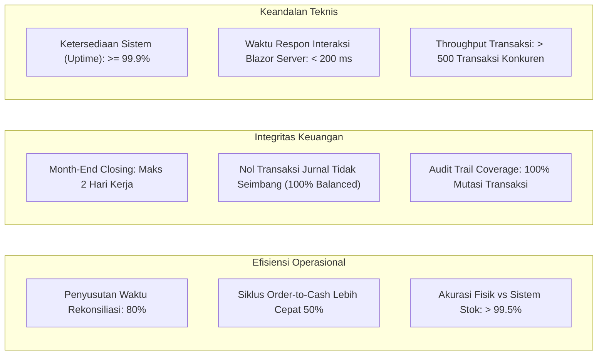

# Project Overview — Enterprise Resource Planning (ERP) System

> **Document Version:** 1.0.0  
> **Classification:** Enterprise Architecture & Strategic Governance  
> **Target Platform:** .NET 10 LTS | PostgreSQL 16+ | Blazor Web App (Interactive Server)  
> **Related Documents:** [PROJECT_OVERVIEW.md](./PROJECT_OVERVIEW.md) | [PRODUCT_REQUIREMENTS.md](./PRODUCT_REQUIREMENTS.md) | [BUSINESS_REQUIREMENTS.md](./BUSINESS_REQUIREMENTS.md) | [SYSTEM_DESIGN.md](./SYSTEM_DESIGN.md)

---

## 1. Latar Belakang & Identifikasi Masalah Bisnis (Problem Statement)

Banyak organisasi skala menengah hingga besar (*mid-to-large enterprises*) menghadapi inefisiensi operasional kritis yang bersumber dari fragmentasi sistem informasi:

1. **Silo Data Antar Departemen (Fragmented Data Silos):**  
   Departemen Penjualan (*Sales*), Pengadaan (*Procurement*), Pergudangan (*Inventory*), dan Keuangan (*Finance*) sering kali menggunakan aplikasi terpisah atau spreadsheet manual. Akibatnya terjadi redundansi input data, ketidaksesuaian angka penjualan vs stok aktual, dan keterlambatan rekonsiliasi.
2. **Ketiadaan Visibilitas Inventaris Real-Time:**  
   Kekurangan visibilitas stok di berbagai cabang dan gudang menyebabkan *stockout* pada barang-barang fast-moving atau penumpukan inventaris *dead stock* yang mengikat modal kerja (*working capital*).
3. **Ketidaksesuaian Pencatatan Keuangan (Financial Journal Imbalance & Late Closing):**  
   Proses penutupan buku akhir bulan (*month-end closing*) memakan waktu berminggu-minggu karena tim akuntansi harus mengejar bukti fisik pengiriman barang (*Delivery Notes*) dan faktur vendor (*Vendor Bills*) secara manual untuk membuat ayat jurnal.
4. **Kelemahan Tata Kelola & Risiko Keamanan (Governance & Audit Deficit):**  
   Sistem warisan (*legacy*) tidak memiliki pencatatan jejak audit (*audit trail*) yang terperinci dan anti-manipulasi (*immutable*). Otorisasi sering kali bersifat longgar tanpa adanya *Permission-Based Access Control* (PBAC) dan isolasi multi-cabang.
5. **Keterbatasan Dukungan Multi-Perusahaan & Multi-Cabang:**  
   Ketika grup perusahaan berkembang dengan membentuk anak perusahaan (*subsidiaries*) atau membuka kantor cabang baru, sistem yang ada tidak mampu mengonsolidasikan data secara terpusat tanpa kompromi pada pemisahan hak akses data per entitas legal.

---

## 2. Visi Produk & Sasaran Strategis (Product Vision & Strategic Goals)

### Visi Produk
> *"Membangun platform Enterprise Resource Planning (ERP) generasi modern yang tangguh, aman, modular, dan terpadu, yang menyatukan seluruh mata rantai proses bisnis korporasi—dari pengadaan, logistik gudang, penjualan, hingga akuntansi berstandar double-entry—dalam satu sistem terintegrasi dengan kedaulatan data penuh."*

### Sasaran Strategis (Strategic Objectives)
- **Single Source of Truth:** Satu basis data terpadu PostgreSQL berarsitektur multi-skema domain yang menjamin integritas transaksi dari hulu ke hilir.
- **Automated Double-Entry Accounting:** Setiap mutasi fisik barang dan transaksi komersial secara otomatis menerbitkan entri jurnal umum yang selalu seimbang ($\sum Debit = \sum Credit$).
- **Multi-Company & Multi-Branch Architecture:** Dukungan bawaan (*built-in*) untuk hierarki perusahaan induk, anak perusahaan, dan cabang dengan isolasi data yang ketat.
- **High-Velocity Operational Workflow:** Memangkas siklus transaksi *Order-to-Cash* (O2C) dan *Procure-to-Pay* (P2P) hingga 60% melalui approval workflow terstruktur.
- **Enterprise-Grade Security & Non-Repudiation:** Implementasi ASP.NET Core Identity dengan PBAC granuler dan audit logging menyeluruh terhadap setiap perubahan data.
- **Optimized Total Cost of Ownership (TCO):** Dibangun dengan ekosistem open-source enterprise (.NET 10 LTS, PostgreSQL, Linux containers) yang mengeliminasi biaya lisensi software komersial pihak ketiga yang mahal.

---

## 3. Profil Sasaran Pengguna & Industri (Target Market & Company Profile)

Sistem ini dirancang sebagai ERP general-purpose yang dapat disesuaikan untuk berbagai jenis industri:

| Sektor Industri | Karakteristik Kebutuhan Utama | Nilai Tambah ERP |
| :--- | :--- | :--- |
| **Distribusi & Grosir (Trading & Wholesale)** | Volume transaksi harian tinggi, multi-gudang, penentuan harga bertingkat, piutang pelanggan ketat. | Otomasi reservasi stok, surat jalan terkontrol, limit kredit otomatis. |
| **Manufaktur Ringan & Perakitan** | Manajemen bahan baku, penerimaan barang bertahap, pergerakan barang antar gudang. | Pelacakan HPP terintegrasi dengan metode *Weighted Average Cost*. |
| **Perusahaan Jasa & Korporasi Multi-Cabang** | Manajemen karyawan multi-cabang, approval berjenjang, reimbursement dan pengeluaran kas. | Hierarki cabang, persetujuan digital, integrasi payroll dengan akuntansi. |
| **Ritel & Rantai Pasok Terintegrasi** | Pemenuhan pesanan cepat, audit stok rutin, perputaran piutang/utang tinggi. | Stock opname akurat, pemantauan jatuh tempo tagihan (*Aging AR/AP*). |

---

## 4. Ruang Lingkup Sistem (System Scope)

### 4.1 In-Scope (Ruang Lingkup Termasuk)
1. **Pondasi Sistem & Multi-Tenancy Logis:**
   - Struktur data Multi-Company, Multi-Branch, Multi-Department, dan Multi-Warehouse.
   - Manajemen otentikasi, otorisasi PBAC, sesi, dan MFA.
2. **Master Data Management:**
   - Karyawan, Pelanggan, Pemasok, Kategori Produk, Satuan Ukur (UoM), Master Produk (Barang/Jasa/Stok).
3. **Human Resource Management (HRM):**
   - Manajemen biodata karyawan, pencatatan absensi, pengajuan cuti, perhitungan komponen gaji dan slip payroll.
4. **Inventory & Warehouse Management:**
   - Saldo stok real-time, pencatatan mutasi masuk/keluar/transfer, penyesuaian (*stock adjustment*), dan valuasi rata-rata tertimbang (*weighted average*).
5. **Procurement & Supply Chain Management:**
   - Permintaan Pembelian (*Purchase Request*), *Approval Workflow*, Pesanan Pembelian (*Purchase Order*), Penerimaan Barang (*Goods Receipt Note*), dan Faktur Pemasok.
6. **Sales & Customer Operations:**
   - Penawaran Harga (*Sales Quotation*), Pesanan Penjualan (*Sales Order*), Pengiriman Barang (*Delivery Order* / Surat Jalan), dan Faktur Penjualan (*Sales Invoice*).
7. **Finance, Cash/Bank, & General Ledger:**
   - Bagan Akun Standar (*Chart of Accounts*), Periode Fiskal, Jurnal Otomatis & Manual, Manajemen Kas/Bank, Alokasi Pembayaran Piutang & Utang.
8. **Reporting & Analytics:**
   - Laporan Laba Rugi, Neraca, Arus Kas, Kartu Stok, Aging AR/AP, dan Dashboard Ringkasan Eksekutif.
9. **Tata Kelola & Audit Trail:**
   - Log audit immutable (perubahan data sebelum vs sesudah), proteksi *optimistic concurrency*, serta penomoran dokumen otomatis terformat.

### 4.2 Out-of-Scope (Bukan Ruang Lingkup Rilis v1.0)
- Advanced Manufacturing Routing & MRP-II (Material Requirements Planning level manufaktur berat).
- POS Terminal Offline-First (Aplikasi kasir retail offline dengan sinkronisasi background).
- Multi-Currency Hedging & Foreign Exchange Auto-Revaluation (Transaksi rilis v1.0 berfokus pada mata uang operasional tunggal Rupiah IDR).
- AI/ML Predictive Demand Forecasting (Akan dievaluasi untuk roadmap rilis v2.0).

---

## 5. Indikator Kinerja Utama Keberhasilan Sistem (Success Metrics & KPIs)

Keberhasilan implementasi teknis dan bisnis sistem ERP ini diukur menggunakan parameter kuantitatif berikut:

---

## 6. Prinsip Desain dan Tata Kelola Arsitektur (Guiding Architectural Principles)

1. **Prinsip Kebenaran Tunggal (*Single Source of Truth*):**  
   Data tidak boleh diduplikasi secara manual di berbagai tempat. Setiap referensi entitas harus menggunakan relasi foreign key yang konsisten.
2. **Prinsip Imutabilitas Dokumen Finansial (*Financial Immutability*):**  
   Dokumen finansial yang telah disetujui (*Approved*) dan diposting (*Posted*) ke buku besar tidak dapat diubah atau dihapus secara langsung. Koreksi hanya diperbolehkan melalui prosedur penerbitan dokumen revisi atau jurnal pembalik (*reversing entries*).
3. **Prinsip Minimalisasi Jejak Serangan (*Least Privilege & Defense-in-Depth*):**  
   Setiap pengguna hanya diberikan akses spesifik ke fungsi dan data cabang yang relevan dengan tugasnya. Akses data dibatasi pada level lapisan aplikasi melalui filter global EF Core.
4. **Pemisahan Logika Bisnis dari Presentasi (*Strict Separation of Concerns*):**  
   Lapisan Blazor Web UI (*Presentation Layer*) murni bertugas menangani rendering dan interaksi pengguna. Seluruh kalkulasi bisnis, validasi integritas, orkestrasi transaksi, dan pembentukan jurnal harus berada di dalam *Application* dan *Domain Layer*.

---

## 7. Struktur Dokumen Terkait

Dokumentasi ini saling terintegrasi dengan dokumen teknis lainnya:
- Untuk analisis kebutuhan pengguna dan fungsionalitas detail, lihat [PRODUCT_REQUIREMENTS.md](./PRODUCT_REQUIREMENTS.md) dan [FUNCTIONAL_REQUIREMENTS.md](./FUNCTIONAL_REQUIREMENTS.md).
- Untuk perancangan arsitektur perangkat lunak, lihat [SOFTWARE_ARCHITECTURE.md](./SOFTWARE_ARCHITECTURE.md) dan [SYSTEM_DESIGN.md](./SYSTEM_DESIGN.md).
- Untuk perancangan struktur data, relasi, dan kamus data, lihat [DATABASE_DESIGN.md](./DATABASE_DESIGN.md) dan [DATABASE_SCHEMA.md](./DATABASE_SCHEMA.md).

