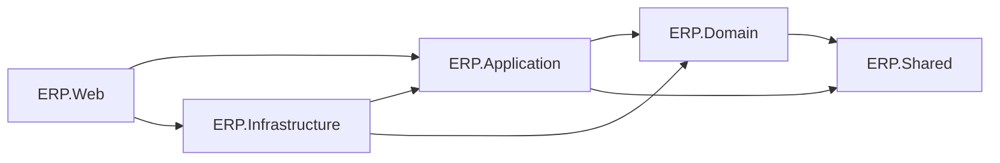

# Project Structure & Repository Layout — Enterprise ERP System

> **Document Version:** 1.0.0  
> **Solution Name:** `EnterpriseERP.sln`  
> **Target Framework:** .NET 10 LTS | C# 14  
> **Related Documents:** [SOFTWARE_ARCHITECTURE.md](./SOFTWARE_ARCHITECTURE.md) | [SYSTEM_DESIGN.md](./SYSTEM_DESIGN.md) | [CODING_STANDARDS.md](./CODING_STANDARDS.md)

---

## 1. Ikhtisar Struktur Solution (`EnterpriseERP.sln`)

Repositori diorganisasikan ke dalam direktori modular tingkat enterprise:

```
EnterpriseERP/
│
├── .github/                      # CI/CD Workflows (GitHub Actions)
│   └── workflows/
│       ├── build-test.yml
│       └── docker-publish.yml
│
├── docs/                         # Pusat Dokumentasi Lengkap Proyek
│   ├── diagrams/
│   ├── modules/
│   ├── database/
│   ├── workflows/
│   ├── adr/
│   ├── guides/
│   └── README.md
│
├── src/                          # Kode Sumber Produksi
│   ├── ERP.Domain/               # Core Enterprise Domain Entities & Rules
│   ├── ERP.Application/          # Use Cases, CQRS Handlers, DTOs, Validations
│   ├── ERP.Infrastructure/       # EF Core, PostgreSQL, Identity, Background Jobs
│   ├── ERP.Shared/               # Generic Results, Constants, Shared Utilities
│   └── ERP.Web/                  # Blazor Interactive Server UI & Composition Root
│
├── tests/                        # Pengujian Otomatis
│   ├── ERP.Architecture.Tests/   # NetArchTest untuk Penegakan Batas Modular Monolith
│   ├── ERP.Domain.Tests/         # Unit Tests Logika Bisnis & Invarian Domain
│   ├── ERP.Application.Tests/    # Unit Tests Handlers & FluentValidation
│   ├── ERP.Infrastructure.Tests/ # Integration Tests PostgreSQL (Testcontainers)
│   └── ERP.Web.Tests/            # BUnit & UI Component Tests
│
├── docker/                       # Konfigurasi Kontainerisasi & Database
│   ├── Dockerfile
│   ├── docker-compose.yml
│   └── init-scripts/
│       └── 01-init-schemas.sql
│
├── .editorconfig                 # Penegakan Standar Coding C#
├── .gitignore                    # Eksklusi File Sementara Git
├── Directory.Build.props          # Konfigurasi Build Terpusat (.NET 10)
├── Directory.Packages.props       # Central Package Management (CPM)
├── EnterpriseERP.sln             # Solution File Visual Studio / .NET CLI
└── README.md                     # Informasi Singkat Repositori
```

---

## 2. Rincian Struktur Proyek Sumber Daya (`src/`)

### 2.1 Proyek: `ERP.Domain`
- **Target:** `net10.0` (Class Library)
- **Ketergantungan:** *NOL dependensi pihak ketiga* (Hanya .NET Runtime dasar).
- **Struktur Folder:**
```
ERP.Domain/
├── Common/
│   ├── AggregateRoot.cs
│   ├── BaseEntity.cs
│   ├── IDomainEvent.cs
│   └── ISoftDeletable.cs
├── ValueObjects/
│   ├── Money.cs
│   ├── DocumentNumber.cs
│   ├── Address.cs
│   └── DateRange.cs
├── Entities/
│   ├── Master/
│   │   ├── Company.cs
│   │   ├── Branch.cs
│   │   ├── Department.cs
│   │   ├── Product.cs
│   │   ├── Customer.cs
│   │   └── Supplier.cs
│   ├── HR/
│   │   ├── Employee.cs
│   │   ├── AttendanceRecord.cs
│   │   ├── LeaveRequest.cs
│   │   └── PayrollPeriod.cs
│   ├── Inventory/
│   │   ├── Warehouse.cs
│   │   ├── StockBalance.cs
│   │   ├── StockMovement.cs
│   │   └── StockTransfer.cs
│   ├── Procurement/
│   │   ├── PurchaseRequest.cs
│   │   ├── PurchaseOrder.cs
│   │   ├── GoodsReceipt.cs
│   │   └── VendorBill.cs
│   ├── Sales/
│   │   ├── Quotation.cs
│   │   ├── SalesOrder.cs
│   │   ├── DeliveryOrder.cs
│   │   └── SalesInvoice.cs
│   └── Finance/
│       ├── ChartOfAccount.cs
│       ├── FiscalPeriod.cs
│       ├── JournalEntry.cs
│       ├── JournalLine.cs
│       └── Payment.cs
├── Enums/
│   ├── OrderStatus.cs
│   ├── AccountType.cs
│   ├── MovementType.cs
│   └── EmploymentStatus.cs
├── Events/
│   ├── SalesOrderConfirmedDomainEvent.cs
│   ├── GoodsReceiptProcessedDomainEvent.cs
│   └── StockBalanceUpdatedDomainEvent.cs
└── Exceptions/
    ├── DomainRuleViolationException.cs
    ├── UnbalancedJournalDomainException.cs
    └── InsufficientStockDomainException.cs
```

---

### 2.2 Proyek: `ERP.Application`
- **Target:** `net10.0` (Class Library)
- **Ketergantungan:** `ERP.Domain`, `MediatR`, `FluentValidation`.
- **Struktur Folder:**
```
ERP.Application/
├── Common/
│   ├── Behaviors/
│   │   ├── LoggingPipelineBehavior.cs
│   │   ├── ValidationPipelineBehavior.cs
│   │   ├── AuthorizationPipelineBehavior.cs
│   │   └── TransactionPipelineBehavior.cs
│   ├── Exceptions/
│   │   ├── ValidationException.cs
│   │   └── NotFoundException.cs
│   ├── Interfaces/
│   │   ├── IApplicationDbContext.cs
│   │   ├── ICurrentUserService.cs
│   │   ├── IDateTimeProvider.cs
│   │   ├── IDocumentSequenceService.cs
│   │   ├── IEmailService.cs
│   │   └── IPdfGeneratorService.cs
│   └── Models/
│       ├── PagedResult.cs
│       └── PaginationFilter.cs
└── Features/
    ├── MasterData/
    ├── HumanResources/
    ├── Inventory/
    ├── Procurement/
    ├── Sales/
    ├── Finance/
    └── Reports/
```

---

### 2.3 Proyek: `ERP.Infrastructure`
- **Target:** `net10.0` (Class Library)
- **Ketergantungan:** `ERP.Application`, `ERP.Domain`, `Npgsql.EntityFrameworkCore.PostgreSQL`, `Microsoft.AspNetCore.Identity.EntityFrameworkCore`, `Hangfire.PostgreSql`.
- **Struktur Folder:**
```
ERP.Infrastructure/
├── Persistence/
│   ├── Context/
│   │   └── ApplicationDbContext.cs
│   ├── Configurations/
│   │   ├── Identity/
│   │   ├── Master/
│   │   ├── HR/
│   │   ├── Inventory/
│   │   ├── Procurement/
│   │   ├── Sales/
│   │   ├── Finance/
│   │   └── Audit/
│   ├── Interceptors/
│   │   ├── AuditSaveChangesInterceptor.cs
│   │   └── SoftDeleteInterceptor.cs
│   └── Migrations/
├── Identity/
│   ├── Models/
│   │   ├── ApplicationUser.cs
│   │   └── ApplicationRole.cs
│   ├── Services/
│   │   ├── IdentityAuthenticationService.cs
│   │   └── PermissionPolicyProvider.cs
├── Services/
│   ├── CurrentUserService.cs
│   ├── SystemDateTimeProvider.cs
│   ├── DocumentSequenceGenerator.cs
│   ├── QuestPdfGeneratorService.cs
│   └── SmtpEmailService.cs
└── BackgroundJobs/
    ├── HangfireConfiguration.cs
    ├── StockAgingCalculationJob.cs
    └── MonthlyPayrollBatchJob.cs
```

---

### 2.4 Proyek: `ERP.Web`
- **Target:** `net10.0` (ASP.NET Core Web App)
- **Ketergantungan:** `ERP.Application`, `ERP.Infrastructure`, `MudBlazor`, `Serilog.AspNetCore`.
- **Struktur Folder:**
```
ERP.Web/
├── Components/
│   ├── App.razor
│   ├── Routes.razor
│   ├── Layout/
│   │   ├── MainLayout.razor
│   │   ├── MainLayout.razor.cs
│   │   ├── NavMenu.razor
│   │   ├── AppHeader.razor
│   │   └── BranchSelector.razor
│   ├── Shared/
│   │   ├── StatusChip.razor
│   │   ├── ConfirmDialog.razor
│   │   ├── CurrencyInput.razor
│   │   └── PageHeader.razor
│   └── Pages/
│       ├── Dashboard/
│       ├── MasterData/
│       ├── HR/
│       ├── Inventory/
│       ├── Procurement/
│       ├── Sales/
│       ├── Finance/
│       ├── Reports/
│       └── Security/
├── Services/
│   ├── BlazorCurrentUserService.cs
│   └── NavigationHistoryService.cs
├── Middleware/
│   ├── GlobalExceptionHandlerMiddleware.cs
│   └── SecurityHeadersMiddleware.cs
├── wwwroot/
│   ├── css/
│   │   └── app.css
│   ├── js/
│   │   └── app.js
│   └── favicon.ico
├── appsettings.json
├── appsettings.Production.json
└── Program.cs
```

---

## 3. Matriks Referensi Proyek (Project References Matrix)



### Aturan Dependensi Ketat:
- `ERP.Domain` **dilarang mereferensikan** proyek lain selain `ERP.Shared`.
- `ERP.Application` **dilarang mereferensikan** `ERP.Infrastructure` atau `ERP.Web`.
- Seluruh komunikasi antar-layer dijembatani menggunakan abstraksi antarmuka (*Interface Segregation Principle*).

