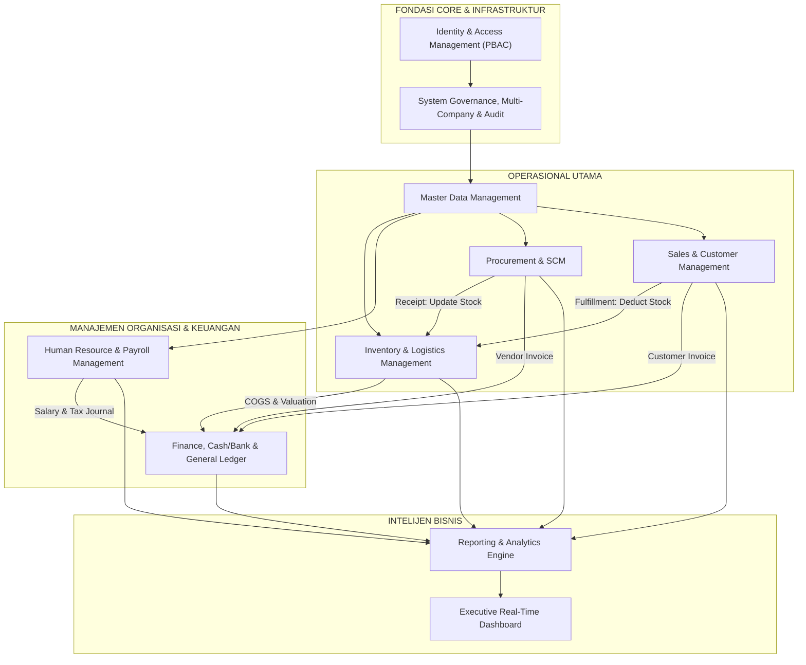

# Enterprise ERP System — Master Documentation Portal

> **Status:** Architecture & Requirements Complete (Ready for Engineering Review)  
> **Target Release:** v1.0.0-LTS  
> **Tech Stack:** .NET 10 LTS | C# 14 | Blazor Web App (Interactive Server) | MudBlazor | PostgreSQL 16+ | EF Core 10 | Npgsql  
> **Architecture Pattern:** Clean Architecture + Modular Monolith  

---

## 1. Executive Summary & Purpose

Sistem **Enterprise ERP (Enterprise Resource Planning)** ini dirancang khusus sebagai platform terpadu berskala enterprise untuk mengotomasi, mengintegrasikan, dan mengontrol seluruh operasional bisnis perusahaan multi-perusahaan (*multi-company*) dan multi-cabang (*multi-branch*).

Sistem ini mengeliminasi *data silos* antar departemen melalui satu sumber kebenaran (*Single Source of Truth*) yang mencakup:
1. **Master Data & Corporate Structure**
2. **Identity, Authentication & Permission-Based Access Control (PBAC)**
3. **Human Resource Management & Payroll**
4. **Inventory & Warehouse Logistics**
5. **Procurement & Supply Chain Management**
6. **Sales, Quotation, & Customer Relationship Operations**
7. **Finance, Cash/Bank, General Ledger, & Double-Entry Bookkeeping**
8. **Executive Dashboard & Real-Time Business Analytics**
9. **Centralized Auditing, Concurrency Protection, & Document Governance**

Dokumentasi ini adalah **Blueprint Teknis & Bisnis Resmi (Level Enterprise)** yang menjadi acuan wajib seluruh pemangku kepentingan (*Product Manager*, *Software Architect*, *Lead Engineer*, *DBA*, *QA Engineer*, *DevOps*, dan *Business Analyst*).

---

## 2. Peta Navigasi Dokumentasi (Documentation Sitemap)

Seluruh spesifikasi teknis dan fungsional diatur secara hierarkis dan saling terhubung (*cross-referenced*). Gunakan matriks navigasi berikut untuk menelusuri dokumen:

### A. Strategi Produk & Analisis Bisnis (Product & Business Specifications)
| Dokumen | Deskripsi Inti | Pemangku Kepentingan |
| :--- | :--- | :--- |
| [PROJECT_OVERVIEW.md](./PROJECT_OVERVIEW.md) | Visi, misi, ruang lingkup, latar belakang masalah, dan nilai strategis ERP. | Direksi, C-Level, PM, Architect |
| [PRODUCT_REQUIREMENTS.md](./PRODUCT_REQUIREMENTS.md) | *Product Requirement Document* (PRD), Personas, MoSCoW prioritization, dan Kriteria Keberhasilan. | Product Owner, PM, QA Lead |
| [BUSINESS_REQUIREMENTS.md](./BUSINESS_REQUIREMENTS.md) | Kebutuhan bisnis enterprise, analisis stakeholder, kalkulasi efisiensi ROI. | Business Analyst, CFO, COO |
| [FUNCTIONAL_REQUIREMENTS.md](./FUNCTIONAL_REQUIREMENTS.md) | Spesifikasi kebutuhan fungsional detail (FR-001 s.d. FR-080) dan Use Case Catalog. | Developer, QA Engineer, BA |
| [NON_FUNCTIONAL_REQUIREMENTS.md](./NON_FUNCTIONAL_REQUIREMENTS.md) | Metrik NFR: Performa, Ketersediaan 99.9%, Keamanan, Skalabilitas, Auditabilitas. | Solution Architect, DevOps, SRE |
| [GLOSSARY.md](./GLOSSARY.md) | Kamus istilah bisnis, akuntansi, supply chain, dan teknis arsitektur software. | Seluruh Tim |

---

### B. Arsitektur Perangkat Lunak & Desain Sistem (System Architecture)
| Dokumen | Deskripsi Inti | Pemangku Kepentingan |
| :--- | :--- | :--- |
| [SYSTEM_DESIGN.md](./SYSTEM_DESIGN.md) | *System Design Document* (SDD), batas modularitas, alur data, integrasi, dan background jobs. | Enterprise Architect, Tech Lead |
| [SOFTWARE_ARCHITECTURE.md](./SOFTWARE_ARCHITECTURE.md) | Detail Clean Architecture, Modular Monolith, aturan dependensi, CQRS, dan MediatR. | Senior .NET Architect, Developers |
| [ARCHITECTURE_DECISION_RECORDS.md](./ARCHITECTURE_DECISION_RECORDS.md) | Log keputusan arsitektural (ADR-001 s.d. ADR-012) beserta trade-off dan justifikasi. | Architect, Principal Engineer |
| [PROJECT_STRUCTURE.md](./PROJECT_STRUCTURE.md) | Struktur fisik repositori, folder, project references, dan penamaan assembly. | Software Engineers |
| [CODING_STANDARDS.md](./CODING_STANDARDS.md) | Standar coding C# 14, .NET 10, EF Core best practices, Result pattern, dan konvensi. | Software Engineers, Code Reviewer |

---

### C. Spesifikasi Modul & Aturan Bisnis (Modules & Domain Rules)
| Dokumen | Deskripsi Inti | Pemangku Kepentingan |
| :--- | :--- | :--- |
| [MODULE_SPECIFICATIONS.md](./MODULE_SPECIFICATIONS.md) | Spesifikasi lengkap 9 modul bisnis (tujuan, fitur, submenu, aktor, validasi, status). | Business Analyst, Dev Team |
| [BUSINESS_WORKFLOWS.md](./BUSINESS_WORKFLOWS.md) | Alur kerja lintas modul (Order-to-Cash, Procure-to-Pay, Month-End Close) & diagram Mermaid. | Ops Manager, Business Analyst |
| [BUSINESS_RULES.md](./BUSINESS_RULES.md) | Aturan bisnis formal (validasi stok, penomoran dokumen otomatis, jurnal seimbang, approval). | BA, Compliance, Backend Dev |

---

### D. Arsitektur Database & Data Governance (Database Architecture)
| Dokumen | Deskripsi Inti | Pemangku Kepentingan |
| :--- | :--- | :--- |
| [DATABASE_DESIGN.md](./DATABASE_DESIGN.md) | Filosofi multi-tenant (Company/Branch), UUIDv7, Audit Fields, Concurrency, Precision. | Database Architect, DBA, Lead Dev |
| [DATABASE_SCHEMA.md](./DATABASE_SCHEMA.md) | Definisi DDL PostgreSQL per domain schema (*identity, master, hr, inventory, procurement, sales, finance, audit*). | DBA, Backend Developers |
| [ENTITY_RELATIONSHIP_DIAGRAM.md](./ENTITY_RELATIONSHIP_DIAGRAM.md) | Diagram ERD lengkap menggunakan Mermaid untuk visualisasi relasi entitas. | Seluruh Tim Engineering |
| [DATA_DICTIONARY.md](./DATA_DICTIONARY.md) | Kamus data komprehensif: kolom, tipe data, indeks, nullability, default, dan constraint. | Database Engineer, QA |

---

### E. Keamanan, Identitas & Hak Akses (Security & Access Control)
| Dokumen | Deskripsi Inti | Pemangku Kepentingan |
| :--- | :--- | :--- |
| [SECURITY_DESIGN.md](./SECURITY_DESIGN.md) | Model ancaman STRIDE, proteksi data, mitigasi OWASP Top 10, audit trail anti-tamper. | InfoSec, Security Officer, Lead Dev |
| [USER_ROLES_AND_PERMISSIONS.md](./USER_ROLES_AND_PERMISSIONS.md) | Matriks hak akses granuler (PBAC), isolasi data cabang/perusahaan, privilege hierarki. | Security Admin, Compliance Officer |

---

### F. Desain Antarmuka Pengguna (UI/UX Design System)
| Dokumen | Deskripsi Inti | Pemangku Kepentingan |
| :--- | :--- | :--- |
| [UI_UX_GUIDELINES.md](./UI_UX_GUIDELINES.md) | Blueprint MudBlazor: Layout, Navigasi, Form Patterns, Server DataTables, Responsive, A11y. | UI/UX Designer, Frontend/Blazor Dev |

---

### G. Strategi Pengujian, Penerapan & Operasional (QA & DevOps)
| Dokumen | Deskripsi Inti | Pemangku Kepentingan |
| :--- | :--- | :--- |
| [TESTING_STRATEGY.md](./TESTING_STRATEGY.md) | Piramida pengujian: Unit (xUnit), Integrasi (Testcontainers PostgreSQL), E2E, Workflow test. | QA Engineer, Automation Tester |
| [DEPLOYMENT_GUIDE.md](./DEPLOYMENT_GUIDE.md) | Arsitektur kontainer Docker, Nginx reverse proxy, PostgreSQL backup/WAL, CI/CD pipeline. | DevOps Engineer, SysAdmin |
| [DEVELOPMENT_ROADMAP.md](./DEVELOPMENT_ROADMAP.md) | Roadmap 16 minggu implementasi bertahap dari Foundation hingga Production Cutover. | Project Manager, Scrum Master |
| [IMPLEMENTATION_PLAN.md](./IMPLEMENTATION_PLAN.md) | Work Breakdown Structure (WBS), rincian sprint, manajemen dependensi, dan mitigasi risiko. | PM, Engineering Leads |
| [CHANGELOG.md](./CHANGELOG.md) | Log rilis dan riwayat evolusi arsitektur sistem. | Release Manager |

---

## 3. Matriks Domain Modul Sistem

Sistem ERP ini dibagi menjadi 9 modul fungsional yang beroperasi di atas fondasi Clean Architecture:

---

## 4. Prinsip Arsitektur Utama (Guiding Architectural Tenets)

1. **Clean Architecture & Strict Dependency Rule**: Lapisan Domain adalah pusat absolut. Lapisan Domain tidak memiliki dependensi eksternal apapun. Lapisan Application hanya bergantung pada Domain. Lapisan Infrastructure dan Web mengimplementasikan kontrak interface yang didefinisikan di Application.
2. **Modular Monolith**: Meskipun dikemas dalam satu unit deployment (*monolithic artifact* untuk kesederhanaan operasional), batas-batas modul (*module boundaries*) ditegakkan secara ketat melalui isolasi namespace, DbContext schema boundaries, dan komunikasi in-process via MediatR Commands/Events.
3. **Double-Entry Balancing Enforced**: Transaksi finansial **wajib** mencatat debit dan kredit yang bernilai persis sama ($\sum Debit = \sum Credit$). Tidak ada celah bagi jurnal yang tidak seimbang untuk tersimpan ke basis data.
4. **Perpetual Inventory Control**: Nilai stok persediaan tercatat secara *real-time* dengan metode *Weighted Average Cost*. Setiap perpindahan barang fisik (*goods movement*) wajib menerbitkan mutasi persediaan dan jurnal akuntansi terkait (*Goods in Transit* / *Inventory Received Not Invoiced*).
5. **Auditing & Non-Repudiation**: Setiap mutasi data penting dicatat pada skema audit terisolasi (*audit trail* mencakup: user identity, timestamp, IP address, data sebelum dan data sesudah). Transaksi finansial yang sudah berstatus *Posted* dilarang keras dihapus secara fisik (*Immutable Records*); pembatalan hanya dapat dilakukan melalui jurnal pembalik (*Reversal Journal*).
6. **Zero Client Secret Exposure**: Menggunakan Blazor Interactive Server di mana seluruh logika bisnis, state, dan query database dieksekusi 100% di server side melalui secure SignalR binary protocol.

---

## 5. Instruksi Selanjutnya untuk Tim Pengembang

> [!CAUTION]
> **ATURAN PROJEK NOMOR 1:**
> **JANGAN MEMULAI CODING / IMPLEMENTASI APLIKASI** sebelum:
> 1. Seluruh dokumen dalam portal `/docs` telah ditinjau dan divalidasi silang.
> 2. Skema database telah disetujui oleh Database Architect.
> 3. Alur workflow transaksi telah disetujui oleh Business Analyst dan Solution Architect.
> 4. User memberikan persetujuan eksplisit untuk memulai fase konstruksi kode.

