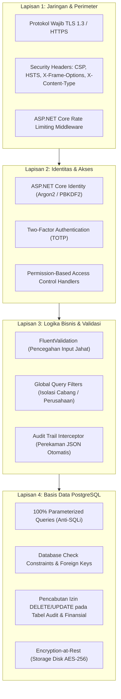

# Security Architecture & Threat Modeling — Enterprise ERP System

> **Document Version:** 1.0.0  
> **Security Standard:** OWASP Top 10 (2025/2026 Enterprise Edition) & STRIDE Threat Model  
> **Related Documents:** [USER_ROLES_AND_PERMISSIONS.md](./USER_ROLES_AND_PERMISSIONS.md) | [SYSTEM_DESIGN.md](./SYSTEM_DESIGN.md) | [DATABASE_DESIGN.md](./DATABASE_DESIGN.md)

---

## 1. Analisis Ancaman dengan Model STRIDE

Sistem ERP memproses aset finansial, data pribadi karyawan, dan informasi transaksi sensitif. Berikut pemetaan ancaman menggunakan metodologi **STRIDE**:

| Kategori Ancaman | Deskripsi Potensi Serangan | Skenario Risiko di ERP | Mekanisme Mitigasi Arsitektural |
| :--- | :--- | :--- | :--- |
| **S (Spoofing)** | Peniruan identitas pengguna sah. | Penyerang menebak password akun Finance Manager atau mencuri session cookie. | Autentikasi kuat via ASP.NET Core Identity, wajib 2FA/TOTP untuk level manajer, password hashing PBKDF2, lockout setelah 5x gagal login. |
| **T (Tampering)** | Manipulasi data transaksi saat transit atau di database. | Staf gudang mengubah kuantitas barang di database untuk menutupi pencurian stok. | TLS 1.3 transit encryption, EF Core parameterized queries, PostgreSQL check constraints, imutabilitas tabel `stock_movements`, dan checksum audit log. |
| **R (Repudiation)** | Pengguna menyangkal telah melakukan transaksi tertentu. | Manajer menyangkal telah menyetujui Purchase Order senilai Rp 500 juta. | Pencatatan audit trail otomatis via `AuditSaveChangesInterceptor` (merekam `user_id`, `ip_address`, `timestamp_utc`, payload JSON perubahan). Izin `UPDATE/DELETE` dicabut pada tabel audit. |
| **I (Information Disclosure)** | Kebocoran data sensitif ke pihak tak berwenang. | Staf cabang Surabaya dapat melihat nominal gaji direktur atau omset cabang Jakarta. | Multi-tier authorization: PBAC dievaluasi di server, EF Core Global Query Filter membatasi data hanya ke cabang aktif pengguna, masking data sensitif pada log. |
| **D (Denial of Service)** | Melumpuhkan ketersediaan server dengan beban berlebih. | Penyerang mengirim ribuan permintaan query berat atau membuka ribuan koneksi WebSocket. | Rate limiting middleware, pembatasan ukuran payload upload maks 5MB, paginasi wajib sisi server (maks 100 baris/halaman), koneksi WebSocket diputus jika idle 30 menit. |
| **E (Elevation of Privilege)** | Pengguna biasa mendapatkan hak akses administrator. | Operator sales memodifikasi request untuk memicu aksi `finance.journal.post`. | Pemeriksaan permission server-side menggunakan `[RequirePermission]`, larangan mutlak mempercayai input client, validasi kepemilikan data sebelum commit. |

---

## 2. Arsitektur Pertahanan Berlapis (Defense-in-Depth Strategy)



---

## 3. Matriks Mitigasi OWASP Top 10

### 3.1 A01: Broken Access Control (Kerentanan Kontrol Akses)
- **Mitigasi:**  
  Setiap request Use Case divalidasi oleh `AuthorizationPipelineBehavior` di MediatR. Pengujian unit arsitektural memastikan tidak ada method controller atau page handler yang terbuka tanpa atribut otorisasi. Data dibatasi secara transparan di EF Core sehingga pengguna tidak dapat membaca data cabang lain meskipun memanipulasi ID di URL.

### 3.2 A02: Cryptographic Failures (Kegagalan Kriptografi)
- **Mitigasi:**  
  - Seluruh komunikasi HTTP dialihkan ke HTTPS dengan *HTTP Strict Transport Security* (HSTS) berdurasi 1 tahun (`max-age=31536000; includeSubDomains`).
  - Password disimpan menggunakan algoritma hashing standar ASP.NET Core Identity dengan salt kriptografis unik.
  - Data cadangan (*backup dumps*) dienkripsi dengan GPG AES-256 sebelum diunggah ke penyimpanan sekunder.

### 3.3 A03: Injection (Injeksi Kode & SQL)
- **Mitigasi:**  
  - Seluruh akses basis data menggunakan EF Core LINQ atau Npgsql parameterized queries. Penggabungan string manual (*raw string concatenation*) ke dalam query SQL **DILARANG KERAS**.
  - Blazor secara bawaan melakukan HTML auto-escaping pada string yang dirender, melindungi aplikasi dari serangan Cross-Site Scripting (XSS).

### 3.4 A04: Insecure Design (Desain Tidak Aman)
- **Mitigasi:**  
  - Penerapan invarian bisnis di domain layer: Jurnal akuntansi menolak disimpan jika debit $\ne$ kredit.
  - Alur persetujuan bertingkat (*Approval Matrix*) untuk transaksi bernilai tinggi mencegah kecurangan dari satu orang staf (*Segregation of Duties / SoD*).

### 3.5 A05: Security Misconfiguration (Kesalahan Konfigurasi Keamanan)
- **Mitigasi:**  
  - Seluruh secret (koneksi DB, password SMTP) dibaca dari Environment Variables atau Secret Manager. File `appsettings.json` yang di-commit ke Git hanya berisi template kosong.
  - Middleware menerapkan header keamanan ketat:
    ```http
    X-Content-Type-Options: nosniff
    X-Frame-Options: DENY
    Referrer-Policy: strict-origin-when-cross-origin
    Content-Security-Policy: default-src 'self'; script-src 'self'; style-src 'self' 'unsafe-inline';
    ```

---

## 4. Keamanan Log Audit & Anti-Manipulasi (Anti-Tampering Governance)

Untuk menjamin integritas rekam jejak audit (*Non-Repudiation*):

1. **Pemisahan Akun Database (Least Privilege DB Roles):**  
   Pengguna aplikasi ERP di PostgreSQL (`erp_app_user`) hanya diberikan hak akses:
   ```sql
   -- Batasan Izin Pengguna Aplikasi pada Skema Audit
   GRANT USAGE ON SCHEMA audit TO erp_app_user;
   GRANT SELECT, INSERT ON audit.audit_logs TO erp_app_user;
   
   -- CABUT IZIN MODIFIKASI & PENGHAPUSAN:
   REVOKE UPDATE, DELETE, TRUNCATE ON audit.audit_logs FROM erp_app_user;
   ```
2. **Hasil Proteksi:**  
   Bahkan jika akun aplikasi berhasil dieksploitasi oleh penyerang, penyerang tersebut **tidak dapat menghapus atau mengubah jejak audit masa lalu**, karena mesin database PostgreSQL akan langsung menolak operasi `UPDATE` atau `DELETE` pada tabel `audit.audit_logs`.

