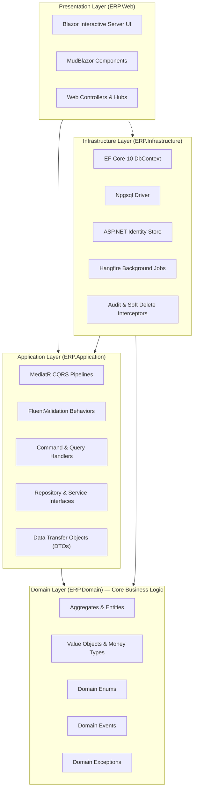
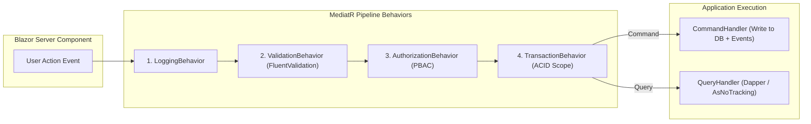

# Software Architecture Document — Enterprise ERP System

> **Document Version:** 1.0.0  
> **Target Framework:** .NET 10 LTS (C# 14)  
> **Architecture Pattern:** Clean Architecture + Modular Monolith  
> **Related Documents:** [SYSTEM_DESIGN.md](./SYSTEM_DESIGN.md) | [ARCHITECTURE_DECISION_RECORDS.md](./ARCHITECTURE_DECISION_RECORDS.md) | [CODING_STANDARDS.md](./CODING_STANDARDS.md) | [PROJECT_STRUCTURE.md](./PROJECT_STRUCTURE.md)

---

## 1. Fondasi Paradigma: Clean Architecture & Modular Monolith

Sistem Enterprise ERP ini mengadopsi kombinasi **Clean Architecture** (dicetuskan oleh Robert C. Martin / Uncle Bob) dengan arsitektur **Modular Monolith**.

### Mengapa Modular Monolith?
1. **Kesederhanaan Operasional:** Menghindari kompleksitas operasional microservices (seperti *distributed tracing*, *network latency*, *two-phase commit*, dan *Kubernetes orchestration overhead*) pada fase awal, namun tetap menjaga isolasi batas domain yang bersih.
2. **Kinerja Tinggi (In-Process Execution):** Transaksi lintas modul (misal: Sales memicu pemotongan stok dan pembentukan jurnal akuntansi) dapat dieksekusi secara in-process dalam satu transaksi basis data ACID yang aman dan sangat cepat tanpa overhead network HTTP/gRPC.
3. **Evolusi Arsitektural:** Karena batas modul (*boundaries*) dipisahkan secara ketat melalui namespace, antarmuka, dan event in-process, jika salah satu modul (misal: Inventory atau Sales) di kemudian hari perlu dipisahkan menjadi microservice independen, refaktorisasi dapat dilakukan dengan mudah tanpa merombak domain logic.

---

## 2. Diagram Lapisan & Aturan Ketergantungan (Dependency Rule)



### Aturan Utama Dependensi (The Dependency Rule):
- **Lingkaran Terdalam adalah Domain:** Lapisan `ERP.Domain` tidak mengetahui keberadaan database, web framework, atau pustaka eksternal apapun.
- **Lapisan Application hanya mengetahui Domain:** Seluruh use case bisnis dinyatakan dalam bentuk *Commands* dan *Queries* yang mengoperasikan entitas Domain dan memanggil *Interfaces*.
- **Lapisan Infrastructure mengimplementasikan Kontrak:** Detail teknis (PostgreSQL, EF Core, SMTP, PDF Generator) ditempatkan di `ERP.Infrastructure`.
- **Lapisan Presentation (Web) adalah Composition Root:** `ERP.Web` bertanggung jawab mengikat semua dependensi menggunakan *Dependency Injection container* ASP.NET Core pada file `Program.cs`.

---

## 3. Pola Taktis Domain-Driven Design (DDD Patterns)

### 3.1 Entity & Aggregate Root
Seluruh objek bisnis utama diturunkan dari kelas dasar `AggregateRoot<TId>` atau `BaseEntity<TId>`:

```csharp
// Konsep Desain: Base Aggregate Root di ERP.Domain
public abstract class AggregateRoot<TId> : BaseEntity<TId>
{
    private readonly List<IDomainEvent> _domainEvents = new();
    public IReadOnlyCollection<IDomainEvent> DomainEvents => _domainEvents.AsReadOnly();

    protected void AddDomainEvent(IDomainEvent domainEvent)
    {
        _domainEvents.Add(domainEvent);
    }

    public void ClearDomainEvents()
    {
        _domainEvents.Clear();
    }
}

public abstract class BaseEntity<TId>
{
    public TId Id { get; protected set; } = default!;
    public Guid CompanyId { get; protected set; }
    public Guid BranchId { get; protected set; }
    
    // Audit Fields
    public DateTime CreatedAtUtc { get; protected set; }
    public Guid CreatedByUserId { get; protected set; }
    public DateTime? UpdatedAtUtc { get; protected set; }
    public Guid? UpdatedByUserId { get; protected set; }
    public bool IsDeleted { get; protected set; }
    public uint Version { get; protected set; } // Optimistic Concurrency Token
}
```

### 3.2 Value Objects (Objek Nilai)
Untuk atribut yang diidentifikasi oleh nilainya dan bukan oleh ID unik (misalnya: Nominal Uang, Alamat, Nomor Dokumen), digunakan *Value Objects* berbasis `record` C# 14 yang bersifat *immutable*:

```csharp
public readonly record struct Money(decimal Amount, string Currency)
{
    public static Money Zero(string currency = "IDR") => new(0m, currency);
    
    public static Money operator +(Money a, Money b)
    {
        if (a.Currency != b.Currency)
            throw new InvalidOperationException("Tidak dapat menjumlahkan mata uang yang berbeda.");
        return new Money(a.Amount + b.Amount, a.Currency);
    }
}
```

### 3.3 Domain Events (Peristiwa Domain)
Digunakan untuk mencatat kejadian penting dalam domain yang memicu efek samping di modul lain:
- `SalesOrderConfirmedDomainEvent`
- `GoodsReceiptCompletedDomainEvent`
- `PayrollApprovedDomainEvent`

---

## 4. Implementasi CQRS & MediatR Pipeline

Aplikasi memisahkan operasi pembacaan data (*Query*) dari operasi pengubahan data (*Command*) menggunakan pola CQRS (*Command Query Responsibility Segregation*):



### Urutan Pipeline Behaviors:
1. **LoggingBehavior:** Mencatat waktu mulai, parameter input (dengan masking data sensitif), dan durasi eksekusi use case.
2. **ValidationBehavior:** Menjalankan seluruh class `AbstractValidator<TCommand>` yang terdaftar untuk memeriksa format, rentang nilai, dan kelengkapan input sebelum masuk ke Handler. Jika gagal, eksekusi diputus dan melempar `ValidationException`.
3. **AuthorizationBehavior:** Memeriksa apakah pengguna memiliki permission yang disyaratkan oleh atribut `[RequirePermission("...")]` pada command/query tersebut.
4. **TransactionBehavior:** Membuka transaksi database PostgreSQL melalui EF Core. Jika handler berhasil tanpa error, transaksi di-commit; jika terjadi kegagalan atau exception, transaksi di-rollback secara otomatis.

---

## 5. Pola Akses Data (Data Access with EF Core 10 & Npgsql)

### 5.1 Satu DbContext Terpadu dengan Konfigurasi Terpisah
Meskipun database dipartisi menjadi 8 schema (*identity, master, hr, inventory, procurement, sales, finance, audit*), aplikasi menggunakan `ApplicationDbContext` terpadu yang memuat pemetaan terpisah menggunakan `IEntityTypeConfiguration<T>`:

```csharp
// Contoh Konfigurasi Entity Mapping Terisolasi per Schema
public class SalesOrderConfiguration : IEntityTypeConfiguration<SalesOrder>
{
    public void Configure(EntityTypeBuilder<SalesOrder> builder)
    {
        builder.ToTable("sales_orders", "sales");
        builder.HasKey(x => x.Id);
        
        builder.Property(x => x.OrderNumber)
            .HasMaxLength(50)
            .IsRequired();
            
        builder.HasIndex(x => new { x.CompanyId, x.OrderNumber })
            .IsUnique();

        // Optimistic Concurrency menggunakan PostgreSQL xmin
        builder.UseXminAsConcurrencyToken();
    }
}
```

### 5.2 Global Query Filters untuk Multi-Tenancy & Soft-Delete
Seluruh query secara otomatis menyaring data berdasarkan cabang aktif pengguna dan status penghapusan data:

```csharp
// Di dalam OnModelCreating ApplicationDbContext
builder.Entity<SalesOrder>().HasQueryFilter(x => 
    !x.IsDeleted && 
    x.CompanyId == _currentUserService.CompanyId &&
    (_currentUserService.IsHeadOffice || x.BranchId == _currentUserService.BranchId)
);
```

### 5.3 EF Core SaveChanges Interceptor untuk Otomasi Audit
Setiap pemanggilan `SaveChangesAsync()` dipotong oleh `AuditSaveChangesInterceptor` yang secara transparan:
1. Mengisi nilai `CreatedAtUtc` dan `CreatedByUserId` untuk entitas baru (*Added*).
2. Mengisi nilai `UpdatedAtUtc` dan `UpdatedByUserId` untuk entitas yang diubah (*Modified*).
3. Mengonversi operasi *Deleted* menjadi *Soft-Delete* (`IsDeleted = true`).
4. Menyimpan rekam jejak audit (*AuditLog*) berupa payload JSON perubahan nilai kolom lama vs baru ke tabel `audit.audit_logs`.

---

## 6. Arsitektur Blazor Interactive Server

Untuk sistem ERP korporat internal, **Blazor Interactive Server** memberikan keunggulan arsitektural yang signifikan:

1. **Stateful Server Connection:**  
   UI dirender secara langsung di sisi server; hanya perubahan DOM virtual berukuran sangat kecil (*DOM diffs*) yang dikirimkan ke browser client melalui koneksi biner WebSocket (SignalR).
2. **Koneksi Database Langsung & Cepat:**  
   Komponen server dapat langsung mengeksekusi MediatR query in-process tanpa perlu serialisasi JSON bolak-balik melalui REST API publik, menghasilkan performa rendering data list yang sangat responsif.
3. **Keamanan Tanpa Paparan Token:**  
   Tidak ada JWT token atau kredensial database yang tersimpan di LocalStorage browser client, sepenuhnya mengeliminasi risiko pencurian token melalui serangan XSS.
4. **Isolasi Circuit & Pemeliharaan State:**  
   Setiap tab browser pengguna memiliki *Circuit* tersendiri di memori server Kestrel. State sesi dikelola menggunakan scoped service yang dibersihkan secara otomatis saat sirkuit ditutup (*graceful disposal*).

