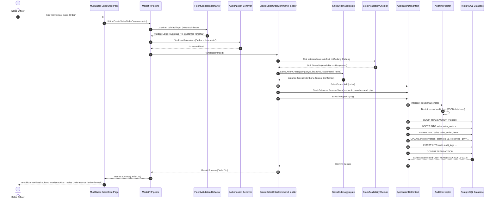
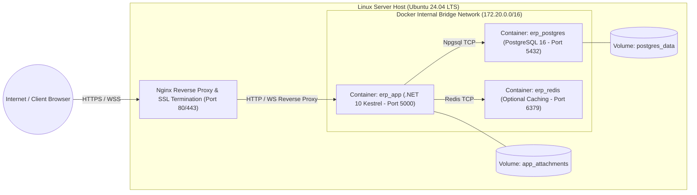

# System Design Document (SDD) — Enterprise ERP System

> **Document Version:** 1.0.0  
> **Classification:** Enterprise Solution & Software Architecture  
> **Tech Stack:** .NET 10 LTS | C# 14 | Blazor Web App (Interactive Server) | MudBlazor | PostgreSQL 16+ | EF Core 10 | Npgsql  
> **Related Documents:** [SOFTWARE_ARCHITECTURE.md](./SOFTWARE_ARCHITECTURE.md) | [ARCHITECTURE_DECISION_RECORDS.md](./ARCHITECTURE_DECISION_RECORDS.md) | [DATABASE_DESIGN.md](./DATABASE_DESIGN.md) | [PROJECT_STRUCTURE.md](./PROJECT_STRUCTURE.md)

---

## 1. Gambaran Arsitektur Sistem (High-Level System Architecture)

Sistem ERP ini dirancang menggunakan paradigma **Clean Architecture** yang diimplementasikan dalam pola **Modular Monolith**. Seluruh kapabilitas bisnis dikemas dalam satu unit kompilasi dan *deployment runtime*, tetapi secara internal dipartisi dengan batas-batas modular (*module boundaries*) yang tegas dan tidak saling tumpang tindih (*zero circular dependency*).

```mermaid
graph TD
    subgraph ClientTier ["CLIENT TIER (Browser)"]
        BROWSER["Web Browser (Desktop / Tablet)"]
    end

    subgraph HostTier ["APPLICATION HOST TIER (.NET 10 LTS Kestrel)"]
        subgraph WebLayer ["1. Presentation Layer (ERP.Web)"]
            ROUTER["Blazor Router & Circuit Handler"]
            MUDBLAZOR["MudBlazor Component Engine"]
            UI_PAGES["Blazor Pages & Razor Components"]
            AUTH_STATE["AuthenticationStateProvider"]
        end

        subgraph AppLayer ["2. Application Layer (ERP.Application)"]
            CQRS["MediatR Command/Query Pipeline"]
            VAL_BEH["FluentValidation Pipeline Behavior"]
            AUTH_BEH["Authorization Pipeline Behavior"]
            AUDIT_BEH["Auditing & Logging Behavior"]
            USECASES["Application Services & Handlers"]
            EVENT_PUB["In-Process Domain Event Publisher"]
        end

        subgraph DomainLayer ["3. Domain Layer (ERP.Domain) - Core Engine"]
            ENTITIES["Domain Entities & Aggregates"]
            VALUE_OBJ["Value Objects & Money Types"]
            DOM_RULES["Domain Business Rules & Invariants"]
            DOM_EVENTS["Domain Events Definitions"]
        end

        subgraph InfraLayer ["4. Infrastructure Layer (ERP.Infrastructure)"]
            EFCORE["Entity Framework Core 10 DbContext"]
            ID_STORE["ASP.NET Core Identity Store"]
            NPGSQL["Npgsql PostgreSQL ADO.NET Driver"]
            AUDIT_INT["EF Core SaveChanges Interceptor (Audit Trail)"]
            HANGFIRE["Hangfire Background Job Engine"]
            EMAIL_SVC["SMTP Notification Service"]
        end
    end

    subgraph DataTier ["PERSISTENCE TIER (PostgreSQL 16+)"]
        PG_DB[("Enterprise PostgreSQL Database")]
        SCH_ID["schema: identity"]
        SCH_MST["schema: master"]
        SCH_HR["schema: hr"]
        SCH_INV["schema: inventory"]
        SCH_PRC["schema: procurement"]
        SCH_SLS["schema: sales"]
        SCH_FIN["schema: finance"]
        SCH_AUD["schema: audit"]
    end

    BROWSER <==>|Encrypted WebSocket / TLS 1.3 (SignalR Binary)| ROUTER
    ROUTER --> MUDBLAZOR
    MUDBLAZOR --> UI_PAGES
    UI_PAGES --> AUTH_STATE
    UI_PAGES -->|Send Command/Query| CQRS

    CQRS --> VAL_BEH
    VAL_BEH --> AUTH_BEH
    AUTH_BEH --> AUDIT_BEH
    AUDIT_BEH --> USECASES

    USECASES --> ENTITIES
    USECASES --> DOM_RULES
    USECASES -->|Invoke Interfaces| EFCORE
    USECASES --> EVENT_PUB

    EFCORE --> AUDIT_INT
    AUDIT_INT --> NPGSQL
    ID_STORE --> NPGSQL
    HANGFIRE --> NPGSQL
    NPGSQL --> PG_DB

    PG_DB --- SCH_ID
    PG_DB --- SCH_MST
    PG_DB --- SCH_HR
    PG_DB --- SCH_INV
    PG_DB --- SCH_PRC
    PG_DB --- SCH_SLS
    PG_DB --- SCH_FIN
    PG_DB --- SCH_AUD
```

---

## 2. Pembagian Layer & Tanggung Jawab Proyek (Clean Architecture Layers)

Struktur solusi perangkat lunak dipartisi secara ketat menjadi 5 proyek inti:

| Proyek | Layer | Tanggung Jawab Utama | Aturan Dependensi (Dependency Rules) |
| :--- | :--- | :--- | :--- |
| **`ERP.Domain`** | Domain Layer (Enterprise Core) | Berisi *Entities*, *Aggregates*, *Value Objects*, *Enums*, *Domain Exceptions*, dan *Domain Events*. Mengandung logika bisnis murni dan invarian bisnis. | **HANYA BERGANTUNG PADA .NET RUNTIME.** Sama sekali tidak boleh mereferensikan proyek lain, EF Core, atau library UI. |
| **`ERP.Application`** | Application Layer (Use Cases) | Mengorkestrasi alur aplikasi. Berisi definisi use case (Commands, Queries, DTOs, Handlers), *FluentValidation Validators*, interfaces repository/unit of work, dan *Pipeline Behaviors*. | **Hanya bergantung pada `ERP.Domain`** dan pustaka abstraksi (`MediatR`, `FluentValidation`). |
| **`ERP.Infrastructure`** | Infrastructure Layer (External Concerns) | Implementasi teknis dari interface di Application: EF Core DbContext, pemetaan tabel via Fluent API, konfigurasi Npgsql, integrasi ASP.NET Core Identity, eksekusi audit interceptor, dan background jobs. | **Bergantung pada `ERP.Application` dan `ERP.Domain`.** Mengimplementasikan interface yang telah dikontrakkan di Application. |
| **`ERP.Web`** | Presentation Layer (Composition Root) | Antarmuka pengguna berbasis Blazor Web App (Interactive Server), MudBlazor components, custom authentication state provider, controller API (bila ada), middleware pipeline, dan registrasi DI di `Program.cs`. | **Bergantung pada `ERP.Application` dan `ERP.Infrastructure`** (sebagai host eksekutabel). |
| **`ERP.Shared`** | Cross-Cutting Concerns | Berisi konstanta global, model hasil operasi generik (*Result Pattern*), error codes, dan utility umum yang tidak terikat domain tertentu. | Dapat direferensikan oleh seluruh proyek di atas. |

---

## 3. Batas-Batas Modularitas (Modular Boundaries)

Meskipun sistem dikompilasi menjadi satu aplikasi monolitik (*Single Deployment Unit*), pemisahan antar domain bisnis dijaga menggunakan konvensi berikut:

1. **Namespace Isolation:**  
   Setiap modul fungsional memiliki namespace tersendiri di dalam proyek `ERP.Domain` dan `ERP.Application`:
   - `ERP.Application.Features.MasterData.*`
   - `ERP.Application.Features.HumanResources.*`
   - `ERP.Application.Features.Inventory.*`
   - `ERP.Application.Features.Procurement.*`
   - `ERP.Application.Features.Sales.*`
   - `ERP.Application.Features.Finance.*`
2. **Schema-Bound DbContext Mapping:**  
   Setiap modul memiliki konfigurasi *Entity Mapping* tersendiri yang diarahkan ke PostgreSQL schema spesifik melalui `builder.ToTable("nama_tabel", "nama_schema")`.
3. **In-Process Loose Coupling via MediatR:**  
   Suatu modul tidak boleh memanggil langsung internal handler modul lain secara erat (*tight coupling*). Jika Modul Sales membutuhkan pembuatan jurnal otomatis di Modul Finance saat barang dikirim, Modul Sales menerbitkan *Domain Event* (`DeliveryOrderDispatchedDomainEvent`), dan event handler di Modul Finance yang berlangganan event tersebut akan dieksekusi secara asinkron dalam satu transaksi database yang sama atau via background worker.

---

## 4. Alur Data & Siklus Transaksi End-to-End (Data & Transaction Flow)

Diagram berikut mengilustrasikan alur transaksi terpadu ketika seorang Sales Officer membuat Sales Order hingga pemotongan stok persediaan:



---

## 5. Pola Penanganan Error & Result Pattern (Error Handling Strategy)

Untuk menghindari penggunaan *Exceptions* sebagai kontrol alur logika bisnis biasa (*exceptions are expensive*), sistem mengadopsi **Result Pattern** standar di lapisan Application:

```csharp
// Konsep Desain: Result Pattern
public class Result<T>
{
    public bool IsSuccess { get; }
    public T? Value { get; }
    public Error Error { get; }

    protected Result(bool isSuccess, T? value, Error error)
    {
        IsSuccess = isSuccess;
        Value = value;
        Error = error;
    }

    public static Result<T> Success(T value) => new(true, value, Error.None);
    public static Result<T> Failure(Error error) => new(false, default, error);
}

public record Error(string Code, string Message, ErrorType Type)
{
    public static readonly Error None = new(string.Empty, string.Empty, ErrorType.Failure);
}

public enum ErrorType
{
    Failure,
    Validation,
    NotFound,
    Conflict,
    Unauthorized,
    Forbidden
}
```

### Penanganan Exception Global:
1. **Unhandled Exceptions:** Ditangkap oleh ASP.NET Core Global Exception Handler Middleware dan Blazor Error Boundary, dicatat ke Serilog dengan stack trace lengkap, dan pengguna hanya menerima pesan error yang ramah (*sanitized error message* tanpa membocorkan detail internal server).
2. **Database Concurrency Conflicts (`DbUpdateConcurrencyException`):** Ditangkap oleh handler spesifik yang memberikan instruksi kepada pengguna bahwa data telah dimodifikasi oleh pengguna lain dan meminta refresh halaman.

---

## 6. Pemrosesan di Latar Belakang (Background Processing Architecture)

Sistem menggunakan **Hangfire** yang terintegrasi dengan penyimpanan PostgreSQL (*Hangfire.PostgreSql*) untuk mengelola proses komputasi berat tanpa memblokir thread UI Blazor Server:

| Job Name | Tipe Eksekusi | Jadwal / Pemicu | Tanggung Jawab |
| :--- | :--- | :--- | :--- |
| **`CalculateDailyStockAgingJob`** | Recurring (Cron) | Setiap hari pukul 01:00 WIB | Menghitung umur barang di gudang untuk mendeteksi potensi *slow-moving stock*. |
| **`ProcessMonthlyPayrollBatchJob`** | Fire-and-Forget | Dipicu oleh HR Manager saat klik "Hitung Payroll" | Mengkalkulasi komponen gaji massal untuk ratusan karyawan secara paralel. |
| **`ReconcileBankStatementJob`** | Recurring (Cron) | Setiap hari pukul 03:00 WIB | Mencocokkan transaksi bank masuk dengan invoice penjualan terbuka. |
| **`PurgeExpiredAuditLogsJob`** | Recurring (Cron) | Setiap awal bulan pukul 02:00 WIB | Mengarsipkan data audit yang berusia lebih dari 5 tahun ke penyimpanan dingin (*cold storage*). |

---

## 7. Mekanisme Notifikasi Real-Time (Notification Architecture)

1. **In-Memory SignalR Backplane:**  
   Blazor Server secara inheren memiliki koneksi SignalR persisten. Layanan `INotificationService` memungkinkan pengiriman notifikasi antar pengguna di dalam sirkuit yang sama atau lintas pengguna secara instan.
2. **Notification Event Pipeline:**  
   Ketika Purchase Request membutuhkan persetujuan:
   - Command Handler menyimpan permohonan ke database.
   - Event `PurchaseRequestSubmittedEvent` diterbitkan.
   - Notification Handler mencari manajer departemen terkait dan mengirimkan payload notifikasi via `IHubContext<NotificationHub>`.
   - MudBlazor Notification Badge di header aplikasi pemohon/manajer langsung bertambah angkanya dan membunyikan alert halus (*toast snackbar*).

---

## 8. Desain Logging & Observabilitas (Logging & Observability)

Sistem mengimplementasikan standar telemetri terpadu:
- **Serilog Structured Logging:** Seluruh log ditulis dalam format JSON dengan enricher:
  - `EnvironmentName`
  - `ApplicationName`
  - `ThreadId`
  - `CorrelationId` (TraceId W3C)
  - `CurrentUserId`
  - `CurrentCompanyId`
  - `CurrentBranchId`
- **Tingkat Log (Log Levels):**
  - `Information`: Login pengguna, perubahan status transaksi utama (PO disetujui, Invoice lunas).
  - `Warning`: Kegagalan validasi berulang, limit kredit terlampaui, stok mendekati minimum.
  - `Error`: Kegagalan koneksi database, exception logika bisnis tak terduga, kegagalan pengiriman email.
  - `Fatal`: Kegagalan inisialisasi aplikasi atau crash pada Kestrel server.

---

## 9. Arsitektur Penerapan Kontainer (Deployment Topology)

Sistem didesain untuk dijalankan secara efisien di lingkungan virtual private server (Linux VPS / Cloud VM) menggunakan Docker Compose:



