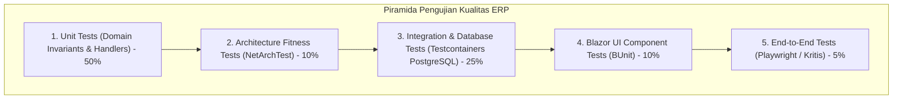

# Testing Strategy & Quality Assurance — Enterprise ERP System

> **Document Version:** 1.0.0  
> **Testing Frameworks:** xUnit | FluentAssertions | Testcontainers PostgreSQL | BUnit | NetArchTest  
> **Target Code Coverage:** $\ge 80\%$ on `ERP.Domain` and `ERP.Application`  
> **Related Documents:** [SOFTWARE_ARCHITECTURE.md](./SOFTWARE_ARCHITECTURE.md) | [CODING_STANDARDS.md](./CODING_STANDARDS.md) | [DEPLOYMENT_GUIDE.md](./DEPLOYMENT_GUIDE.md)

---

## 1. Piramida Pengujian Kualitas Perangkat Lunak (Testing Pyramid)

Untuk menjamin keandalan sistem berskala enterprise, strategi pengujian disusun dalam 5 tingkat piramida:



---

## 2. Rincian Proyek Pengujian (Test Projects Specification)

| Proyek Pengujian | Target Layer | Fokus Pengujian & Metodologi | Pustaka Utama |
| :--- | :--- | :--- | :--- |
| **`ERP.Domain.Tests`** | `ERP.Domain` | Menguji invarian bisnis murni: perhitungan valuasi persediaan, kalkulasi PPN/PPh, invarian jurnal seimbang, validasi nominal uang. Eksekusi ultra-cepat di memori. | `xUnit`, `FluentAssertions` |
| **`ERP.Application.Tests`** | `ERP.Application` | Menguji alur Use Case (Commands & Queries), validasi FluentValidation, mapping DTO, dan penanganan Result pattern dengan mocking repository. | `xUnit`, `NSubstitute`, `FluentValidation` |
| **`ERP.Architecture.Tests`** | Seluruh Solusi | Memverifikasi penegakan aturan arsitektur Clean Architecture dan Modular Monolith: tidak ada dependensi terlarang, penamaan handler konsisten. | `NetArchTest.Rules` |
| **`ERP.Infrastructure.Tests`** | `ERP.Infrastructure` | Pengujian integrasi terhadap database PostgreSQL nyata: pemetaan EF Core, eksekusi migrasi, SaveChanges audit interceptor, dan konkurensi token `xmin`. | `Testcontainers.PostgreSql`, `Respawn` |
| **`ERP.Web.Tests`** | `ERP.Web` | Menguji komponen antarmuka Blazor dan MudBlazor: rendering tabel data, binding form input, penanganan event klik, dan dialog konfirmasi. | `bUnit`, `MudBlazor` |

---

## 3. Pola Pengujian Unit Domain (Domain Unit Testing Pattern)

Pengujian domain berfokus pada validasi aturan bisnis tanpa melibatkan database:

```csharp
// Contoh Pengujian Invarian Jurnal Akuntansi di ERP.Domain.Tests
public class JournalEntryTests
{
    [Fact]
    public void Post_WithUnbalancedDebitAndCredit_ThrowsUnbalancedJournalException()
    {
        // Arrange
        var journal = JournalEntry.Create(
            companyId: Guid.NewGuid(),
            branchId: Guid.NewGuid(),
            journalNumber: "JV-202611-TEST-0001",
            journalDate: new DateOnly(2026, 11, 8),
            referenceType: "Manual",
            referenceNumber: "REF-001",
            description: "Jurnal Pembelian Barang",
            userId: Guid.NewGuid()
        );

        // Tambahkan baris Debit Rp 10.000.000 dan Kredit Rp 9.500.000 (Selisih Rp 500.000)
        journal.AddLine(accountId: Guid.NewGuid(), debit: 10_000_000m, credit: 0m, description: "Beban");
        journal.AddLine(accountId: Guid.NewGuid(), debit: 0m, credit: 9_500_000m, description: "Kas");

        // Act
        Action act = () => journal.Post(Guid.NewGuid(), DateTime.UtcNow);

        // Assert
        act.Should().Throw<UnbalancedJournalDomainException>()
            .WithMessage("*tidak seimbang*");
    }

    [Fact]
    public void Post_WithBalancedDebitAndCredit_SetsStatusToPosted()
    {
        // Arrange
        var journal = JournalEntry.Create(
            companyId: Guid.NewGuid(),
            branchId: Guid.NewGuid(),
            journalNumber: "JV-202611-TEST-0002",
            journalDate: new DateOnly(2026, 11, 8),
            referenceType: "Manual",
            referenceNumber: "REF-002",
            description: "Jurnal Pembelian Seimbang",
            userId: Guid.NewGuid()
        );

        journal.AddLine(accountId: Guid.NewGuid(), debit: 5_000_000m, credit: 0m, description: "Beban");
        journal.AddLine(accountId: Guid.NewGuid(), debit: 0m, credit: 5_000_000m, description: "Kas");

        // Act
        journal.Post(Guid.NewGuid(), DateTime.UtcNow);

        // Assert
        journal.Status.Should().Be("Posted");
        journal.TotalDebit.Should().Be(5_000_000m);
        journal.TotalCredit.Should().Be(5_000_000m);
    }
}
```

---

## 4. Pengujian Batas Arsitektur (Architecture Fitness Tests)

Menjamin bahwa pengembang lain tidak merusak batas Clean Architecture secara tidak sengaja:

```csharp
// Contoh Pengujian Penegakan Batas di ERP.Architecture.Tests
public class ArchitectureTests
{
    private static readonly Assembly DomainAssembly = typeof(BaseEntity<>).Assembly;
    private static readonly Assembly ApplicationAssembly = typeof(IApplicationDbContext).Assembly;
    private static readonly Assembly InfrastructureAssembly = typeof(ApplicationDbContext).Assembly;

    [Fact]
    public void Domain_ShouldNotHaveDependencyOnOtherProjects()
    {
        var result = Types.InAssembly(DomainAssembly)
            .ShouldNot()
            .HaveDependencyOnAny("ERP.Application", "ERP.Infrastructure", "ERP.Web")
            .GetResult();

        result.IsSuccessful.Should().BeTrue("Lapisan Domain tidak boleh bergantung pada lapisan luar!");
    }

    [Fact]
    public void Handlers_ShouldHaveNamesEndingWithHandler()
    {
        var result = Types.InAssembly(ApplicationAssembly)
            .That()
            .ImplementInterface(typeof(IRequestHandler<,>))
            .Should()
            .HaveNameEndingWith("Handler")
            .GetResult();

        result.IsSuccessful.Should().BeTrue("Seluruh MediatR handler harus berakhiran 'Handler'!");
    }
}
```

---

## 5. Pengujian Integrasi Database dengan Testcontainers

Pengujian dilakukan terhadap instans Docker PostgreSQL aktual yang dinyalakan secara dinamis selama pengujian:

```csharp
// Contoh Fixture Database Nyata di ERP.Infrastructure.Tests
public class DatabaseIntegrationTestFixture : IAsyncLifetime
{
    private readonly PostgreSqlContainer _dbContainer = new PostgreSqlBuilder()
        .WithImage("postgres:16-alpine")
        .WithDatabase("erp_test")
        .WithUsername("test_user")
        .WithPassword("test_pass")
        .Build();

    public async Task InitializeAsync()
    {
        await _dbContainer.StartAsync();
        // Jalankan EF Core Migrations otomatis pada kontainer uji
    }

    public async Task DisposeAsync()
    {
        await _dbContainer.StopAsync();
    }
}
```

---

## 6. Target Ambang Kualitas CI/CD (Quality Gates)

Setiap Pull Request (PR) wajib melewati gerbang kualitas berikut sebelum dapat dimerge ke branch `main`:
1. **Build Success:** Nol compiler error dan nol warning level kritis.
2. **Architecture Tests:** 100% lulus tanpa ada pelanggaran batas modul.
3. **Unit & Integration Tests:** 100% lulus seluruh skenario pengujian.
4. **Code Coverage:** Minimal **80%** untuk seluruh file di dalam `ERP.Domain` dan `ERP.Application`.

