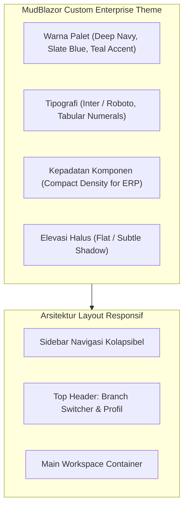

# UI/UX Design System & Guidelines (MudBlazor) — Enterprise ERP System

> **Document Version:** 1.0.0  
> **UI Framework:** Blazor Web App (Interactive Server) + MudBlazor 7.x/8.x  
> **Design Philosophy:** Clean Material Design Enterprise, High-Density Information, Sub-second Feedback  
> **Related Documents:** [SYSTEM_DESIGN.md](./SYSTEM_DESIGN.md) | [MODULE_SPECIFICATIONS.md](./MODULE_SPECIFICATIONS.md) | [CODING_STANDARDS.md](./CODING_STANDARDS.md)

---

## 1. Filosofi Desain & Standar Visual (Design System Foundation)

Aplikasi Enterprise ERP membutuhkan antarmuka yang mengutamakan **kejelasan informasi**, **kepadatan data yang efisien (*compact data density*)**, dan **kemudahan navigasi keyboard** untuk mempercepat input data harian oleh operator bisnis.



---

## 2. Palet Warna & Tema Korporat (Theme Configuration)

Konfigurasi tema MudBlazor disesuaikan untuk kenyamanan visual durasi kerja panjang:

```csharp
// Konfigurasi Tema MudBlazor di ERP.Web
public static class ErpTheme
{
    public static MudTheme EnterpriseTheme => new()
    {
        PaletteLight = new PaletteLight()
        {
            Primary = "#1E3A8A",          // Deep Corporate Blue
            Secondary = "#0F766E",        // Professional Teal
            Tertiary = "#475569",         // Slate Gray
            AppbarBackground = "#1E293B",  // Dark Slate Header
            Background = "#F8FAFC",        // Crisp Light Gray Background
            Surface = "#FFFFFF",           // Clean Card Surface
            DrawerBackground = "#0F172A",  // Obsidian Dark Sidebar
            DrawerText = "#E2E8F0",
            DrawerIcon = "#94A3B8",
            Success = "#16A34A",           // Emerald Green (Approved / Completed)
            Warning = "#D97706",           // Amber (Pending Approval / Due Soon)
            Error = "#DC2626",             // Crimson Red (Rejected / Overdue)
            Info = "#2563EB",              // Azure Blue (Draft / Informational)
            TextPrimary = "#0F172A",
            TextSecondary = "#475569"
        },
        LayoutProperties = new LayoutProperties()
        {
            DefaultBorderRadius = "6px"
        }
    };
}
```

---

## 3. Tata Letak Navigasi & Komponen Shell (Layout Architecture)

1. **Header Bar (Top AppBar):**
   - **Branch Switcher:** Dropdown seleksi cabang aktif pengguna dengan badge indikator kantor pusat.
   - **Universal Search:** Pintasan cepat (`Ctrl + K`) untuk melompat ke nomor dokumen atau menu aplikasi.
   - **Notification Bell:** Menampilkan hitungan pending approval dan notifikasi real-time via SignalR.
   - **User Profile Menu:** Foto profil, peran aktif, pengaturan 2FA, dan tombol Logout aman.
2. **Sidebar Navigasi (NavDrawer):**
   - Menu dikelompokkan secara logis ke dalam *NavGroups* yang dapat diperluas (*collapsible*):
     - Dashboard & BI
     - Master Data
     - Penjualan & Distribusi
     - Pengadaan & SCM
     - Logistik & Gudang
     - Keuangan & Akuntansi
     - Sumber Daya Manusia
     - Laporan & Dokumen
     - Tata Kelola & Pengaturan

---

## 4. Pola Form Input & Data Grid Standar Enterprise

### 4.1 Pola Header-Detail (Master-Detail Form Pattern)
Digunakan pada formulir transaksi multi-item (Sales Order, Purchase Order, Jurnal Umum):
- **Bagian Atas (Document Header Card):** Nomor dokumen (auto-generated), tanggal transaksi, nama mitra bisnis (Customer/Vendor autocomplete), cabang pembuat, dan catatan memo.
- **Bagian Tengah (Dynamic Items Grid):** Tabel baris transaksi dengan fitur:
  - Input SKU cepat dengan pencarian autocomplete (*MudAutocomplete*).
  - Validasi otomatis kuantitas $> 0$.
  - Format angka moneter dengan perataan kanan (*right-aligned tabular numerals*).
  - Tombol aksi: Tambah Baris, Hapus Baris, Duplikasi Baris.
- **Bagian Bawah (Financial Summary Card):** Subtotal, Diskon Transaksi, Kalkulasi Pajak PPN otomatis, dan Nilai Total Akhir berukuran tebal.
- **Bilah Aksi Tetap (Sticky Footer Actions):** Tombol "Simpan Draf", "Kirim Approval", "Cetak PDF", dan "Batal".

---

### 4.2 Standar MudTable dengan Paginasi Sisi Server (Server-Side DataTables)
Untuk tabel daftar data yang memiliki ribuan record:

```razor
<!-- Pola Server-Side Table MudBlazor di ERP.Web -->
<MudTable ServerData="LoadServerData" 
          Dense="true" 
          Hover="true" 
          Striped="true" 
          Elevation="1" 
          @ref="_table">
    <ToolBarContent>
        <MudText Typo="Typo.h6">Daftar Pesanan Penjualan</MudText>
        <MudSpacer />
        <!-- Search Input dengan Debounce 300ms -->
        <MudTextField T="string" 
                      ValueChanged="@(s => OnSearchChanged(s))" 
                      Placeholder="Cari Nomor SO / Customer..." 
                      Adornment="Adornment.Start" 
                      AdornmentIcon="@Icons.Material.Filled.Search" 
                      IconSize="Size.Medium" 
                      Class="mt-0" 
                      DebounceInterval="300" />
    </ToolBarContent>
    <HeaderContent>
        <MudTh><MudTableSortLabel SortLabel="OrderNumber" T="SalesOrderDto">Nomor SO</MudTableSortLabel></MudTh>
        <MudTh><MudTableSortLabel SortLabel="CustomerName" T="SalesOrderDto">Pelanggan</MudTableSortLabel></MudTh>
        <MudTh><MudTableSortLabel SortLabel="OrderDate" T="SalesOrderDto">Tanggal</MudTableSortLabel></MudTh>
        <MudTh Style="text-align:right">Total Nilai (IDR)</MudTh>
        <MudTh Style="text-align:center">Status</MudTh>
        <MudTh Style="text-align:center">Aksi</MudTh>
    </HeaderContent>
    <RowTemplate>
        <MudTd DataLabel="Nomor SO"><strong>@context.OrderNumber</strong></MudTd>
        <MudTd DataLabel="Pelanggan">@context.CustomerName</MudTd>
        <MudTd DataLabel="Tanggal">@context.OrderDate.ToString("dd MMM yyyy")</MudTd>
        <MudTd DataLabel="Total Nilai" Style="text-align:right">@context.TotalAmount.ToString("N2")</MudTd>
        <MudTd DataLabel="Status" Style="text-align:center">
            <StatusChip Status="@context.Status" />
        </MudTd>
        <MudTd Style="text-align:center">
            <MudIconButton Icon="@Icons.Material.Filled.Visibility" Size="Size.Small" OnClick="@(() => ViewDetail(context.Id))" />
        </MudTd>
    </RowTemplate>
    <NoRecordsContent>
        <MudText Align="Align.Center" Class="pa-4">Tidak ada transaksi yang cocok dengan kriteria pencarian.</MudText>
    </NoRecordsContent>
    <LoadingContent>
        <MudProgressLinear Color="Color.Primary" Indeterminate="true" Class="my-7" />
    </LoadingContent>
    <PagerContent>
        <MudTablePager RowsPerPageString="Baris per halaman:" PageSizeOptions="new int[] { 10, 25, 50, 100 }" />
    </PagerContent>
</MudTable>
```

---

## 5. Status Visual Transaksi (Status Chips & Visual Indicators)

Status dokumen ditampilkan menggunakan komponen `<MudChip>` dengan konvensi warna terstandarisasi:

| Status Transaksi | Varian Chip | Warna MudBlazor | Makna Bisnis |
| :--- | :---: | :---: | :--- |
| `Draft` | Outlined | `Color.Default` / Slate | Dokumen baru dibuat, belum ada efek jurnal/stok. |
| `Pending Approval` | Filled | `Color.Warning` / Amber | Menunggu persetujuan atasan/manajer. |
| `Approved` / `Confirmed` | Filled | `Color.Info` / Azure Blue | Telah disetujui, stok terkunci (*reserved*). |
| `Dispatched` / `Delivered`| Filled | `Color.Primary` / Deep Blue | Barang dalam perjalanan / telah tiba di tujuan. |
| `Posted` / `Paid` | Filled | `Color.Success` / Emerald | Transaksi finansial resmi dibukukan / tagihan lunas. |
| `Rejected` / `Cancelled` | Filled | `Color.Error` / Crimson | Dokumen ditolak atau dibatalkan resmi. |

---

## 6. Penanganan State Asinkron (Loading, Empty, & Error Boundaries)

1. **Loading State:**  
   Tombol submit form menggunakan properti `Processing="true"` dan menampilkan animasi spinner kecil saat operasi asinkron sedang dieksekusi di server untuk mencegah klik ganda (*double-submit*).
2. **Skeleton Screen:**  
   Halaman dashboard menggunakan komponen `<MudSkeleton SkeletonType="SkeletonType.Rectangle" />` selama data agregat awal dimuat ke memori.
3. **Empty State:**  
   Ketika tabel atau riwayat kosong, tampilkan ilustrasi ikon bersih, pesan penjelas, dan tombol pemicu aksi pertama (contoh: "Belum ada pesanan penjualan. Klik [Buat Pesanan Baru]").
4. **Global Error Boundary (`<MudErrorBoundary>`):**  
   Membungkus halaman utama sehingga jika terjadi crash pada satu komponen tabel, seluruh aplikasi tidak tertutup. Komponen menampilkan kartu error yang bersih dengan opsi tombol "Muat Ulang Komponen".

---

## 7. Standar Aksesibilitas (Accessibility & Usability)
- **Keyboard Navigation:** Seluruh input form dapat dinavigasi secara penuh menggunakan tombol `Tab`, `Shift + Tab`, dan `Enter`.
- **Contrast Ratios:** Rasio kontras teks terhadap latar belakang memenuhi standar **WCAG 2.1 AA** (rasio minimal 4.5:1 untuk teks biasa dan 3:1 untuk teks besar).
- **Format Numerik Lokal:** Seluruh tampilan angka uang menggunakan pemisah ribuan titik (`.`) dan desimal koma (`,`) standar format Indonesia (contoh: `Rp 12.500.000,00`).

