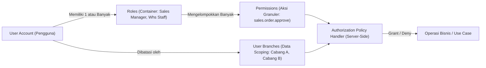

# User Roles, Permissions & Access Control (PBAC) — Enterprise ERP System

> **Document Version:** 1.0.0  
> **Target Framework:** ASP.NET Core Identity & Custom PBAC Engine  
> **Related Documents:** [SECURITY_DESIGN.md](./SECURITY_DESIGN.md) | [BUSINESS_RULES.md](./BUSINESS_RULES.md) | [MODULE_SPECIFICATIONS.md](./MODULE_SPECIFICATIONS.md)

---

## 1. Arsitektur Otorisasi: Permission-Based Access Control (PBAC)

Sistem ERP ini tidak hanya mengandalkan peran (*Role-Based Access Control / RBAC*) yang bersifat kaku, melainkan menggunakan pola **Permission-Based Access Control (PBAC)**:



### Konsep Inti:
1. **Roles adalah Kontainer Izin:** Role (misal: `FinanceManager`) hanyalah nama kelompok yang memuat sekumpulan *Permissions*.
2. **Evaluasi Berbasis Izin Spesifik:** Kode aplikasi tidak pernah mengecek `User.IsInRole("Admin")`, melainkan memeriksa permission spesifik, contoh:  
   `[RequirePermission(Permissions.Finance.JournalPost)]`.
3. **Data Access Scoping:** Hak akses fungsi dipadukan dengan batasan lokasi data. Seorang pengguna yang memiliki izin `inventory.stock.view` hanya dapat melihat stok pada cabang yang tercantum dalam profil akses cabangnya.

---

## 2. Daftar Peran Standar Enterprise (Standard Enterprise Roles)

| Kode Peran | Nama Peran | Cakupan Tanggung Jawab & Hak Istimewa |
| :--- | :--- | :--- |
| **`SUPER_ADMIN`** | Super Administrator | Pengelolaan teknis sistem, konfigurasi server, pemeliharaan role & permission, audit logs. Tidak dibatasi oleh cabang (*Bypass Branch Scoping*). |
| **`DIRECTOR`** | C-Level Executive / Direksi | Akses *Read-Only* komprehensif ke seluruh dashboard, laporan konsolidasi holding, analitik laba rugi, dan hak persetujuan (*Approval*) transaksi bernilai tinggi. |
| **`FIN_MGR`** | Finance & Accounting Manager | Otoritas penuh atas bagan akun (COA), penutupan buku periode fiskal, verifikasi 3-way matching, dan posting jurnal umum. |
| **`FIN_STAFF`** | Finance AP/AR Staff | Input transaksi pembayaran kas/bank, alokasi pelunasan piutang/utang, penerbitan draf faktur dan kuitansi. |
| **`SALES_MGR`** | Sales Commercial Manager | Persetujuan diskon khusus, konfirmasi Sales Order yang melebihi limit kredit, alokasi target penjualan, monitoring pipeline. |
| **`SALES_EXEC`** | Sales Executive | Pembuatan Sales Quotation, input Sales Order pelanggan, pelacakan status pengiriman dan faktur penjualan. |
| **`PROC_MGR`** | Procurement Manager | Persetujuan Purchase Request lintas departemen, penerbitan PO ke pemasok, negosiasi harga dan evaluasi vendor. |
| **`WHS_MGR`** | Warehouse & Logistics Manager| Otoritas persetujuan penyesuaian stok opname (*Stock Adjustment*), otorisasi transfer antar gudang, manajemen tata letak gudang. |
| **`WHS_STAFF`** | Warehouse Staff / Clerk | Input penerimaan fisik barang dari PO (GRN), pengecekan barang surat jalan pengiriman (DO), dan mutasi fisik. |
| **`HR_MGR`** | Human Resources Manager | Pengelolaan master karyawan, persetujuan cuti tingkat lanjut, kalkulasi dan posting batch penggajian bulanan (Payroll). |
| **`EMPLOYEE`** | Karyawan Standar | Akses layanan mandiri (*Employee Self-Service*): absensi harian, pengajuan cuti pribadi, dan pengunduhan slip gaji pribadi. |

---

## 3. Matriks Hak Akses Komprehensif (Permission Matrix)

Tabel berikut memetakan izin akses spesifik terhadap seluruh peran enterprise:

| Kode Permission | Modul / Aksi Fungsional | SUPER ADMIN | DIRECTOR | FIN MGR | FIN STAFF | SALES MGR | SALES EXEC | PROC MGR | WHS MGR | WHS STAFF | HR MGR | EMP |
| :--- | :--- | :---: | :---: | :---: | :---: | :---: | :---: | :---: | :---: | :---: | :---: | :---: |
| `security.users.manage` | Kelola Akun & Reset Password | ✅ | ❌ | ❌ | ❌ | ❌ | ❌ | ❌ | ❌ | ❌ | ❌ | ❌ |
| `security.roles.manage` | Kelola Role & Matriks Izin | ✅ | ❌ | ❌ | ❌ | ❌ | ❌ | ❌ | ❌ | ❌ | ❌ | ❌ |
| `security.audit.view` | Lihat Jejak Audit Lengkap | ✅ | ✅ | ❌ | ❌ | ❌ | ❌ | ❌ | ❌ | ❌ | ❌ | ❌ |
| `dashboard.executive.view`| Lihat KPI Keuangan & Omset | ✅ | ✅ | ✅ | ❌ | ✅ | ❌ | ❌ | ❌ | ❌ | ❌ | ❌ |
| `master.company.manage` | Kelola Entitas Perusahaan | ✅ | ❌ | ❌ | ❌ | ❌ | ❌ | ❌ | ❌ | ❌ | ❌ | ❌ |
| `master.product.manage` | Tambah/Edit Master Produk | ✅ | ❌ | ❌ | ❌ | ❌ | ❌ | ✅ | ✅ | ❌ | ❌ | ❌ |
| `master.customer.manage` | Kelola Pelanggan & Limit Kredit| ✅ | ❌ | ✅ | ❌ | ✅ | ✅ | ❌ | ❌ | ❌ | ❌ | ❌ |
| `master.supplier.manage` | Kelola Data Pemasok/Vendor | ✅ | ❌ | ✅ | ❌ | ❌ | ❌ | ✅ | ❌ | ❌ | ❌ | ❌ |
| `sales.quotation.create` | Buat & Kirim Penawaran Harga | ✅ | ❌ | ❌ | ❌ | ✅ | ✅ | ❌ | ❌ | ❌ | ❌ | ❌ |
| `sales.order.create` | Input Draf Pesanan Penjualan | ✅ | ❌ | ❌ | ❌ | ✅ | ✅ | ❌ | ❌ | ❌ | ❌ | ❌ |
| `sales.order.approve` | Konfirmasi & Rilis Sales Order | ✅ | ✅ | ❌ | ❌ | ✅ | ❌ | ❌ | ❌ | ❌ | ❌ | ❌ |
| `sales.delivery.dispatch`| Cetak & Rilis Surat Jalan (DO) | ✅ | ❌ | ❌ | ❌ | ❌ | ❌ | ❌ | ✅ | ✅ | ❌ | ❌ |
| `sales.invoice.issue` | Terbitkan Faktur Tagihan Penjualan| ✅ | ❌ | ✅ | ✅ | ❌ | ❌ | ❌ | ❌ | ❌ | ❌ | ❌ |
| `procurement.pr.create` | Buat Permintaan Pembelian (PR)| ✅ | ❌ | ✅ | ✅ | ✅ | ✅ | ✅ | ✅ | ✅ | ✅ | ❌ |
| `procurement.pr.approve` | Setujui Dokumen PR Departemen | ✅ | ✅ | ✅ | ❌ | ✅ | ❌ | ✅ | ✅ | ❌ | ✅ | ❌ |
| `procurement.po.create` | Terbitkan Pesanan Pembelian (PO)| ✅ | ❌ | ❌ | ❌ | ❌ | ❌ | ✅ | ❌ | ❌ | ❌ | ❌ |
| `procurement.po.approve` | Otorisasi PO ke Vendor | ✅ | ✅ | ✅ | ❌ | ❌ | ❌ | ✅ | ❌ | ❌ | ❌ | ❌ |
| `procurement.grn.receive` | Terima Barang Masuk dari PO | ✅ | ❌ | ❌ | ❌ | ❌ | ❌ | ❌ | ✅ | ✅ | ❌ | ❌ |
| `procurement.bill.verify`| Verifikasi 3-Way & Tagihan Vendor| ✅ | ❌ | ✅ | ✅ | ❌ | ❌ | ❌ | ❌ | ❌ | ❌ | ❌ |
| `inventory.stock.view` | Lihat Saldo & Kartu Stok Gudang | ✅ | ✅ | ✅ | ✅ | ✅ | ✅ | ✅ | ✅ | ✅ | ❌ | ❌ |
| `inventory.transfer.create`| Inisiasi Transfer Antar Gudang | ✅ | ❌ | ❌ | ❌ | ❌ | ❌ | ❌ | ✅ | ✅ | ❌ | ❌ |
| `inventory.adjustment.approve`| Setujui Selisih Stock Opname | ✅ | ✅ | ✅ | ❌ | ❌ | ❌ | ❌ | ✅ | ❌ | ❌ | ❌ |
| `finance.coa.manage` | Kelola Struktur Bagan Akun (COA)| ✅ | ❌ | ✅ | ❌ | ❌ | ❌ | ❌ | ❌ | ❌ | ❌ | ❌ |
| `finance.journal.create` | Input Entri Jurnal Umum | ✅ | ❌ | ✅ | ✅ | ❌ | ❌ | ❌ | ❌ | ❌ | ❌ | ❌ |
| `finance.journal.post` | Posting Permanen Jurnal Buku Besar| ✅ | ❌ | ✅ | ❌ | ❌ | ❌ | ❌ | ❌ | ❌ | ❌ | ❌ |
| `finance.payment.process`| Eksekusi Kas/Bank Masuk & Keluar | ✅ | ❌ | ✅ | ✅ | ❌ | ❌ | ❌ | ❌ | ❌ | ❌ | ❌ |
| `finance.period.close` | Kunci Periode Fiskal Bulanan | ✅ | ✅ | ✅ | ❌ | ❌ | ❌ | ❌ | ❌ | ❌ | ❌ | ❌ |
| `hr.employee.manage` | Kelola Data Biodata Karyawan | ✅ | ❌ | ❌ | ❌ | ❌ | ❌ | ❌ | ❌ | ❌ | ✅ | ❌ |
| `hr.attendance.manage` | Rekapitulasi Presensi & Lembur | ✅ | ❌ | ❌ | ❌ | ❌ | ❌ | ❌ | ❌ | ❌ | ✅ | ❌ |
| `hr.leave.approve` | Persetujuan Permohonan Cuti | ✅ | ✅ | ✅ | ❌ | ✅ | ❌ | ✅ | ✅ | ❌ | ✅ | ❌ |
| `hr.payroll.process` | Hitung & Posting Batch Payroll | ✅ | ❌ | ✅ | ❌ | ❌ | ❌ | ❌ | ❌ | ❌ | ✅ | ❌ |
| `hr.selfservice.view` | Akses Slip Gaji & Absensi Diri | ✅ | ✅ | ✅ | ✅ | ✅ | ✅ | ✅ | ✅ | ✅ | ✅ | ✅ |
| `reports.financial.view`| Buka Laporan Neraca & Laba Rugi | ✅ | ✅ | ✅ | ❌ | ❌ | ❌ | ❌ | ❌ | ❌ | ❌ | ❌ |
| `reports.export.data` | Ekspor Laporan ke Excel & PDF | ✅ | ✅ | ✅ | ✅ | ✅ | ✅ | ✅ | ✅ | ❌ | ✅ | ❌ |

---

## 4. Mekanisme Isolasi Data Cabang (Data Scoping Architecture)

Setiap permintaan query atau transaksi dievaluasi terhadap konteks cabang aktif pengguna:

```csharp
// Contoh Atribut Kebijakan dan Filter
public interface ICurrentUserService
{
    Guid UserId { get; }
    Guid CompanyId { get; }
    Guid ActiveBranchId { get; }
    bool IsHeadOffice { get; }
    IReadOnlyList<Guid> AllowedBranchIds { get; }
}
```

### Logika Penyaringan Query (EF Core Global Filter):
1. Jika pengguna berstatus `IsHeadOffice = true` atau memiliki peran `SUPER_ADMIN`: Pengguna dapat mengakses seluruh baris transaksi di perusahaan tersebut (`x.CompanyId == currentCompanyId`).
2. Jika pengguna adalah staf cabang lokal: Query otomatis menambahkan filter SQL:
   ```sql
   WHERE company_id = @CompanyId AND branch_id = @ActiveBranchId AND is_deleted = FALSE
   ```
3. Pengguna dilarang keras memalsukan atau menginjeksi `branch_id` lain melalui manipulasi form; nilai `branch_id` selalu diambil dari konteks sesi server yang terautentikasi.

