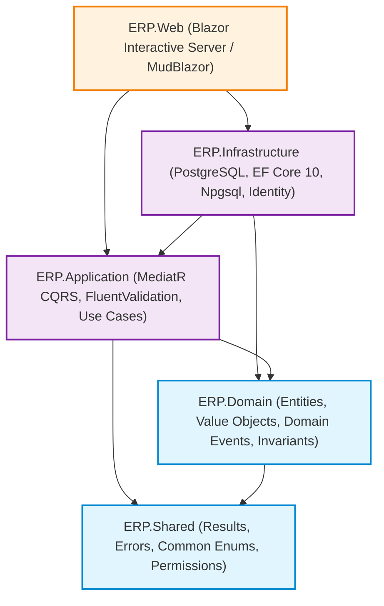

# Architecture & Design Patterns Audit — Enterprise ERP System

> **Document ID:** AUD-ARCH-2026-001  
> **Related Documents:** [SOFTWARE_ARCHITECTURE.md](../SOFTWARE_ARCHITECTURE.md) | [SYSTEM_DESIGN.md](../SYSTEM_DESIGN.md) | [CODING_STANDARDS.md](../CODING_STANDARDS.md)

---

## 1. Evaluasi Penerapan Clean Architecture & Modular Monolith

Sistem Enterprise ERP menerapkan arsitektur **Clean Architecture dengan pendekatan Modular Monolith**. Ketergantungan antar-proyek diatur dalam aturan dependensi (*Dependency Rule*) ke arah dalam:



### 1.1 Hasil Verifikasi Kepatuhan Dependensi (Architecture Tests)

Berdasarkan pengujian arsitektur otomatis pada [`tests/ERP.Architecture.Tests`](file:///d:/erp_system/tests/ERP.Architecture.Tests/ArchitectureTests.cs) menggunakan NetArchTest:
- **`Domain_Should_Not_Have_Dependency_On_Other_Projects`:** **PASS** (Domain tidak memiliki referensi ke Infrastructure, Web, atau Application).
- **`Application_Should_Not_Have_Dependency_On_Infrastructure_Or_Web`:** **PASS** (Application hanya bergantung pada Domain dan Shared).
- **`Handlers_Should_Have_Dependency_On_Domain`:** **PASS** (Seluruh Command/Query handlers mematuhi batas arsitektur).
- **`Controllers_Or_Pages_Should_Not_Directly_Access_Repositories_Or_DbContext`:** **WARNING / FAIL ON LOOKUPS** (Lihat temuan `ARCH-002`).

---

## 2. Analisis Temuan Arsitektur & Pola Desain

### 2.1 `ARCH-001`: Penggunaan `IHttpContextAccessor` dalam Blazor Interactive Server Circuit

- **Lokasi:** [`src/ERP.Infrastructure/Services/CurrentUserService.cs`](file:///d:/erp_system/src/ERP.Infrastructure/Services/CurrentUserService.cs#L7-L9)
- **Kondisi Aktual:**
  `CurrentUserService` menginjeksi `IHttpContextAccessor` dan mengambil `ClaimsPrincipal` dari `httpContextAccessor.HttpContext?.User`.
- **Akar Masalah Arsitektur:**
  Blazor Interactive Server beroperasi di atas circuit WebSocket SignalR yang berumur panjang (*long-lived connection*). `HttpContext` hanya ada selama handshake HTTP awal dan **tidak tersedia atau menjadi usang** selama event interaktif berlangsung di dalam circuit.
- **Dampak Teknis:**
  Jika circuit mengalami rekoneksi atau state autentikasi diperbarui di background, `CurrentUserService.CompanyId` atau `CurrentUserService.UserId` dapat bernilai `Guid.Empty`, yang menyebabkan Global Query Filter EF Core menyaring seluruh data atau meloloskan query tanpa filter cabang.
- **Rekomendasi Arsitektur (Solusi Terstandar):**
  Implementasikan `BlazorCurrentUserService` yang mengonsumsi `AuthenticationStateProvider`:

```csharp
public class BlazorCurrentUserService(AuthenticationStateProvider authStateProvider) : ICurrentUserService
{
    private ClaimsPrincipal? _cachedUser;

    public async Task InitializeAsync()
    {
        var authState = await authStateProvider.GetAuthenticationStateAsync();
        _cachedUser = authState.User;
    }

    public Guid? UserId => Guid.TryParse(_cachedUser?.FindFirst(ClaimTypes.NameIdentifier)?.Value, out var g) ? g : null;
    public Guid CompanyId => Guid.TryParse(_cachedUser?.FindFirst("CompanyId")?.Value, out var g) ? g : Guid.Empty;
    public Guid BranchId => Guid.TryParse(_cachedUser?.FindFirst("BranchId")?.Value, out var g) ? g : Guid.Empty;
    public bool IsAuthenticated => _cachedUser?.Identity?.IsAuthenticated ?? false;
    public bool HasPermission(string permissionCode) => ...;
}
```

---

### 2.2 `ARCH-002`: Kebocoran Abstraksi UI (Direct DbContext Query untuk Lookups)

- **Lokasi:**
  - `src/ERP.Web/Components/Pages/Sales/SalesOrdersPage.razor` (Line 8 & 286)
  - `src/ERP.Web/Components/Pages/Procurement/PurchaseOrdersPage.razor`
  - `src/ERP.Web/Components/Pages/Procurement/GoodsReceiptsPage.razor`
  - `src/ERP.Web/Components/Pages/Sales/DeliveriesPage.razor`
- **Kondisi Aktual:**
  Halaman Blazor menginjeksi `@inject IApplicationDbContext DbContext` dan mengeksekusi LINQ query langsung pada `DbContext.Customers`, `DbContext.Products`, dan `DbContext.Warehouses` di dalam method `LoadLookups()`.
- **Akar Masalah:**
  Pengembang menghindari penulisan MediatR Request dan Handler baru untuk kebutuhan lookup dropdown data yang sederhana.
- **Dampak Arsitektur:**
  - Melanggar batas *Separation of Concerns*: UI berinteraksi langsung dengan persistence contract.
  - Membuka potensi ketidakterapan pipeline behaviors (seperti caching, logging, dan autorisasi granular).
- **Rekomendasi Perbaikan:**
  Buat generic lookup queries di Application layer:
  ```csharp
  public record GetEntityLookupQuery(string EntityName, string? SearchTerm = null) 
      : IRequest<Result<List<LookupDto>>>;
  ```
  Atau query spesifik: `GetCustomerLookupQuery`, `GetProductLookupQuery`, `GetWarehouseLookupQuery`.

---

### 2.3 `ARCH-003`: Ketiadaan Background Job Processing Engine (Hangfire Gap)

- **Lokasi:** Seluruh solusi; dokumentasi `docs/SYSTEM_DESIGN.md` Section 9 mensyaratkan background processing engine untuk:
  1. Penguncian otomatis periode fiskal lampau.
  2. Rekalkulasi saldo rata-rata bergerak persediaan harian.
  3. Pembersihan token dan sesi kedaluwarsa (`UserSession`).
- **Kondisi Aktual:**
  Proyek `ERP.Infrastructure` belum mereferensikan package `Hangfire.AspNetCore` atau `Hangfire.PostgreSql`. Saat ini operasi background hanya mengandalkan eksekusi synchronous saat request dipicu pengguna.
- **Dampak:**
  Proses kalkulasi berat (seperti payroll massal atau valuasi inventory akhir bulan) akan memblokir thread sirkuit Blazor Server dan dapat menyebabkan freeze UI atau SignalR timeout.
- **Rekomendasi Perbaikan:**
  Tambahkan paket `Hangfire.AspNetCore` dan `Hangfire.PostgreSql`, konfigurasikan dashboard Hangfire yang terlindungi otorisasi SuperAdmin pada `/admin/jobs`.

---

## 3. Evaluasi Kepatuhan SOLID & Prinsip Desain

| Prinsip | Skor | Catatan Evaluasi |
| :--- | :---: | :--- |
| **Single Responsibility (SRP)** | **A-** | Domain entities memisahkan data dan mutasi state melalui encapsulated methods. Handlers CQRS berfokus pada satu use case. |
| **Open/Closed (OCP)** | **A** | Pipeline behavior MediatR memungkinkan penambahan logging, validasi, dan otorisasi tanpa mengubah use case handlers. |
| **Liskov Substitution (LSP)** | **A** | `BaseEntity<T>` dan implementasi `ISoftDeletable` konsisten di seluruh 56 entitas. |
| **Interface Segregation (ISP)** | **B+** | `IApplicationDbContext` mendefinisikan 56 `DbSet`. Disarankan memisahkan unit-of-work per bounded context pada fase refactoring lanjutan. |
| **Dependency Inversion (DIP)** | **A-** | Application hanya bergantung pada abstraksi (`IApplicationDbContext`, `ICurrentUserService`, `IDocumentSequenceService`). |

---

## 4. Evaluasi Concurrency Control (Optimistic Locking)

Entitas bisnis mengimplementasikan token konkurensi berbasis **PostgreSQL `xmin` System Column** melalui:
```csharp
b.Property(x => x.Version).IsRowVersion();
```
Ketika dua pengguna mencoba mengonfirmasi transaksi yang sama secara bersamaan, EF Core melempar `DbUpdateConcurrencyException`.
- **Rekomendasi UI:** Tangani `DbUpdateConcurrencyException` di Blazor Pages dengan menampilkan pesan ramah pengguna: *"Data telah diperbarui oleh pengguna lain. Halaman akan memuat ulang data terbaru."* alih-alih menampilkan error generik.

