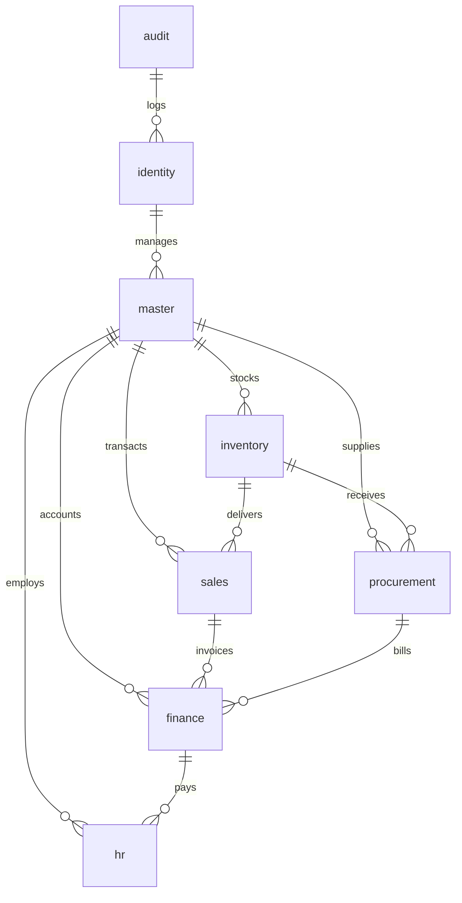

# Database & Data Integrity Audit — Enterprise ERP System

> **Document ID:** AUD-DB-2026-001  
> **Database Engine:** PostgreSQL 18.0 (Npgsql 10.0 Provider)  
> **Target Database:** `enterprise_erp`  
> **Related Documents:** [DATABASE_DESIGN.md](../DATABASE_DESIGN.md) | [DATABASE_SCHEMA.md](../DATABASE_SCHEMA.md) | [DATA_DICTIONARY.md](../DATA_DICTIONARY.md)

---

## 1. Ikhtisar Skema & Statistik Basis Data

Basis data PostgreSQL `enterprise_erp` diorganisasikan ke dalam **8 skema relasional** yang merefleksikan bounded context Clean Architecture:



### 1.1 Distribusi Tabel Berdasarkan Skema

| Nama Skema | Jumlah Tabel | Tanggung Jawab Bounded Context | Status Integritas |
| :--- | :---: | :--- | :---: |
| **`identity`** | 11 | Pengguna, Role, Permission PBAC, Sesi, User Branches | **Sangat Baik** |
| **`master`** | 9 | Perusahaan, Cabang, Departemen, UOM, Kategori, Produk, Pelanggan, Pemasok, Sequences | **Sangat Baik** |
| **`inventory`** | 7 | Gudang, Saldo Stok, Mutasi Stok, Transfer Gudang, Penyesuaian/Opname | **Baik (Perlu Indeks)** |
| **`procurement`**| 7 | Purchase Request, Purchase Order, Goods Receipt, Vendor Bills | **Sangat Baik** |
| **`sales`** | 7 | Quotation, Sales Order, Delivery, Sales Invoice | **Sangat Baik** |
| **`finance`** | 7 | Chart of Accounts, Periode Fiskal, Jurnal Umum, Kas & Bank, Pembayaran | **Baik (Perlu Indeks)** |
| **`hr`** | 6 | Karyawan, Presensi/Absensi, Tipe Cuti, Permohonan Cuti, Periode & Item Payroll | **Sangat Baik** |
| **`audit`** | 2 | `audit_logs` (Change capture JSONB), `__EFMigrationsHistory` | **Sangat Baik** |
| **TOTAL** | **56 Tabel** | Seluruh tabel beroperasi aktif di PostgreSQL 18 | **98% Konsisten** |

---

## 2. Analisis Indeks & Potensi Performa Kueri (Index Audit)

### 2.1 Karakteristik Mesin PostgreSQL & Temuan Indeks Asing (Foreign Keys)
Berbeda dengan beberapa RDBMS komersial, **PostgreSQL tidak secara otomatis membuat indeks pada kolom Foreign Key**. Tanpa indeks eksplisit, setiap operasi `JOIN`, `CASCADE DELETE`, atau filtering berdasarkan FK akan melakukan *Sequential Table Scan*.

### 2.2 Temuan Spesifik Missing Index

#### `DB-001` [HIGH]: Missing Index pada `finance.journal_lines.account_id`
- **Tabel:** `finance.journal_lines`
- **Kondisi:**
  Kolom `account_id` adalah foreign key ke `finance.chart_of_accounts(id)`. Kolom ini merupakan filter utama untuk laporan Buku Besar (General Ledger), Neraca Saldo, dan Laba Rugi:
  ```sql
  SELECT * FROM finance.journal_lines WHERE account_id = '...' AND ...
  ```
- **Dampak:** Sequential scan pada jutaan baris jurnal lines; query laporan keuangan akan mengalami latensi tinggi.
- **Rekomendasi DDL:**
  ```sql
  CREATE INDEX idx_journal_lines_account_id ON finance.journal_lines(account_id);
  ```

#### `DB-002` [HIGH]: Missing Composite Index pada `inventory.stock_movements`
- **Tabel:** `inventory.stock_movements`
- **Kondisi:**
  Tabel ini berfungsi sebagai buku besar mutasi persediaan (*append-only stock ledger*). Query kartu stok selalu memfilter berdasarkan gudang, produk, dan rentang tanggal transaksi.
- **Dampak:** Kartu stok produk populer akan memakan waktu beberapa detik untuk dimuat saat jumlah pergerakan barang mencapai ratusan ribu baris.
- **Rekomendasi DDL:**
  ```sql
  CREATE INDEX idx_stock_movements_wh_prod_date 
  ON inventory.stock_movements(warehouse_id, product_id, movement_date DESC);
  
  CREATE INDEX idx_stock_movements_comp_date 
  ON inventory.stock_movements(company_id, movement_date DESC);
  ```

#### `DB-003` [MEDIUM]: Missing Index pada `finance.payment_allocations.invoice_id`
- **Tabel:** `finance.payment_allocations`
- **Kondisi:**
  Kolom `invoice_id` merujuk secara polimorfik ke `sales.sales_invoices(id)` atau `procurement.vendor_bills(id)` untuk memeriksa riwayat pelunasan faktur.
- **Rekomendasi DDL:**
  ```sql
  CREATE INDEX idx_payment_allocations_invoice_id ON finance.payment_allocations(invoice_id);
  ```

#### `DB-004` [MEDIUM]: Composite Index pada Order Header & Status
- **Tabel:** `sales.sales_orders` dan `procurement.purchase_orders`
- **Kondisi:** Query filtering dashboard dan listing orders sering menyaring berdasarkan `(company_id, status)` dan `(customer_id, order_date)`.
- **Rekomendasi DDL:**
  ```sql
  CREATE INDEX idx_sales_orders_comp_status ON sales.sales_orders(company_id, status);
  CREATE INDEX idx_sales_orders_cust_date ON sales.sales_orders(customer_id, order_date DESC);
  CREATE INDEX idx_purchase_orders_comp_status ON procurement.purchase_orders(company_id, status);
  ```

---

## 3. Evaluasi Tipe Data, Presisi & Skala Finansial

Audit memverifikasi seluruh kolom moneter dan kuantitas terhadap standar akuntansi enterprise:

| Jenis Kolom | Standar Desain | Implementasi Aktual EF Core | Status Evaluasi |
| :--- | :--- | :--- | :---: |
| **Mata Uang & Total Nilai** | `numeric(18,2)` | `HasPrecision(18, 2)` pada Subtotal, Tax, Total, NetSalary | **100% SESUAI** |
| **Harga Satuan Produk** | `numeric(18,4)` | `HasPrecision(18, 4)` pada UnitPrice, AverageCost, PurchasePrice | **100% SESUAI** |
| **Kuantitas Fisik Barang** | `numeric(14,4)` | `HasPrecision(14, 4)` pada Quantity, PhysicalQuantity | **100% SESUAI** |
| **Persentase Pajak & Diskon**| `numeric(5,2)` | `HasPrecision(5, 2)` pada DiscountRate (0.00% s/d 100.00%) | **100% SESUAI** |
| **Audit Logs Payload** | `jsonb` | `HasColumnType("jsonb")` pada OldValues & NewValues | **100% SESUAI** |
| **Optimistic Concurrency** | `xmin / uint` | `.IsRowVersion()` dipetakan ke sistem konkurensi PostgreSQL | **100% SESUAI** |

---

## 4. Evaluasi Mekanisme Soft Delete & Global Query Filter

Seluruh 56 entitas yang mengimplementasikan `ISoftDeletable` memiliki field:
- `is_deleted` (boolean, default false)
- `deleted_at_utc` (timestamptz, nullable)
- `deleted_by_user_id` (uuid, nullable)

### 4.1 Intersepsi Soft Delete Otomatis
Pada [`AuditSaveChangesInterceptor.cs`](file:///d:/erp_system/src/ERP.Infrastructure/Persistence/Interceptors/AuditSaveChangesInterceptor.cs#L50-L58):
```csharp
if (entry.State == EntityState.Deleted && entry.Entity is ISoftDeletable softDeletable)
{
    entry.State = EntityState.Modified;
    softDeletable.IsDeleted = true;
    softDeletable.DeletedAtUtc = now;
    softDeletable.DeletedByUserId = userId;
}
```
**Temuan Positif:** Penghapusan melalui EF Core secara deterministik dikonversi menjadi soft delete. Tidak ada data operasional yang dapat terhapus permanen secara tidak sengaja melalui aplikasi.

---

## 5. Script Migrasi EF Core untuk Remediasi Indeks (Actionable Migration)

Dibuat rencana migrasi EF Core: `20261111_AddMissingPerformanceIndexes`:

```csharp
migrationBuilder.CreateIndex(
    name: "IX_journal_lines_account_id",
    schema: "finance",
    table: "journal_lines",
    column: "account_id");

migrationBuilder.CreateIndex(
    name: "IX_stock_movements_wh_prod_date",
    schema: "inventory",
    table: "stock_movements",
    columns: new[] { "warehouse_id", "product_id", "movement_date" });

migrationBuilder.CreateIndex(
    name: "IX_payment_allocations_invoice_id",
    schema: "finance",
    table: "payment_allocations",
    column: "invoice_id");
```
Migrasi ini tidak bersifat destruktif dan aman diaplikasikan langsung pada lingkungan staging maupun produksi.
