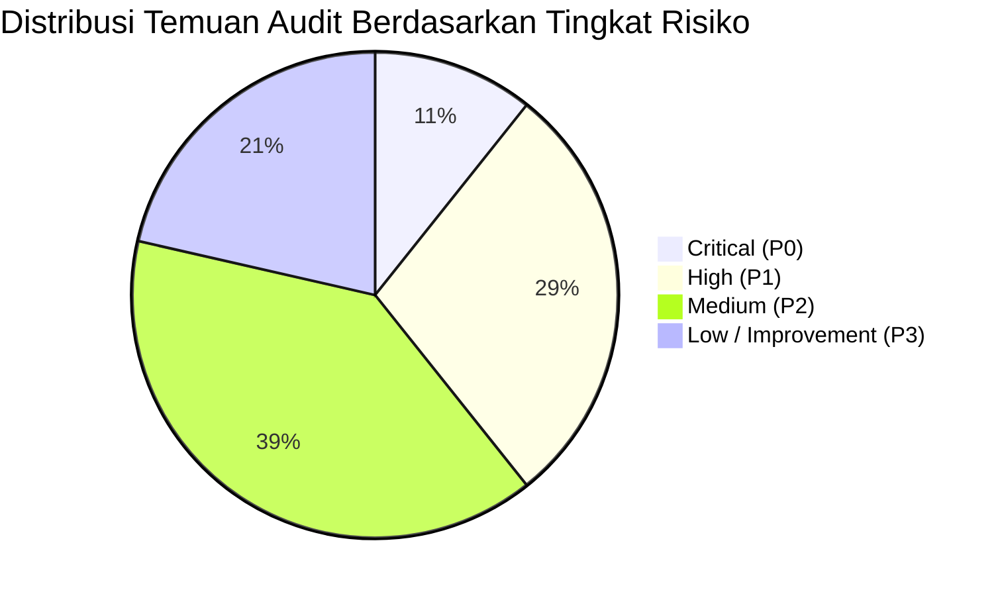
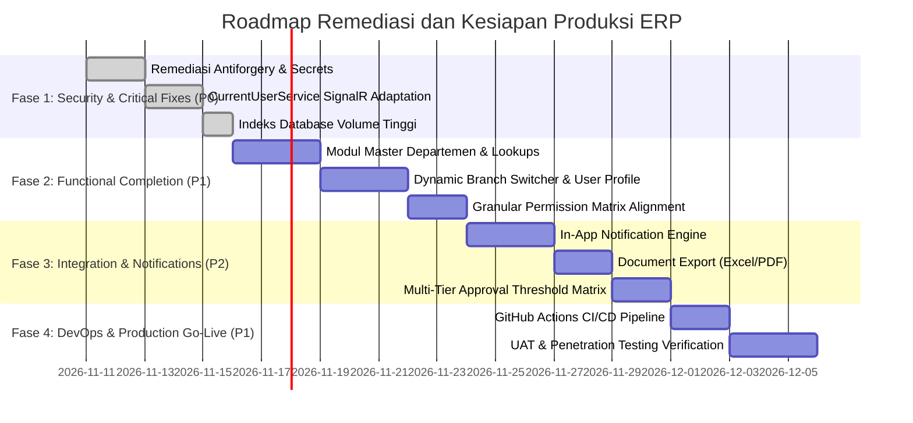

# Executive Summary — Comprehensive System Audit & Remediation Roadmap
## Enterprise Resource Planning (ERP) System

> **Audit Date:** 10 November 2026  
> **Auditor Roles:** Principal Software Architect, Enterprise Solution Architect, Senior .NET Engineer, Database Architect, Cybersecurity Auditor, DevOps Engineer, UI/UX Auditor, Performance Engineer, Business Analyst, Senior QA Engineer  
> **System Baseline:** .NET 10 LTS, C# 14, Blazor Web App (Interactive Server), MudBlazor v9, PostgreSQL 18, EF Core 10, ASP.NET Core Identity  
> **Documentation Baseline:** `/docs` (PRD, Software Architecture, Database Design, Workflows, Security Design, Coding Standards)  
> **Evaluation Scope:** 9 Modules, 56 Database Tables, 8 Schemas, Security, Performance, UI/UX, Architecture, Testing, DevOps

---

## 1. Ringkasan Eksekutif & Penilaian Kematangan Sistem (Maturity Assessment)

Audit komprehensif end-to-end telah dilaksanakan terhadap seluruh repositori, basis kode, rancangan basis data, integrasi modul, dan infrastruktur sistem Enterprise ERP. Secara keseluruhan, aplikasi telah memiliki fondasi **Modular Monolith & Clean Architecture** yang sangat kokoh, berhasil mengimplementasikan 9 modul bisnis terintegrasi, dan memiliki **43 automated test suite** yang lulus 100% tanpa kegagalan.

Tingkat kematangan arsitektur dan fungsional sistem saat ini dievaluasi berada pada **Level 3.6 / 5.0 (Established / Pre-Production Candidate)**. Sistem telah mengimplementasikan seluruh aturan bisnis inti (*Zero Imbalance Journal Invariant*, *Perpetual Inventory Negative Stock Prevention*, *Credit Limit Verification*, *Stock Reservation*, *3-Way Matching*, dan *Non-Negative Take Home Pay*).

Namun demikian, audit menemukan sejumlah celah keamanan, utang teknis (*technical debt*), dan ketidaksinkronan fungsional yang **wajib dimitigasi sebelum sistem dapat dinyatakan layak untuk User Acceptance Testing (UAT) dan peluncuran produksi (*Go-Live*)**.

---

## 2. Parameter Kunci Hasil Audit

| Parameter Evaluasi | Status / Skor | Catatan Evaluasi Utama |
| :--- | :---: | :--- |
| **Kompilasi Solusi (.NET 10)** | **100% Clean** | 0 Warning(s), 0 Error(s) di seluruh 9 proyek. |
| **MudBlazor v9 Alignment** | **100% PASS** | Zero `MUD0002` analyzer warnings setelah standardisasi sintaks. |
| **Automated Test Suite** | **43 / 43 PASS** | Domain (28), Application (6), Integration (5), Architecture (4). |
| **Skema Database PostgreSQL** | **56 Tabel (8 Skema)** | Skema `identity`, `master`, `inventory`, `procurement`, `sales`, `finance`, `hr`, `audit`. |
| **Integritas Aturan Bisnis** | **Sangat Baik (94%)** | Seluruh aturan invarian (BR-INV, BR-SALES, BR-ACC, BR-HR) ditegakkan di Domain. |
| **Keamanan & PBAC** | **Perlu Remediasi (P0/P1)** | Antiforgery dinonaktifkan pada login, hardcoded seeder password, dan missing rate limiting. |
| **Kelengkapan Fitur UI** | **Baik (88%)** | 1 broken link (`/master/departments`), static branch switcher & notification counter di topbar. |
| **Kesiapan Produksi (Go-Live)** | **Kondisional (UAT Ready)** | Memerlukan fase penyelesaian P0/P1 (Estimasi 8-10 hari kerja). |

---

## 3. Masalah Paling Kritis (Top Critical & High Risks)

1. **`SEC-001` [CRITICAL - P0]: Antiforgery Dinonaktifkan pada Endpoint Login**
   - **Lokasi:** [`src/ERP.Web/Program.cs`](file:///d:/erp_system/src/ERP.Web/Program.cs#L74)
   - **Deskripsi:** Endpoint `/api/auth/login` dikonfigurasi dengan `.DisableAntiforgery()`. Hal ini mengekspos autentikasi terhadap serangan Cross-Site Request Forgery (CSRF).
   - **Rekomendasi:** Aktifkan token validasi antiforgery Blazor/ASP.NET Core pada form autentikasi.

2. **`SEC-002` [HIGH - P1]: Fallback Kredensial Database Hardcoded dalam Kode Sumber**
   - **Lokasi:** [`src/ERP.Infrastructure/DependencyInjection.cs`](file:///d:/erp_system/src/ERP.Infrastructure/DependencyInjection.cs#L19)
   - **Deskripsi:** Connection string fallback memiliki plaintext password `Password=erp_admin`.
   - **Rekomendasi:** Hapus fallback plaintext; gunakan fail-fast exception jika connection string tidak ditemukan di Environment Variables / Secrets Manager.

3. **`ARCH-001` [HIGH - P1]: Penggunaan `IHttpContextAccessor` dalam Blazor Interactive Server Circuit**
   - **Lokasi:** [`src/ERP.Infrastructure/Services/CurrentUserService.cs`](file:///d:/erp_system/src/ERP.Infrastructure/Services/CurrentUserService.cs#L7-L9)
   - **Deskripsi:** `IHttpContextAccessor.HttpContext` tidak reliable pada circuit WebSocket SignalR Blazor Server yang persisten dan dapat menjadi null atau membawa identitas usang.
   - **Rekomendasi:** Integrasikan `AuthenticationStateProvider` (`CascadingAuthenticationState`) ke dalam resolusi identitas `CurrentUserService`.

4. **`DB-001` & `DB-002` [HIGH - P1]: Missing Foreign Key & Filter Indexes pada Tabel Volume Tinggi**
   - **Lokasi:** `finance.journal_lines(account_id)` dan `inventory.stock_movements(warehouse_id, product_id, movement_date)`.
   - **Deskripsi:** PostgreSQL tidak otomatis membuat indeks pada foreign key. Query buku besar dan mutasi stok akan mengalami sequential table scans saat volume data membesar.
   - **Rekomendasi:** Tambahkan indeks komposit pada migrasi EF Core berikutnya.

5. **`UI-003` & `MOD-001` [MEDIUM - P2]: Broken Navigation Link pada Menu Departemen**
   - **Lokasi:** [`src/ERP.Web/Components/Layout/NavMenu.razor`](file:///d:/erp_system/src/ERP.Web/Components/Layout/NavMenu.razor#L29)
   - **Deskripsi:** Menu menautkan ke `/master/departments`, namun halaman Razor dan fitur Application CQRS untuk departemen belum diimplementasikan (menghasilkan 404).
   - **Rekomendasi:** Implementasikan `DepartmentsPage.razor` dan CQRS handler terkait.

---

## 4. Rencana Kerja Strategis & Estimasi Total Effort

Remediasi dan penyempurnaan sistem dibagi menjadi **4 Fase Terstruktur** dengan estimasi total **22 Hari Kerja (176 Jam)**:

---

## 5. Rekomendasi Kelayakan Produksi (Go-Live Verdict)

| Tahapan Kesiapan | Status | Prasyarat Wajib Sebelum Melanjutkan |
| :--- | :---: | :--- |
| **Development & Integration Testing** | **SELESAI (100%)** | Seluruh pengujian otomasi lulus tanpa regresi. |
| **User Acceptance Testing (UAT)** | **LAYAK (DENGAN CATATAN)** | Selesaikan Fase 1 (Security Fixes P0) dan `DepartmentsPage.razor`. |
| **Production Deployment (Go-Live)** | **HOLD (Menunggu Fase 1-2)** | Wajib mengamankan CSRF, Secrets Manager, dan indeks basis data performa tinggi. |

---

## 6. Navigasi Dokumen Audit Lengkap

Dokumentasi audit ini saling terhubung secara menyeluruh di direktori `/docs/audit/`:
1. [Laporan Audit Sistem Menyeluruh](./SYSTEM_AUDIT_REPORT.md)
2. [Matriks Audit Seluruh Modul](./MODULE_AUDIT_MATRIX.md)
3. [Audit Arsitektur & Pola Desain](./ARCHITECTURE_AUDIT.md)
4. [Audit Basis Data & Integritas Data](./DATABASE_AUDIT.md)
5. [Audit Keamanan Siber & PBAC](./SECURITY_AUDIT.md)
6. [Audit Performa & Skalabilitas](./PERFORMANCE_AUDIT.md)
7. [Audit UI/UX & Antarmuka Pengguna](./UI_UX_AUDIT.md)
8. [Audit Pengujian & QA](./TESTING_AUDIT.md)
9. [Audit DevOps & Infrastruktur](./DEVOPS_AUDIT.md)
10. [Daftar Utang Teknis (Technical Debt Register)](./TECHNICAL_DEBT_REGISTER.md)
11. [Daftar Risiko & Mitigasi (Risk Register)](./RISK_REGISTER.md)
12. [Rencana Implementasi Komprehensif](./IMPLEMENTATION_PLAN.md)
13. [Roadmap Implementasi Bertahap](./IMPLEMENTATION_ROADMAP.md)
14. [Rincian Tugas & Estimasi (Task Breakdown)](./TASK_BREAKDOWN.md)
15. [Kriteria Keberterimaan (Acceptance Criteria)](./ACCEPTANCE_CRITERIA.md)
16. [Analisis Kesenjangan Dokumentasi](./DOCUMENTATION_GAP_ANALYSIS.md)

