# Comprehensive Implementation Plan — Enterprise ERP Remediation

> **Document ID:** AUD-PLAN-2026-001  
> **Related Documents:** [TASK_BREAKDOWN.md](./TASK_BREAKDOWN.md) | [IMPLEMENTATION_ROADMAP.md](./IMPLEMENTATION_ROADMAP.md) | [ACCEPTANCE_CRITERIA.md](./ACCEPTANCE_CRITERIA.md)

---

## 1. Pendekatan & Metodologi Implementasi

Rencana implementasi dirancang untuk mengatasi seluruh temuan audit secara terstruktur, memprioritaskan keamanan dan stabilitas fondasi sebelum melakukan penyempurnaan fitur bisnis dan antarmuka pengguna:

```mermaid
flowchart LR
    F1["Fase 1: Keamanan & Perbaikan Kritis (P0)"] --> F2["Fase 2: Basis Data & Arsitektur (P1)"]
    F2 --> F3["Fase 3: Kelengkapan Fungsional (P1/P2)"]
    F3 --> F4["Fase 4: Antarmuka UI/UX & Otomasi QA (P2)"]
    F4 --> F5["Fase 5: Kesiapan DevOps & Go-Live (P1)"]

    classDef f1 fill:#ffebee,stroke:#c62828,stroke-width:2px;
    classDef f2 fill:#fff3e0,stroke:#ef6c00,stroke-width:2px;
    classDef f3 fill:#e8f5e9,stroke:#2e7d32,stroke-width:2px;
    classDef f4 fill:#e1f5fe,stroke:#0277bd,stroke-width:2px;
    classDef f5 fill:#f3e5f5,stroke:#6a1b9a,stroke-width:2px;

    class F1 f1;
    class F2 f2;
    class F3 f3;
    class F4 f4;
    class F5 f5;
```

---

## 2. Struktur Pembagian Fase & Rincian Tugas

### Fase 1: Keamanan & Perbaikan Kritis (Critical Security Remediation — P0)
**Fokus Utama:** Menutup kerentanan otentikasi, menegakkan proteksi CSRF, dan membersihkan secret hardcoded.

| Task ID | Nama Tugas | Modul Terdampak | Dependensi | Kompleksitas | Estimasi Effort | Status Awal |
| :--- | :--- | :--- | :---: | :---: | :---: | :---: |
| `TSK-SEC-01` | Remediasi Antiforgery pada Endpoint Login | `ERP.Web` | - | Rendah | 4 Jam | Not Started |
| `TSK-SEC-02` | Hapus Plaintext Connection String Fallback | `ERP.Infrastructure` | - | Rendah | 2 Jam | Not Started |
| `TSK-SEC-03` | Implementasi Rate Limiting pada Login Endpoint | `ERP.Web` | `TSK-SEC-01` | Sedang | 4 Jam | Not Started |
| `TSK-SEC-04` | Konfigurasi Seeding Password Dinamis via Env | `ERP.Infrastructure` | `TSK-SEC-02` | Rendah | 3 Jam | Not Started |

---

### Fase 2: Performa Basis Data & Arsitektur Fondasi (P1)
**Fokus Utama:** Mengeliminasi sequential scans pada PostgreSQL dan memastikan stabilitas state SignalR circuit.

| Task ID | Nama Tugas | Modul Terdampak | Dependensi | Kompleksitas | Estimasi Effort | Status Awal |
| :--- | :--- | :--- | :---: | :---: | :---: | :---: |
| `TSK-ARCH-01` | Migrasi `CurrentUserService` ke `AuthenticationStateProvider` | `ERP.Infrastructure` | `TSK-SEC-01` | Sedang | 6 Jam | Not Started |
| `TSK-DB-01` | Tambahkan Indeks `finance.journal_lines(account_id)` | `ERP.Infrastructure` | - | Rendah | 2 Jam | Not Started |
| `TSK-DB-02` | Tambahkan Indeks Komposit `inventory.stock_movements` | `ERP.Infrastructure` | - | Rendah | 2 Jam | Not Started |
| `TSK-DB-03` | Tambahkan Indeks `payment_allocations(invoice_id)` | `ERP.Infrastructure` | - | Rendah | 2 Jam | Not Started |
| `TSK-DB-04` | Tambahkan Indeks Filter Header `sales_orders` & `purchase_orders` | `ERP.Infrastructure` | - | Rendah | 2 Jam | Not Started |
| `TSK-ARCH-03` | Integrasi Background Job Processing Engine (Hangfire) | `ERP.Infrastructure`, `ERP.Web` | `TSK-DB-01` | Tinggi | 10 Jam | Not Started |

---

### Fase 3: Kelengkapan Fungsional & Integrasi Lintas Modul (P1 / P2)
**Fokus Utama:** Melengkapi fitur departemen, engine notifikasi, dan ekspor dokumen.

| Task ID | Nama Tugas | Modul Terdampak | Dependensi | Kompleksitas | Estimasi Effort | Status Awal |
| :--- | :--- | :--- | :---: | :---: | :---: | :---: |
| `TSK-FUNC-01` | Implementasi CQRS & Entity Use Cases Departemen | `ERP.Application`, `ERP.Domain` | - | Sedang | 6 Jam | Not Started |
| `TSK-UI-01` | Pembuatan Halaman `DepartmentsPage.razor` | `ERP.Web` | `TSK-FUNC-01` | Sedang | 6 Jam | Not Started |
| `TSK-SEC-05` | Perluasan Matriks Izin Granular (`View` Permissions) | `ERP.Shared`, `ERP.Application` | - | Sedang | 6 Jam | Not Started |
| `TSK-FUNC-02` | Implementasi Engine Notifikasi In-App & Email | `ERP.Infrastructure`, `ERP.Application` | `TSK-ARCH-03` | Tinggi | 14 Jam | Not Started |
| `TSK-FUNC-03` | Implementasi Generator Ekspor Excel (xlsx) & PDF | `ERP.Application`, `ERP.Web` | - | Sedang | 10 Jam | Not Started |
| `TSK-FUNC-04` | Matriks Limit Otorisasi Persetujuan Pembelian (PO) | `ERP.Domain`, `ERP.Application` | `TSK-SEC-05` | Sedang | 8 Jam | Not Started |

---

### Fase 4: Penyempurnaan Antarmuka UI/UX & Otomasi QA (P2)
**Fokus Utama:** Mengeliminasi inkonsistensi antarmuka pengguna dan membangun test suite UI.

| Task ID | Nama Tugas | Modul Terdampak | Dependensi | Kompleksitas | Estimasi Effort | Status Awal |
| :--- | :--- | :--- | :---: | :---: | :---: | :---: |
| `TSK-UI-02` | Implementasi Dynamic Branch Switcher pada Top Bar | `ERP.Web` | `TSK-ARCH-01` | Sedang | 6 Jam | Not Started |
| `TSK-UI-03` | Pembuatan Halaman Profil Pengguna & Ganti Password | `ERP.Web` | `TSK-SEC-01` | Sedang | 6 Jam | Not Started |
| `TSK-ARCH-02` | Refactoring Direct DbContext Lookup Query ke CQRS | `ERP.Application`, `ERP.Web` | - | Sedang | 8 Jam | Not Started |
| `TSK-TEST-01` | Pembuatan Test Suite Komponen Razor (bUnit) | `ERP.Web.Tests` | `TSK-UI-01` | Sedang | 12 Jam | Not Started |
| `TSK-TEST-02` | Pembuatan Concurrency Stress Test Mutasi Stok | `ERP.IntegrationTests` | `TSK-DB-02` | Sedang | 6 Jam | Not Started |

---

### Fase 5: Kesiapan DevOps & Produksi (P1)
**Fokus Utama:** Automasi deployment, CI/CD pipeline, dan verifikasi akhir UAT.

| Task ID | Nama Tugas | Modul Terdampak | Dependensi | Kompleksitas | Estimasi Effort | Status Awal |
| :--- | :--- | :--- | :---: | :---: | :---: | :---: |
| `TSK-DEVOPS-01`| Implementasi GitHub Actions CI Pipeline | Root Repo | - | Rendah | 4 Jam | Not Started |
| `TSK-DEVOPS-02`| Konfigurasi Nginx SSL & SignalR Production Proxy | Deployment | `TSK-SEC-01` | Sedang | 6 Jam | Not Started |
| `TSK-DEVOPS-03`| Pengujian Pemulihan Bencana (Disaster Recovery Drill) | Database Scripts | `TSK-DB-01` | Rendah | 4 Jam | Not Started |
| `TSK-UAT-01` | Eksekusi UAT Bersama Pengguna Bisnis (32 Skenario) | Seluruh Modul | All Prior Tasks | Tinggi | 16 Jam | Not Started |

---

## 3. Total Estimasi Sumber Daya & Durasi Pengerjaan

$$\text{Total Estimasi Jam Kerja} = 145 \text{ Jam} \approx 18 \text{ Hari Kerja (Tim 2 Engineer)}$$

Dengan pembagian kerja paralel (Backend/DevOps dan Frontend/QA), seluruh fase remediasi dapat diselesaikan secara penuh dalam kurun waktu **3,5 Minggu Kalender**.

