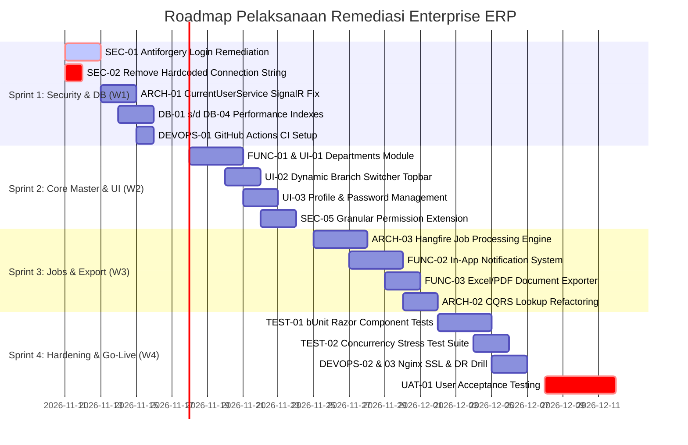

# Implementation Roadmap & Quality Gates — Enterprise ERP Remediation

> **Document ID:** AUD-RDM-2026-001  
> **Timeline Horizon:** 4 Sprint (3.5 Minggu Kalender)  
> **Related Documents:** [IMPLEMENTATION_PLAN.md](./IMPLEMENTATION_PLAN.md) | [TASK_BREAKDOWN.md](./TASK_BREAKDOWN.md)

---

## 1. Jadwal Roadmap Bertahap (Sprint Execution Roadmap)

---

## 2. Definisi Selesai (Definition of Done — DoD)

Sebuah tugas atau modul dinyatakan **SELESAI (DONE)** jika dan hanya jika memenuhi seluruh parameter berikut:

1. **Kompilasi Bersih (.NET 10):** Proyek terkompilasi dengan **0 Warning(s) dan 0 Error(s)**.
2. **Kepatuhan MudBlazor v9:** Tidak ada atribut usang atau warning analyzer `MUD0002`.
3. **Automated Unit & Integration Test:** Minimal 1 pengujian otomasi baru dibuat untuk use case terkait dan seluruh pengujian lama tetap lulus 100% (*zero regression*).
4. **Server-Side Security Enforcement:** Izin akses tervalidasi via `RequirePermissionAttribute` pada pipeline MediatR, bukan hanya disembunyikan di visual UI.
5. **Integritas Transaksi Basis Data:** Operasi mutasi data multi-tabel dibungkus dalam EF Core execution strategy / transaksi eksplisit.
6. **Code Review & Static Analysis:** Kepatuhan terhadap pedoman arsitektur Clean Architecture dan prinsip SOLID.
7. **Dokumentasi Terbarui:** File panduan, changelog, dan referensi silang dokumentasi diperbarui secara sinkron.

---

## 3. Gerbang Kualitas Antar-Fase (Quality Gates)

| Quality Gate | Fase Target | Kriteria Kelulusan Wajib (Entry Criteria) | Aksi Jika Gagal |
| :--- | :---: | :--- | :--- |
| **Gate 1: Keamanan Fondasi** | Akhir Sprint 1 | Proteksi CSRF aktif pada login, zero hardcoded password, seluruh indeks database diterapkan via migrasi. | Sprint 2 ditunda; fokus menyelesaikan perbaikan keamanan P0. |
| **Gate 2: Kelengkapan Navigasi** | Akhir Sprint 2 | Zero 404 broken link di seluruh sidebar dan topbar, modul departemen berfungsi penuh. | Larang pembukaan akses UAT ke pengguna eksternal. |
| **Gate 3: Ketahanan Beban** | Akhir Sprint 3 | Background job berjalan terisolasi, memory leak circuit SignalR tertangani, laporan ditarik $< 1.5$ detik. | Optimasi query SQL dan periksa change tracker EF Core. |
| **Gate 4: Persetujuan Go-Live** | Akhir Sprint 4 | 100% skenario UAT lolos verifikasi stakeholder bisnis, disaster recovery drill terbukti $< 2$ jam. | Rilis produksi dibatalkan; jadwalkan remedi tambahan. |

---

## 4. Persyaratan Pengujian Regresi (Regression Testing Requirements)

Setiap merge kode ke branch utama wajib memicu eksekusi pengujian regresi:
1. **Regresi Aturan Finansial:** Verifikasi invarian keseimbangan jurnal mutlak ($\sum \text{Debit} == \sum \text{Kredit}$) dan pencegahan mutasi periode tertutup.
2. **Regresi Alokasi Persediaan:** Verifikasi saldo stok gudang tidak pernah menjadi negatif pada kondisi apapun.
3. **Regresi Multi-Tenant:** Verifikasi kueri tidak membocorkan data antar perusahaan/cabang.

