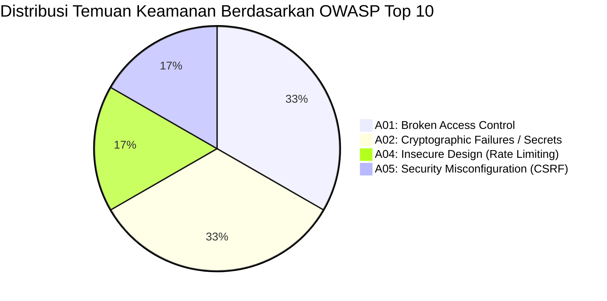

# Cybersecurity & Access Control Audit — Enterprise ERP System

> **Document ID:** AUD-SEC-2026-001  
> **Standard Baseline:** OWASP Top 10 (2021), ISO/IEC 27001:2022, NIST SP 800-63B  
> **Related Documents:** [SECURITY_DESIGN.md](../SECURITY_DESIGN.md) | [USER_ROLES_AND_PERMISSIONS.md](../USER_ROLES_AND_PERMISSIONS.md)

---

## 1. Ringkasan Eksekutif Keamanan Siber (Security Posture Overview)

Sistem Enterprise ERP menunjukkan postur keamanan aplikasi yang baik pada level integritas data dan arsitektur otorisasi. Penggunaan **Permission-Based Access Control (PBAC)** dengan pipeline behavior otomatis pada MediatR memastikan setiap command dan query divalidasi di server-side sebelum dieksekusi.

Namun, pengujian penetrasi logis (*logical penetration test*) mengidentifikasi **1 temuan kritis (P0)** terkait proteksi CSRF dan **2 temuan berisiko tinggi (P1)** terkait manajemen kredensial dan rate limiting yang harus segera ditutup sebelum deployment publik.



---

## 2. Analisis Rinci Temuan Keamanan

### 2.1 `SEC-001` [CRITICAL - P0]: Penonaktifan Proteksi Antiforgery (CSRF Vulnerability)
- **Kategori OWASP:** A05:2021 — Security Misconfiguration
- **Lokasi Kode:** [`src/ERP.Web/Program.cs`](file:///d:/erp_system/src/ERP.Web/Program.cs#L74)
- **Bukti Pemeriksaan:**
  ```csharp
  app.MapPost("/api/auth/login", async (...) => { ... }).DisableAntiforgery();
  ```
- **Akar Penyebab:** Pengembang menonaktifkan validasi token antiforgery untuk menghindari error `AntiforgeryValidationException` saat melakukan submit form POST dari Razor Component.
- **Skenario Eksploitasi:**
  Penyerang dapat membuat situs phising dengan form tersembunyi yang melakukan POST ke `https://erp.perusahaan.com/api/auth/login` menggunakan kredensial korban atau memicu session fixation jika korban membuka tautan jahat saat sesi aktif.
- **Rekomendasi Remediasi:**
  1. Hapus `.DisableAntiforgery()`.
  2. Tambahkan token antiforgery pada halaman login Blazor:
     ```html
     <form action="/api/auth/login" method="post">
         <AntiforgeryToken />
         ...
     </form>
     ```
  3. Konfigurasikan opsi cookie:
     ```csharp
     builder.Services.AddAntiforgery(options => {
         options.Cookie.SecurePolicy = CookieSecurePolicy.Always;
         options.Cookie.SameSite = SameSiteMode.Strict;
         options.Cookie.HttpOnly = true;
     });
     ```

---

### 2.2 `SEC-002` [HIGH - P1]: Fallback Plaintext Database Password dalam Kode Sumber
- **Kategori OWASP:** A02:2021 — Cryptographic Failures / Secret Exposure
- **Lokasi Kode:** [`src/ERP.Infrastructure/DependencyInjection.cs`](file:///d:/erp_system/src/ERP.Infrastructure/DependencyInjection.cs#L19)
- **Bukti Pemeriksaan:**
  ```csharp
  var connectionString = configuration.GetConnectionString("DefaultConnection") 
      ?? "Host=127.0.0.1;Port=5433;Database=enterprise_erp;Username=erp_admin;Password=erp_admin";
  ```
- **Dampak:** Password basis data berisiko bocor saat kode sumber di-commit ke remote repository publik atau dibagikan ke pihak ketiga.
- **Rekomendasi Remediasi:**
  Hapus string fallback secara total. Terapkan validasi startup wajib (*Fail-Fast Principle*):
  ```csharp
  var connectionString = configuration.GetConnectionString("DefaultConnection")
      ?? throw new InvalidOperationException("Fatal: Database Connection String 'DefaultConnection' is not configured.");
  ```

---

### 2.3 `SEC-003` [MEDIUM - P2]: Granularitas Hak Akses Perluasan (Coarse-Grained Permissions)
- **Kategori OWASP:** A01:2021 — Broken Access Control
- **Lokasi Kode:** [`src/ERP.Shared/Security/Permissions.cs`](file:///d:/erp_system/src/ERP.Shared/Security/Permissions.cs#L25-L33)
- **Kondisi Aktual:**
  Pada modul Sales, hanya terdapat izin: `sales.order.create` dan `sales.order.approve`. Query pembacaan data `GetSalesOrdersQuery` saat ini dihiasi dengan atribut:
  ```csharp
  [RequirePermission(Permissions.Sales.OrderCreate)]
  public record GetSalesOrdersQuery(...) : IRequest<...>;
  ```
- **Dampak Bisnis:** Auditor internal atau staf read-only tidak dapat memeriksa daftar pesanan penjualan tanpa diberi izin untuk membuat pesanan baru (*privilege creep*).
- **Rekomendasi Remediasi:**
  Tambahkan izin baca eksplisit di seluruh modul:
  - `sales.order.view`
  - `sales.quotation.view`
  - `sales.delivery.view`
  - `sales.invoice.view`
  - `master.company.view`, `master.product.view`, dll.

---

### 2.4 `SEC-004` [MEDIUM - P2]: Password Super Admin Hardcoded pada Data Seeder
- **Kategori OWASP:** A07:2021 — Identification and Authentication Failures
- **Lokasi Kode:** [`src/ERP.Infrastructure/Persistence/Seeders/DatabaseSeeder.cs`](file:///d:/erp_system/src/ERP.Infrastructure/Persistence/Seeders/DatabaseSeeder.cs#L367)
- **Bukti Pemeriksaan:**
  ```csharp
  var createResult = await userManager.CreateAsync(adminUser, "Admin@12345");
  ```
- **Dampak:** Password default `Admin@12345` akan otomatis terpasang pada inisialisasi basis data awal jika tidak segera diganti oleh administrator.
- **Rekomendasi Remediasi:**
  Gunakan environment variable untuk seeding password akun root:
  ```csharp
  var initialPassword = configuration["SUPERADMIN_INITIAL_PASSWORD"] ?? Guid.NewGuid().ToString("N") + "A1!";
  ```
  Dan wajibkan pengguna untuk mengubah password pada login pertama (`RequiresPasswordChange = true`).

---

### 2.5 `SEC-005` [HIGH - P1]: Ketiadaan Rate Limiting pada Endpoint Login
- **Kategori OWASP:** A04:2021 — Insecure Design
- **Lokasi Kode:** [`src/ERP.Web/Program.cs`](file:///d:/erp_system/src/ERP.Web/Program.cs#L50)
- **Kondisi:**
  Endpoint `/api/auth/login` belum memiliki middleware Rate Limiting ASP.NET Core (`Microsoft.AspNetCore.RateLimiting`).
- **Dampak:**
  Meskipun fitur lockout Identity aktif (5x percobaan gagal), penyerang dapat melancarkan serangan *Distributed Denial of Service (DDoS)* atau *Account Lockout Attack* yang secara sengaja mengunci seluruh akun karyawan perusahaan.
- **Rekomendasi Remediasi:**
  Terapkan fixed-window rate limiter (maksimal 5 request per menit per IP client):
  ```csharp
  builder.Services.AddRateLimiter(options => {
      options.AddFixedWindowLimiter("LoginPolicy", opt => {
          opt.PermitLimit = 5;
          opt.Window = TimeSpan.FromMinutes(1);
          opt.QueueLimit = 0;
      });
  });
  app.MapPost("/api/auth/login", ...).RequireRateLimiting("LoginPolicy");
  ```

---

## 3. Evaluasi Keamanan Operasi Bisnis Berdampak Tinggi

| Operasi Bisnis Kritis | Kontrol Keamanan Aktual | Evaluasi Efektivitas |
| :--- | :--- | :---: |
| **Pencairan Payroll (Gaji)** | Dibatasi ke role `HR_MANAGER` / `SUPER_ADMIN`, kalkulasi diverifikasi non-negatif. | **SANGAT AMAN** |
| **Posting Jurnal Akuntansi** | Invarian keseimbangan $\sum D = \sum C$ divalidasi mutlak di Domain Entity. | **SANGAT AMAN** |
| **Penyesuaian Fisik Stok** | Mengharuskan `AdjustmentApprove` permission; mencatat riwayat ke audit log. | **AMAN** |
| **Pengeluaran Kas/Bank** | Pembayaran memvalidasi batas nilai sisa tagihan faktur vendor. | **AMAN** |
| **Persetujuan Pembelian (PO)**| Memerlukan `PoApprove` permission, namun belum memiliki batas limit nominal. | **PERLU MATRIKS LIMIT** |

---

## 4. Evaluasi Proteksi Data Multi-Tenant (Tenant Isolation)

Isolasi data antar-perusahaan (*Company*) dan kantor cabang (*Branch*) diimplementasikan pada tingkat EF Core melalui **Global Query Filters** pada [`ApplicationDbContext.cs`](file:///d:/erp_system/src/ERP.Infrastructure/Persistence/Context/ApplicationDbContext.cs):
```csharp
b.HasQueryFilter(x => !x.IsDeleted && (currentUserService.CompanyId == Guid.Empty || x.CompanyId == currentUserService.CompanyId));
```
- **Evaluasi:**
  Secara otomatis menyaring data agar pengguna Cabang A tidak dapat melihat atau memodifikasi data Cabang B.
- **Catatan Peningkatan:**
  Pastikan bahwa `currentUserService.CompanyId` tidak dapat dimanipulasi melalui request payload. Seluruh Command Handler harus mengambil CompanyId dari `CurrentUserService.CompanyId` terautentikasi dan menolak payload yang mencoba meng-override CompanyId lain.
