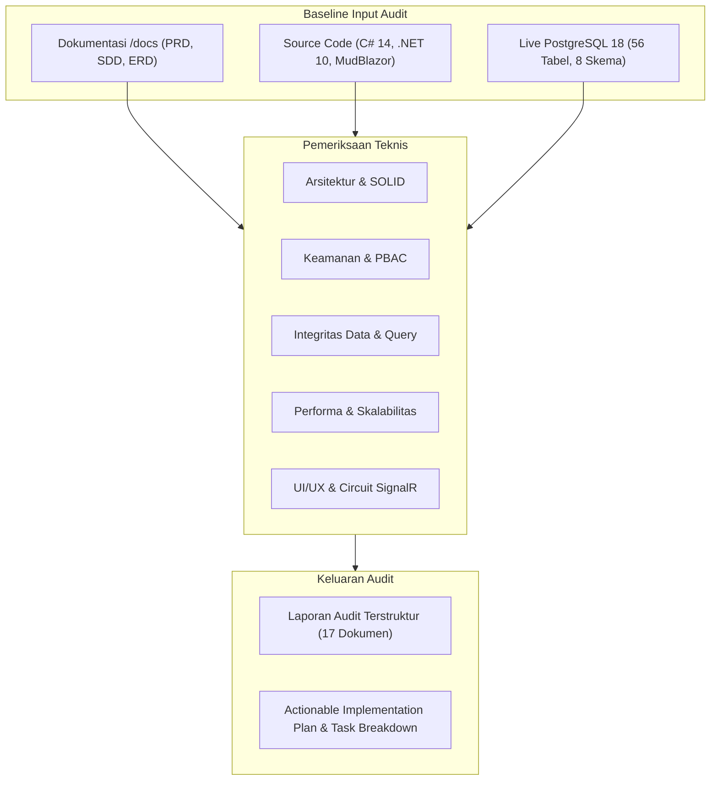

# Comprehensive System Audit Report — Enterprise ERP System

> **Document ID:** AUD-RPT-2026-001  
> **Classification:** Confidential / Enterprise Technical Audit  
> **Audited Baseline:** Tag `v1.0.0-rc1` (Commit `0c2d4f2`)  
> **Related Documents:** [EXECUTIVE_SUMMARY.md](./EXECUTIVE_SUMMARY.md) | [MODULE_AUDIT_MATRIX.md](./MODULE_AUDIT_MATRIX.md) | [ARCHITECTURE_AUDIT.md](./ARCHITECTURE_AUDIT.md)

---

## 1. Metodologi & Lingkup Audit (Audit Methodology & Scope)

Audit dilakukan secara menyeluruh (*grey-box and white-box examination*) dengan menggabungkan:
1. **Source Code Static Analysis & Architectural Review:** Menelaah 9 proyek .NET 10, dependensi antar-layer, dan pola desain Clean Architecture.
2. **Database Schema & DDL Deep Inspection:** Menginspeksi 56 tabel, 8 skema di PostgreSQL 18, indeks, constraints, nullability, dan relasi foreign key.
3. **Automated Test Run & Code Coverage:** Menjalankan 43 unit, integration, dan architecture tests.
4. **Security Vulnerability Assessment:** Meninjau alur otentikasi, otorisasi PBAC, proteksi CSRF, session handling, dan data isolation.
5. **UI/UX & Interactive Server Circuit Inspection:** Memeriksa 31 file Blazor Razor components, SignalR state, MudBlazor v9 compliance, dan alur form.



---

## 2. Ringkasan Status Verifikasi Teknologi Aktual

| Komponen Teknologi | Spesifikasi Requirement | Kondisi Aktual Implementasi | Kesesuaian |
| :--- | :--- | :--- | :---: |
| **Runtime & SDK** | .NET 10 LTS (net10.0) | .NET 10.0.100 SDK terkonfigurasi pada seluruh csproj | **100% MATCH** |
| **Bahasa Pemrograman** | C# 14 | C# 14 dengan fitur modern (primary constructors, pattern matching) | **100% MATCH** |
| **Frontend Framework** | Blazor Interactive Server | Blazor Web App dengan mode Interactive Server aktif | **100% MATCH** |
| **UI Component Suite** | MudBlazor v9 | MudBlazor v9.0.0, zero `MUD0002` analyzer warnings | **100% MATCH** |
| **Basis Data Relasional** | PostgreSQL | PostgreSQL 18, 56 tabel di 8 skema | **100% MATCH** |
| **Object-Relational Mapper** | EF Core 10 & Npgsql | EF Core 10 dengan Npgsql PostgreSQL provider | **100% MATCH** |
| **Autentikasi & Keamanan** | ASP.NET Core Identity & PBAC | IdentityDbContext dengan 11 tabel kustom di skema `identity` | **100% MATCH** |
| **Arsitektur Solusi** | Clean Architecture (Modular Monolith)| Pemisahan tegas Shared, Domain, Application, Infrastructure, Web | **100% MATCH** |

---

## 3. Matriks Temuan Audit Berdasarkan Kategori & Tingkat Risiko

| ID Temuan | Kategori | Lokasi File / Komponen | Tingkat Risiko | Status Temuan |
| :--- | :--- | :--- | :---: | :---: |
| **`SEC-001`** | Security | `src/ERP.Web/Program.cs` | **CRITICAL (P0)** | Bug Terbukti |
| **`SEC-002`** | Security | `src/ERP.Infrastructure/DependencyInjection.cs` | **HIGH (P1)** | Potensi Risiko |
| **`SEC-003`** | Security | `src/ERP.Shared/Security/Permissions.cs` | **MEDIUM (P2)** | Improvement |
| **`SEC-004`** | Security | `src/ERP.Infrastructure/Persistence/Seeders/DatabaseSeeder.cs`| **MEDIUM (P2)** | Technical Debt |
| **`SEC-005`** | Security | `src/ERP.Web/Program.cs` | **HIGH (P1)** | Potensi Risiko |
| **`ARCH-001`**| Architecture | `src/ERP.Infrastructure/Services/CurrentUserService.cs` | **HIGH (P1)** | Technical Debt |
| **`ARCH-002`**| Architecture | `src/ERP.Web/Components/Pages/**/*.razor` | **MEDIUM (P2)** | Architectural Violation |
| **`ARCH-003`**| Architecture | Background Jobs Engine | **HIGH (P1)** | Belum Diimplementasikan |
| **`DB-001`**  | Database | `ApplicationDbContext.cs` (`journal_lines`) | **HIGH (P1)** | Performance Risk |
| **`DB-002`**  | Database | `ApplicationDbContext.cs` (`stock_movements`) | **HIGH (P1)** | Performance Risk |
| **`DB-003`**  | Database | `ApplicationDbContext.cs` (`payment_allocations`)| **MEDIUM (P2)** | Data Integrity Risk |
| **`DB-004`**  | Database | `ApplicationDbContext.cs` (`sales_orders`, `purchase_orders`)| **MEDIUM (P2)** | Performance Risk |
| **`PERF-001`**| Performance | MudBlazor Table Filtering di Memori UI | **MEDIUM (P2)** | Scalability Bottleneck |
| **`PERF-002`**| Performance | SignalR Circuit Lifetime Management | **LOW (P3)** | Improvement Opportunity |
| **`PERF-003`**| Performance | Ketiadaan Distributed Cache (Redis) | **MEDIUM (P2)** | Improvement Opportunity |
| **`FUNC-001`**| Functional | `src/ERP.Application/Features/Master/Departments` | **MEDIUM (P2)** | Belum Diimplementasikan |
| **`FUNC-002`**| Functional | In-App & Email Notification Subsystem | **HIGH (P1)** | Belum Diimplementasikan |
| **`FUNC-003`**| Functional | Native Excel/PDF Report Export Engine | **MEDIUM (P2)** | Belum Diimplementasikan |
| **`FUNC-004`**| Functional | User Profile & Change Password Subsystem | **MEDIUM (P2)** | Belum Diimplementasikan |
| **`FUNC-005`**| Functional | Multi-Tier Approval Threshold Matrix | **MEDIUM (P2)** | Improvement Opportunity |
| **`UI-001`**  | UI/UX | `src/ERP.Web/Components/Layout/MainLayout.razor` | **MEDIUM (P2)** | Usability Debt |
| **`UI-002`**  | UI/UX | `src/ERP.Web/Components/Layout/MainLayout.razor` | **LOW (P3)** | Usability Debt |
| **`UI-003`**  | UI/UX | `src/ERP.Web/Components/Layout/NavMenu.razor` | **MEDIUM (P2)** | Broken Link (404) |
| **`UI-004`**  | UI/UX | Komponen Tabel Keuangan pada Layar Mobile | **LOW (P3)** | Usability Opportunity |
| **`TEST-001`**| Testing | Web UI E2E Automated Testing (Playwright) | **MEDIUM (P2)** | QA Gap |
| **`TEST-002`**| Testing | Concurrency Integration Testing | **LOW (P3)** | QA Gap |
| **`DEVOPS-001`**| DevOps | CI/CD Pipeline Automasi (GitHub Actions) | **HIGH (P1)** | Belum Diimplementasikan |
| **`DEVOPS-002`**| DevOps | APM Monitoring & OpenTelemetry | **LOW (P3)** | Improvement Opportunity |

---

## 4. Analisis Detail Temuan Kunci

### 4.1 Temuan Keamanan (Security)

#### `SEC-001`: Penonaktifan Antiforgery pada Endpoint Login
- **Lokasi:** [`src/ERP.Web/Program.cs`](file:///d:/erp_system/src/ERP.Web/Program.cs#L74)
- **Bukti Kode:**
  ```csharp
  app.MapPost("/api/auth/login", async (...) => { ... }).DisableAntiforgery();
  ```
- **Akar Masalah:** Kemudahan pengujian awal form login HTML tradisional memicu penambahan `.DisableAntiforgery()`.
- **Dampak Teknis & Bisnis:** Penyerang dapat merekayasa halaman web jahat (*malicious website*) yang mengirimkan POST request tersembunyi untuk mengeksekusi login/logout tanpa disadari pengguna, melanggar standar kepatuhan ISO 27001 dan OWASP Top 10 A01.
- **Rekomendasi Perbaikan:** Aktifkan middleware `Antiforgery`, sertakan token CSRF `<AntiforgeryToken />` pada form login, dan lakukan validasi server-side otomatis.

#### `SEC-002`: Fallback Hardcoded Kredensial Database
- **Lokasi:** [`src/ERP.Infrastructure/DependencyInjection.cs`](file:///d:/erp_system/src/ERP.Infrastructure/DependencyInjection.cs#L18-L20)
- **Bukti Kode:**
  ```csharp
  var connectionString = configuration.GetConnectionString("DefaultConnection") 
      ?? "Host=127.0.0.1;Port=5433;Database=enterprise_erp;Username=erp_admin;Password=erp_admin";
  ```
- **Akar Masalah:** Penyediaan nilai default lokal agar aplikasi dapat langsung berjalan tanpa konfigurasi file `.env`.
- **Dampak:** Berpotensi membocorkan pola kredensial ke version control jika branch diunggah ke publik.
- **Rekomendasi:** Terapkan pola fail-fast: jika connection string kosong, lemparkan `InvalidOperationException("Connection string 'DefaultConnection' is required.")`.

---

### 4.2 Temuan Arsitektur & Pola Desain (Architecture)

#### `ARCH-001`: Inkonsistensi Resolusi Identitas pada Blazor SignalR Circuit
- **Lokasi:** [`src/ERP.Infrastructure/Services/CurrentUserService.cs`](file:///d:/erp_system/src/ERP.Infrastructure/Services/CurrentUserService.cs)
- **Bukti Kode:**
  ```csharp
  public class CurrentUserService(IHttpContextAccessor httpContextAccessor) : ICurrentUserService
  {
      private readonly ClaimsPrincipal? _user = httpContextAccessor.HttpContext?.User;
      ...
  }
  ```
- **Akar Masalah:** Mengandalkan `IHttpContextAccessor` yang bersifat ephemeral pada koneksi HTTP awal. Pada arsitektur Blazor Interactive Server, interaksi selanjutnya terjadi melalui WebSocket (SignalR circuit), di mana `HttpContext` tidak diperbarui atau bernilai `null`.
- **Dampak:** Global Query Filter tenant (`CompanyId`) dan pemeriksaan izin (`HasPermission`) berisiko mengembalikan nilai kosong atau tidak akurat saat circuit mengalami *reconnection*.
- **Rekomendasi:** Ubah `CurrentUserService` untuk memanfaatkan `AuthenticationStateProvider` milik Blazor untuk mengonsumsi state otentikasi sirkuit aktif secara reaktif.

#### `ARCH-002`: Pelanggaran Prinsip Clean Architecture (Direct DbContext Query pada UI)
- **Lokasi:** [`src/ERP.Web/Components/Pages/Sales/SalesOrdersPage.razor`](file:///d:/erp_system/src/ERP.Web/Components/Pages/Sales/SalesOrdersPage.razor#L8), `GoodsReceiptsPage.razor`, `DeliveriesPage.razor`.
- **Bukti Kode:**
  ```razor
  @inject IApplicationDbContext DbContext
  ...
  _availableCustomers = await DbContext.Customers.AsNoTracking()...ToListAsync();
  ```
- **Akar Masalah:** Jalan pintas untuk mengambil data lookup/dropdown tanpa membuat MediatR Query terpisah.
- **Dampak:** UI Layer memiliki kopling langsung dengan interface data access `IApplicationDbContext`, melanggar batasan Clean Architecture.
- **Rekomendasi:** Buat query lookup terstandar di Application layer (misalnya `GetCustomerLookupQuery`, `GetProductLookupQuery`) yang mengembalikan read-only DTO teroptimasi.

---

### 4.3 Temuan Basis Data (Database & Data Integrity)

#### `DB-001` & `DB-002`: Missing Index pada Tabel Buku Besar & Mutasi Stok
- **Lokasi:** Skema `finance.journal_lines` dan `inventory.stock_movements`.
- **Bukti:**
  Pada [`ApplicationDbContext.cs`](file:///d:/erp_system/src/ERP.Infrastructure/Persistence/Context/ApplicationDbContext.cs#L302-L315), entitas `StockMovement` hanya memiliki Primary Key. Tidak terdapat deklarasi indeks untuk `(WarehouseId, ProductId)` maupun `MovementDate`.
- **Dampak:** Pada volume transaksi enterprise (misal 500.000 mutasi stok per tahun), kalkulasi kartu stok dan penarikan laporan *stock ledger* akan memicu Sequential Scan berkepanjangan pada PostgreSQL, meningkatkan CPU utilization hingga 100%.
- **Rekomendasi:** Buat migrasi EF Core baru untuk menambahkan:
  ```csharp
  b.HasIndex(x => new { x.WarehouseId, x.ProductId, x.MovementDate });
  b.HasIndex(x => new { x.CompanyId, x.MovementDate });
  ```

---

### 4.4 Temuan Fungsional & UI/UX

#### `UI-003` & `MOD-001`: Menu Navigasi Departemen Mengarah ke Route Kosong (404)
- **Lokasi:** [`src/ERP.Web/Components/Layout/NavMenu.razor`](file:///d:/erp_system/src/ERP.Web/Components/Layout/NavMenu.razor#L29)
- **Bukti:** NavMenu memiliki entri `<MudNavLink Href="/master/departments"> Departemen </MudNavLink>`, namun tidak ada file `DepartmentsPage.razor` di dalam direktori `src/ERP.Web/Components/Pages/Master/`.
- **Dampak:** Pengguna yang mengklik menu Departemen diarahkan ke halaman 404 (Not Found), menimbulkan kesan sistem belum selesai dan menurunkan skor usability.
- **Rekomendasi:** Implementasikan fitur CQRS Departemen di Application layer dan buat `DepartmentsPage.razor` menggunakan MudBlazor Table & Dialog.

---

## 5. Kesimpulan Audit

Enterprise ERP System memiliki kualitas arsitektur dasar yang sangat baik dan siap melangkah ke tahap pengujian pengguna (UAT) setelah **Fase 1 (P0/P1 Remediation)** diselesaikan. Tim pengembang disarankan untuk memprioritaskan perbaikan keamanan dan indeks basis data sebelum melanjutkan penambahan modul baru.

