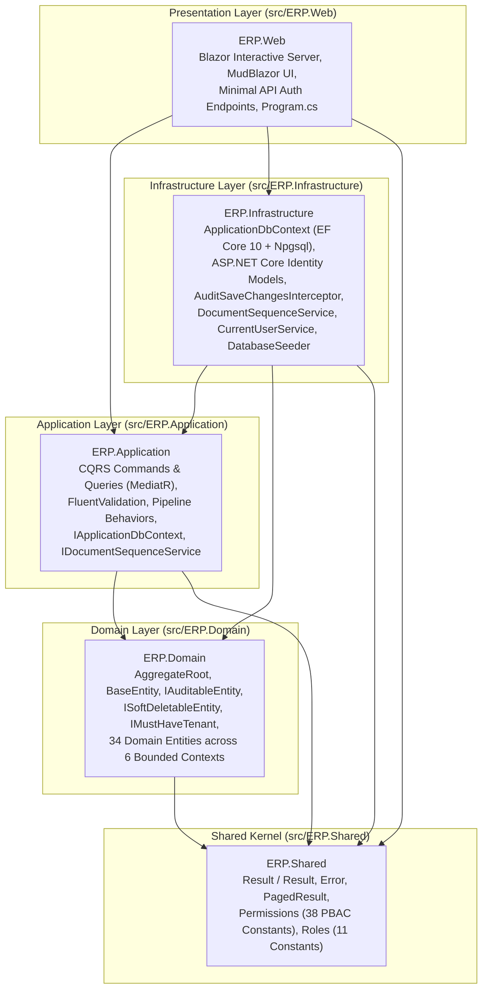
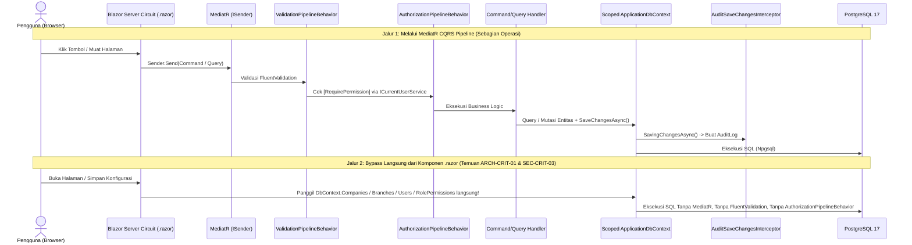

# SYSTEM OVERVIEW — Enterprise ERP System (.NET 10 LTS)

> **Tanggal Audit:** 12 November 2026  
> **Auditor:** Principal .NET Architect, Senior Fullstack .NET Engineer, Database Architect, Security & Performance Specialist  
> **Metode Evaluasi:** White-box Static Code Analysis, Dependency & Runtime Graph Inspection, Database Schema & EF Core Model Verification  
> **Status Dokumen:** Factual Baseline Audit (Tanpa Modifikasi Source Code)

---

## 1. Executive Summary

**Enterprise ERP System** (`EnterpriseERP.slnx`) adalah aplikasi Enterprise Resource Planning berbasis **Modular Monolith** dengan pola **Clean Architecture** dan **CQRS (Command Query Responsibility Segregation)** yang dibangun di atas **.NET 10.0 LTS (C# 14)**, **Blazor Web App (Interactive Server)**, **MudBlazor 9.12.0**, dan **PostgreSQL 17** melalui **Entity Framework Core 10.0.5**.

Secara struktural, solusi ini memiliki fondasi domain yang kaya (34 entitas domain + 4 entitas autentikasi/otorisasi + 1 entitas audit trail di 8 skema PostgreSQL), pemisahan layer proyek yang bersih (diuji oleh 4 *Architecture Tests* menggunakan `NetArchTest.Rules`), serta cakupan modul bisnis end-to-end (Master Data, Inventory, Procurement/P2P, Sales/O2C, Finance & Accounting/R2R, HR & Payroll, Reports & Analytics, serta Security/PBAC).

Namun, hasil **audit teknis menyeluruh terhadap kode sumber aktual** menemukan sejumlah **temuan kritis (`Critical`) dan tinggi (`High`)** yang secara faktual menghalangi kesiapan produksi saat ini:
1. **Kegagalan Hidrasi Klaim Otorisasi (`SEC-CRIT-01`):** Tidak adanya implementasi `IUserClaimsPrincipalFactory<ApplicationUser>` menyebabkan klaim kustom (`Permission`, `CompanyId`, `BranchId`, `FullName`, `AllowedBranchId`) tidak pernah dimasukkan ke dalam *authentication cookie* saat login. Akibatnya:
   - Seluruh akun non-`SUPER_ADMIN` (`DIRECTOR`, `FINANCE_MANAGER`, `SALES_MANAGER`, `PROCUREMENT_OFFICER`, `WAREHOUSE_STAFF`, `HR_MANAGER`, `CASHIER`, `AUDITOR`, `STAFF`) **terkunci 100%** dari seluruh handler MediatR yang memiliki atribut `[RequirePermission]`.
   - `CurrentUserService.CompanyId` selalu mengembalikan `Guid.Empty`, yang secara tidak sengaja **menonaktifkan seluruh Global Query Filter multi-tenant** (`currentUserService.CompanyId == Guid.Empty || x.CompanyId == currentUserService.CompanyId`) di `ApplicationDbContext`.
2. **Unhandled Runtime Crash pada 8 Halaman Blazor (`SEC-CRIT-02`):** Delapan halaman (`SettingsPage`, `EmployeesPage`, `AttendancePage`, `LeavesPage`, `PayrollPage`, `FinancialReportPage`, `InventoryReportPage`, `SalesReportPage`) mendeklarasikan `@attribute [Authorize(Policy = ...)]`, tetapi tidak ada `AuthorizationPolicy` atau `IAuthorizationPolicyProvider` kustom yang didaftarkan di `Program.cs`. Navigasi ke salah satu dari 8 rute tersebut langsung memicu *unhandled exception* `InvalidOperationException: The AuthorizationPolicy named: '...' was not found`.
3. **13 Halaman UI (Termasuk Admin Keamanan) Tanpa `@attribute [Authorize]` (`SEC-CRIT-03`):** Halaman `/security/users`, `/security/roles`, `/security/audit-logs`, `/`, seluruh halaman `/master/*`, dan seluruh halaman `/inventory/*` tidak memiliki `@attribute [Authorize]`, serta mengakses `ApplicationDbContext` / `UserManager<ApplicationUser>` secara langsung dari komponen Razor tanpa melewati pipeline otorisasi MediatR.
4. **Bahaya Konkurensi `DbContext` pada Blazor Interactive Server Circuit (`ARCH-CRIT-01`):** `ApplicationDbContext` didaftarkan sebagai `Scoped` (yang hidup sepanjang umur koneksi SignalR circuit) dan diinjeksikan langsung ke `MainLayout.razor` sekaligus 25+ halaman Razor anak, memicu potensi `InvalidOperationException` akibat eksekusi query paralel pada satu instans `DbContext` serta pembengkakan memori `ChangeTracker`.
5. **Materialisasi In-Memory Tabel Penuh pada Laporan & Analitik (`PERF-CRIT-01`):** Query laporan keuangan (`GetFinancialReportsQuery`), analitik penjualan (`GetSalesAnalyticsQuery`), dan kartu KPI stok di Dashboard (`Home.razor`) menarik seluruh baris transaksi ke memori aplikasi (`.ToListAsync()` tanpa `.AsNoTracking()`) sebelum melakukan agregasi di C#.

---

## 2. Teknologi & Versi Aktual yang Digunakan

Berdasarkan pemeriksaan langsung pada file proyek (`.csproj`), `EnterpriseERP.slnx`, `Dockerfile`, dan `docker-compose.yml`:

| Kategori | Teknologi / Paket NuGet | Versi Aktual | Lokasi Bukti Konfigurasi |
| :--- | :--- | :--- | :--- |
| **Runtime & SDK** | .NET SDK / Runtime (`net10.0`) | `10.0` (LTS) | `src/*/*.csproj:3`, `Dockerfile:2,25` |
| **Bahasa Pemrograman** | C# (`ImplicitUsings`, `Nullable=enable`) | `C# 14` | `src/*/*.csproj:4-5` |
| **Frontend Framework** | ASP.NET Core Blazor Web App (Interactive Server) | `10.0.0` | `src/ERP.Web/Program.cs:15-16` |
| **UI Component Library** | `MudBlazor` | `9.12.0` | `src/ERP.Web/ERP.Web.csproj:13` |
| **CQRS & Mediator** | `MediatR` | `14.1.0` | `src/ERP.Domain/ERP.Domain.csproj:10`, `src/ERP.Application/ERP.Application.csproj:14` |
| **Input Validation** | `FluentValidation` & `FluentValidation.DependencyInjectionExtensions` | `12.1.1` | `src/ERP.Application/ERP.Application.csproj:12-13` |
| **ORM & Persistence** | `Microsoft.EntityFrameworkCore` & `Relational` | `10.0.5` | `src/ERP.Application/ERP.Application.csproj:15`, `src/ERP.Infrastructure/ERP.Infrastructure.csproj:15` |
| **Database Provider** | `Npgsql.EntityFrameworkCore.PostgreSQL` | `10.0.1` | `src/ERP.Infrastructure/ERP.Infrastructure.csproj:17` |
| **Database Engine** | PostgreSQL | `17-alpine` | `docker-compose.yml:5` |
| **Authentication / Identity** | `Microsoft.AspNetCore.Identity.EntityFrameworkCore` | `10.0.5` | `src/ERP.Infrastructure/ERP.Infrastructure.csproj:13` |
| **Logging Library** | `Serilog.AspNetCore` *(Terinstal tetapi belum di-wire)* | `10.0.0` | `src/ERP.Web/ERP.Web.csproj:14` |
| **Testing Frameworks** | `xunit` (`2.9.3`), `FluentAssertions` (`8.9.0`), `Moq` (`4.20.72`), `NetArchTest.Rules` (`1.3.2`), `Microsoft.EntityFrameworkCore.InMemory` (`10.0.5`) | Sesuai daftar | `tests/*/*.csproj` |

---

## 3. Struktur Solution & Tanggung Jawab Setiap Project

Solusi `EnterpriseERP.slnx` terdiri dari **5 proyek utama** pada direktori `src/` dan **4 proyek pengujian** pada direktori `tests/`:

### Rincian Proyek (`src/` dan `tests/`)

1. **`src/ERP.Shared`:**
   - Menyimpan primitif lintas-layer tanpa ketergantungan ke layer lain: `Result`, `Result<T>`, `Error` (`src/ERP.Shared/Common/Result.cs`), `PagedResult<T>` (`src/ERP.Shared/Common/PagedResult.cs`), serta matriks konstanta `Permissions` dan `Roles` (`src/ERP.Shared/Security/Permissions.cs`).
2. **`src/ERP.Domain`:**
   - Menyimpan *building blocks* DDD (`BaseEntity<TId>`, `AggregateRoot<TId>`, `IDomainEvent`, `IAuditableEntity`, `ISoftDeletableEntity`, `IMustHaveTenant` di `src/ERP.Domain/Common/BaseEntity.cs`) dan 34 entitas bisnis yang diorganisasikan ke dalam 6 namespace modul: `Master`, `Inventory`, `Procurement`, `Sales`, `Finance`, dan `Hr`.
3. **`src/ERP.Application`:**
   - Mengimplementasikan pola *Vertical Feature Slices* di bawah `src/ERP.Application/Features/{Module}/{SubModule}/`.
   - Menyediakan kontrak abstraksi (`IApplicationDbContext`, `ICurrentUserService`, `IDocumentSequenceService`, `IDateTimeProvider`) dan 2 MediatR Pipeline Behaviors (`ValidationPipelineBehavior`, `AuthorizationPipelineBehavior`).
4. **`src/ERP.Infrastructure`:**
   - Mengimplementasikan `ApplicationDbContext` (`src/ERP.Infrastructure/Persistence/Context/ApplicationDbContext.cs` — 723 baris konfigurasi Fluent API, skema, indeks, konversi `xmin`, dan Global Query Filter), `AuditSaveChangesInterceptor`, `DocumentSequenceService`, `CurrentUserService`, `DatabaseSeeder`, dan migrasi EF Core (`20260329172235_InitialEnterpriseSchema.cs`).
5. **`src/ERP.Web`:**
   - Host aplikasi web ASP.NET Core & Blazor Interactive Server, menyertakan `MainLayout.razor`, `NavMenu.razor`, `EnterpriseTheme.cs`, 2 endpoint Minimal API (`/api/auth/login` dan `/api/auth/logout`), serta 26 komponen halaman `.razor`.
6. **`tests/` (`ERP.Domain.Tests`, `ERP.Application.Tests`, `ERP.IntegrationTests`, `ERP.Architecture.Tests`):**
   - Total 43 pengujian otomatis (28 unit test domain, 6 unit test aplikasi, 5 integration test berbasis EF Core InMemory, dan 4 tes arsitektur `NetArchTest`).

---

## 4. Siklus Hidup Request & Konfigurasi Dependency Injection

### 4.1 Registrasi Dependency Injection Aktual
Berdasarkan `src/ERP.Application/DependencyInjection.cs`, `src/ERP.Infrastructure/DependencyInjection.cs`, dan `src/ERP.Web/Program.cs`:

| Service / Komponen | Lifetime | Lokasi Registrasi | Catatan Audit |
| :--- | :--- | :--- | :--- |
| `AuditSaveChangesInterceptor` | `Scoped` | `src/ERP.Infrastructure/DependencyInjection.cs:24` | Mengintersepsi `SavingChanges` / `SavingChangesAsync` pada `ApplicationDbContext` |
| `ApplicationDbContext` / `IApplicationDbContext` | `Scoped` | `src/ERP.Infrastructure/DependencyInjection.cs:26-35` | **Bermasalah di Blazor Server (`ARCH-CRIT-01`):** hidup selama SignalR circuit aktif dan dipakai bersama oleh `MainLayout` + halaman anak |
| `UserManager<ApplicationUser>` / `SignInManager<ApplicationUser>` | `Scoped` | `src/ERP.Infrastructure/DependencyInjection.cs:39-52` | Tidak dilengkapi `IUserClaimsPrincipalFactory<ApplicationUser>` kustom (`SEC-CRIT-01`) |
| `IDateTimeProvider` (`DateTimeProvider`) | `Transient` | `src/ERP.Infrastructure/DependencyInjection.cs:54` | Aman (stateless wrapper `DateTime.UtcNow`) |
| `ICurrentUserService` (`CurrentUserService`) | `Scoped` | `src/ERP.Infrastructure/DependencyInjection.cs:55` | Bergantung pada `IHttpContextAccessor.HttpContext?.User` |
| `IDocumentSequenceService` (`DocumentSequenceService`) | `Scoped` | `src/ERP.Infrastructure/DependencyInjection.cs:56` | Memanggil `SaveChangesAsync` prematur di dalam `NextDocumentNumberAsync` (`ARCH-CRIT-02`) |
| `ValidationPipelineBehavior<,>` | `Transient` | `src/ERP.Application/DependencyInjection.cs:20` | Didaftarkan **sebelum** `AuthorizationPipelineBehavior` (`SEC-MED-03`) |
| `AuthorizationPipelineBehavior<,>` | `Transient` | `src/ERP.Application/DependencyInjection.cs:21` | Memeriksa atribut `[RequirePermission]` via refleksi |

### 4.2 Alur Eksekusi Request (Actual Data Flow)
Sistem saat ini memiliki **dua jalur eksekusi yang berbeda** dari komponen UI Blazor menuju database:

---

## 5. Skor Kualitas Sistem Saat Ini (Quantitative Scorecard 0–100)

Penilaian objektif berdasarkan kondisi aktual kode sumber, konfigurasi, pengujian, dan keamanan sebelum perbaikan dilakukan:

| Aspek Penilaian | Skor (0–100) | Status | Ringkasan Dasar Penilaian Faktual |
| :--- | :---: | :---: | :--- |
| **1. Architecture & Modularity** | **68 / 100** | ⚠️ Perlu Perbaikan | Pemisahan 5 proyek Clean Architecture baik, tetapi dilanggar oleh injeksi langsung `IApplicationDbContext` / `ApplicationDbContext` di 25+ file `.razor`, ketiadaan integrasi jurnal otomatis lintas modul, dan `Scoped DbContext` di Blazor Circuit. |
| **2. Code Quality & Maintainability** | **74 / 100** | 🟡 Cukup Baik | C# 14 modern, Rich Domain Entities dengan enkapsulasi metode bisnis, tanpa circular dependency. Dikurangi oleh duplikasi resolusi `Company`/`Branch` di 16 halaman UI, ketidakseragaman kontrak `PagedResult` vs `Result<PagedResult>`, dan halaman mock (`SettingsPage`). |
| **3. Security & Access Control** | **38 / 100** | 🔴 Kritis | `SEC-CRIT-01` (klaim tidak pernah dihidrasi -> non-SuperAdmin terkunci & query filter tenant bocor), `SEC-CRIT-02` (8 halaman crash karena Policy tidak terdaftar), `SEC-CRIT-03` (13 halaman termasuk `/security/users` dan `/security/roles` tanpa `[Authorize]`), dan 15 request MediatR tanpa `[RequirePermission]`. |
| **4. Database & EF Core Design** | **72 / 100** | 🟡 Cukup Baik | Skema multi-schema PostgreSQL (8 skema, 39 tabel), tipe `numeric(18,2)`/`numeric(18,4)`, dan audit JSONB dirancang baik. Namun `StockBalance` & `DocumentSequence` kehilangan konkurensi `xmin` (`DB-CRIT-01`), dan 4 tabel kehilangan `HasQueryFilter` (`DB-HIGH-01`). |
| **5. Performance & Scalability** | **52 / 100** | 🔴 Berisiko Tinggi | Materialisasi penuh tabel jurnal, faktur penjualan, dan saldo stok ke memori C# (`PERF-CRIT-01`), query N+1 di dalam loop pada 8 handler transaksi inti (`PERF-HIGH-01`), refleksi per-entitas di `AuditSaveChangesInterceptor`, dan ketiadaan caching. |
| **6. API & CQRS Contract Consistency** | **66 / 100** | ⚠️ Perlu Perbaikan | Sebagian besar Command/Query menggunakan pola `Result<T>`, namun `GetGoodsReceiptsQuery` dan `GetVendorBillsQuery` mengembalikan `PagedResult<T>` mentah (memicu exception di `AuthorizationPipelineBehavior`), dan lebih dari separuh Command belum memiliki `AbstractValidator<T>`. |
| **7. Testing Coverage & Fidelity** | **62 / 100** | ⚠️ Perlu Perbaikan | 43 tes lulus 100%, namun `ERP.IntegrationTests` menggunakan `UseInMemoryDatabase` yang mengabaikan transaksi relasional, *foreign key constraint*, dan konkurensi `xmin` PostgreSQL; serta belum ada tes untuk HR, Finance, Reports, dan alur otorisasi pengguna. |
| **8. Production Readiness & DevOps** | **54 / 100** | 🔴 Belum Siap | `Dockerfile`, `docker-compose.yml`, dan CI workflow tersedia, namun container `Production` tidak menjalankan migrasi database, `Serilog` belum di-wire di `Program.cs`, tidak ada endpoint `/health`, dan `appsettings.json` memuat kredensial plaintext serta `Include Error Detail=true`. |
| **SKOR RATA-RATA KESELURUHAN** | **60.8 / 100** | 🔴 **NOT READY FOR PRODUCTION** | **Membutuhkan eksekusi *Remediation & Implementation Plan* (Fase 1–5) sebelum *Go-Live*.** |
