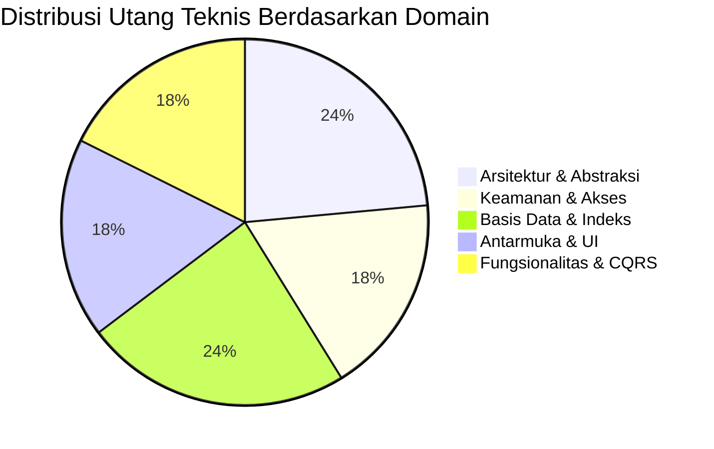

# Technical Debt Register — Enterprise ERP System

> **Document ID:** AUD-DEBT-2026-001  
> **Related Documents:** [SYSTEM_AUDIT_REPORT.md](./SYSTEM_AUDIT_REPORT.md) | [IMPLEMENTATION_PLAN.md](./IMPLEMENTATION_PLAN.md)

---

## 1. Ikhtisar Utang Teknis (Technical Debt Summary)

Utang teknis diidentifikasi, diklasifikasikan, dan dipetakan ke dalam estimasi jam kerja (*effort*) untuk memastikan transparansi arsitektur bagi tim engineering dan stakeholder:

---

## 2. Register Lengkap Utang Teknis

| ID Debt | Kategori | Lokasi Kode / Modul | Deskripsi Utang Teknis | Dampak Arsitektur / Bisnis | Prioritas | Estimasi Effort | Task Remediasi |
| :--- | :--- | :--- | :--- | :--- | :---: | :---: | :---: |
| **`DEBT-001`** | Security | `src/ERP.Web/Program.cs` | Antiforgery dinonaktifkan pada endpoint `/api/auth/login`. | Risiko serangan CSRF pada autentikasi. | **P0** | 4 Jam | `TSK-SEC-01` |
| **`DEBT-002`** | Security | `src/ERP.Infrastructure/DependencyInjection.cs` | Plaintext fallback connection string dengan password di kode. | Potensi kebocoran password basis data. | **P1** | 2 Jam | `TSK-SEC-02` |
| **`DEBT-003`** | Architecture | `src/ERP.Infrastructure/Services/CurrentUserService.cs` | Ketergantungan pada `IHttpContextAccessor` di Blazor Interactive Server. | State pengguna tidak sinkron saat SignalR reconnect. | **P1** | 6 Jam | `TSK-ARCH-01` |
| **`DEBT-004`** | Architecture | `src/ERP.Web/Components/Pages/**/*.razor` | Kueri langsung `IApplicationDbContext` pada lookup modal. | Pelanggaran batas Clean Architecture pada UI. | **P2** | 8 Jam | `TSK-ARCH-02` |
| **`DEBT-005`** | Architecture | Solusi Keseluruhan | Ketiadaan background job processing engine (Hangfire). | Operasi kalkulasi periodik berjalan di thread UI. | **P1** | 8 Jam | `TSK-ARCH-03` |
| **`DEBT-006`** | Database | `finance.journal_lines` | Missing index pada kolom `account_id`. | Kueri buku besar melambat drastis pada data besar. | **P1** | 2 Jam | `TSK-DB-01` |
| **`DEBT-007`** | Database | `inventory.stock_movements` | Missing index komposit `(warehouse_id, product_id, date)`. | Kartu stok melambat pada volume ratusan ribu mutasi. | **P1** | 2 Jam | `TSK-DB-02` |
| **`DEBT-008`** | Database | `finance.payment_allocations` | Missing index pada foreign identifier `invoice_id`. | Pengecekan sisa tagihan faktur membutuhkan scan tabel. | **P2** | 2 Jam | `TSK-DB-03` |
| **`DEBT-009`** | Database | `sales.sales_orders`, `purchase_orders` | Missing composite index pada header filter `(company_id, status)`. | Query listing order pada multi-tenant membutuhkan scan. | **P2** | 2 Jam | `TSK-DB-04` |
| **`DEBT-010`** | Functional | `src/ERP.Application/Features/Master/Departments` | Ketiadaan Command & Query untuk entitas Departemen. | Fitur pengelolaan departemen tidak dapat diakses. | **P2** | 6 Jam | `TSK-FUNC-01` |
| **`DEBT-011`** | Functional | Solusi Keseluruhan | Ketiadaan in-app notification engine & email delivery service. | User tidak menerima alert otomatis saat ada approval. | **P2** | 12 Jam | `TSK-FUNC-02` |
| **`DEBT-012`** | Functional | Modul Laporan | Ketiadaan binary exporter untuk Excel (xlsx) dan PDF. | Pengguna hanya dapat mencetak via browser print. | **P2** | 8 Jam | `TSK-FUNC-03` |
| **`DEBT-013`** | UI/UX | `src/ERP.Web/Components/Layout/NavMenu.razor` | Menu Departemen menautkan ke URL 404 (Not Found). | Kerusakan link navigasi menurunkan usability. | **P2** | 4 Jam | `TSK-UI-01` |
| **`DEBT-014`** | UI/UX | `src/ERP.Web/Components/Layout/MainLayout.razor` | Indikator cabang dan badge notifikasi bersifat teks statis. | Pengguna multi-cabang tidak dapat beralih cabang di UI. | **P2** | 6 Jam | `TSK-UI-02` |
| **`DEBT-015`** | UI/UX | `src/ERP.Web/Components/Layout/MainLayout.razor` | Link `/security/profile` dan `/security/change-password` 404. | Pengguna tidak dapat memperbarui profil / password. | **P2** | 6 Jam | `TSK-UI-03` |
| **`DEBT-016`** | Testing | Solusi Pengujian | Ketiadaan pengujian otomasi UI (bUnit & Playwright). | Perubahan komponen Razor berisiko memicu regresi UI. | **P2** | 12 Jam | `TSK-TEST-01` |
| **`DEBT-017`** | DevOps | Repositori Root | Ketiadaan GitHub Actions CI/CD automation workflow. | Tidak ada verifikasi otomatis pada pull request. | **P1** | 4 Jam | `TSK-DEVOPS-01`|

---

## 3. Strategi Pembayaran Utang Teknis (Paydown Strategy)

Total estimasi utang teknis adalah **88 Jam Kerja (~11 Hari Kerja)**. Strategi pelunasan utang teknis dibagi ke dalam sprint berikut:
1. **Sprint 1 (Kritikal & Fondasi - 24 Jam):** Pelunasan `DEBT-001`, `DEBT-002`, `DEBT-003`, `DEBT-006`, `DEBT-007`, `DEBT-017`.
2. **Sprint 2 (Fungsional & Usability - 32 Jam):** Pelunasan `DEBT-004`, `DEBT-010`, `DEBT-013`, `DEBT-014`, `DEBT-015`.
3. **Sprint 3 (Integrasi & Otomasi - 32 Jam):** Pelunasan `DEBT-005`, `DEBT-011`, `DEBT-012`, `DEBT-016`.

