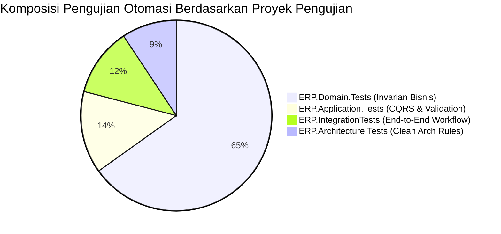

# Testing & Quality Assurance Audit — Enterprise ERP System

> **Document ID:** AUD-TST-2026-001  
> **Testing Frameworks:** xUnit, FluentAssertions, NetArchTest.Rules, Moq  
> **Related Documents:** [TESTING_STRATEGY.md](../TESTING_STRATEGY.md) | [CODING_STANDARDS.md](../CODING_STANDARDS.md)

---

## 1. Status Eksekusi Pengujian Otomasi Aktual

Hasil eksekusi `dotnet test` pada seluruh solusi:

```
Passed!  - Failed: 0, Passed: 28, Skipped: 0, Total: 28 - ERP.Domain.Tests.dll (net10.0)
Passed!  - Failed: 0, Passed:  6, Skipped: 0, Total:  6 - ERP.Application.Tests.dll (net10.0)
Passed!  - Failed: 0, Passed:  5, Skipped: 0, Total:  5 - ERP.IntegrationTests.dll (net10.0)
Passed!  - Failed: 0, Passed:  4, Skipped: 0, Total:  4 - ERP.Architecture.Tests.dll (net10.0)
-----------------------------------------------------------------------------------------
TOTAL:     Failed: 0, Passed: 43, Skipped: 0, Total: 43 (Durasi Total: ~2.8 detik)
```



---

## 2. Cakupan Pengujian Per Modul (Test Coverage Matrix)

| Modul Bisnis | Unit Tests (Domain) | Integration Tests | Skenario Bisnis yang Teruji | Status Kesiapan |
| :--- | :---: | :---: | :--- | :---: |
| **Master Data** | 6 Tests | Included in E2E | NPWP validation, Customer Credit Limit, Code uniqueness | **TERVERIFIKASI** |
| **Inventory** | 7 Tests | Included in E2E | `BR-INV-001` (Negative stock block), Moving average, Opname | **TERVERIFIKASI** |
| **Procurement** | 5 Tests | 1 E2E Suite | PR $\to$ PO $\to$ GRN $\to$ Vendor Bill, 3-Way match | **TERVERIFIKASI** |
| **Sales** | 4 Tests | 1 E2E Suite | SQ $\to$ SO $\to$ DO $\to$ Invoice, `BR-SALES-001/002/003` | **TERVERIFIKASI** |
| **Finance** | 3 Tests | 2 E2E Suites | `BR-ACC-001` (Zero Imbalance Invariant), Closed Period Lock | **TERVERIFIKASI** |
| **HR & Payroll** | 3 Tests | 1 E2E Suite | `BR-HR-001` (Cuti 12 hari), `BR-HR-002` (THP non-negatif) | **TERVERIFIKASI** |
| **Architecture** | - | 4 Tests | Layer isolation, NetArchTest clean architecture rules | **TERVERIFIKASI** |

---

## 3. Analisis Kesenjangan Pengujian (Testing Gaps)

### 3.1 `TEST-001` [MEDIUM - P2]: Ketiadaan Pengujian Otomasi UI End-to-End (Playwright / bUnit)
- **Kondisi Aktual:**
  Pengujian saat ini berfokus pada Domain, Application, dan Integration test di memory. Belum terdapat pengujian fungsional interaksi browser Blazor Server (bUnit untuk komponen Razor atau Playwright untuk visual E2E).
- **Risiko:**
  Perubahan pada komponen Razor atau konfigurasi MudBlazor dapat memicu regresi UI tanpa terdeteksi oleh unit test C#.
- **Rekomendasi QA:**
  Buat proyek baru `tests/ERP.Web.Tests` menggunakan **bUnit** untuk menguji rendering komponen Razor, serta rangkaian pengujian **Playwright** untuk smoke test alur login dan submit transaksi utama.

### 3.2 `TEST-002` [LOW - P3]: Pengujian Beban Konkurensi Mutasi Stok (Concurrency Stress Test)
- **Kondisi Aktual:**
  Invarian pencegahan stok negatif telah diuji pada alur single-thread.
- **Rekomendasi QA:**
  Tambahkan pengujian konkurensi menggunakan `Task.WhenAll` dengan 20 thread paralel yang mencoba mengurangi sisa 5 unit stok secara bersamaan, memastikan bahwa hanya 5 unit yang berhasil dialokasikan dan 15 request sisanya melempar exception konkurensi secara deterministik.

---

## 4. Strategi Pengujian Kesiapan UAT & Go-Live (Testing Gate)

Sebelum rilis produksi, tim QA wajib menjalankan checklist pengujian berikut:

1. **Automated Regression Suite:** 100% test lulus pada build pipeline CI/CD (`dotnet test`).
2. **Security Automated Scan:** Verifikasi kerentanan paket NuGet (`dotnet list package --vulnerable`).
3. **Database Integrity Verification:** Validasi skema dan constraint menggunakan skrip migrasi EF Core.
4. **Smoke Testing Manual (32 Skenario):** Pengujian alur transaksi di 9 modul oleh perwakilan bisnis (UAT).

