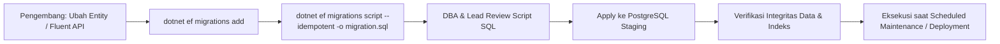

# Database Migration & Versioning Strategy — Enterprise ERP System

> **Document Version:** 1.0.0  
> **Target Database Engine:** PostgreSQL 16+ | EF Core 10 & Npgsql  
> **Related Documents:** [../DATABASE_DESIGN.md](../DATABASE_DESIGN.md) | [../DATABASE_SCHEMA.md](../DATABASE_SCHEMA.md) | [../DEPLOYMENT_GUIDE.md](../DEPLOYMENT_GUIDE.md)

---

## 1. Strategi Evolusi Skema Basis Data

Sistem ERP menggunakan **Entity Framework Core 10 Code-First Migrations** yang dikombinasikan dengan tinjauan skrip SQL manual sebelum diterapkan ke lingkungan produksi (*Staging & Production*).



---

## 2. Aturan Emas Migrasi Skema Produksi (Zero-Downtime Migration Rules)

Untuk mencegah lock tabel yang lama (*table lock starvation*) atau terputusnya operasional pengguna:

1. **Prinsip Expand and Contract (Two-Phase Migration):**
   - **Fase 1 (Expand):** Jika mengganti nama kolom atau memecah tabel, tambahkan kolom baru terlebih dahulu sebagai `nullable`. Aplikasi baru menulis ke kolom baru dan lama secara sinkron.
   - **Fase 2 (Backfill):** Jalankan batch update di latar belakang untuk mengisi data lama ke kolom baru.
   - **Fase 3 (Contract):** Setelah seluruh aplikasi diperbarui dan stabil, buat migrasi berikutnya untuk menghapus kolom lama.
2. **Larangan Default Nilai Statis Berat pada Tabel Masif:**  
   Menambahkan kolom baru dengan nilai default pada PostgreSQL 11+ tidak melakukan rewrite tabel, namun jika ada kalkulasi fungsi berat, lakukan pengisian secara bertahap.
3. **Pembuatan Indeks Tanpa Memblokir Transaksi (`CONCURRENTLY`):**  
   Pada basis data produksi yang aktif, pembuatan indeks besar wajib menggunakan opsi `CONCURRENTLY` di luar transaksi untuk mencegah penguncian tabel (*write lock*):
   ```sql
   CREATE INDEX CONCURRENTLY idx_sales_orders_customer_id 
   ON sales.sales_orders (customer_id);
   ```

---

## 3. Strategi Penyemaian Data Awal (Data Seeding Strategy)

Data awal dibagi menjadi 3 tingkatan penyemaian (*seed tiers*):

| Kategori Seed | Cakupan Data | Mekanisme Eksekusi |
| :--- | :--- | :--- |
| **Tier 1: System Baseline** | Seluruh izin sistem (`identity.permissions`), peran default (`identity.roles`), dan bagan akun standar (COA). | Dijalankan otomatis saat aplikasi pertama kali inisialisasi via `IApplicationDbContextSeeder`. |
| **Tier 2: Demo / Development** | Perusahaan contoh (PT Demo Korporat), 2 cabang, 10 produk, 5 pelanggan, 5 pemasok, saldo stok awal. | Hanya dieksekusi jika environment bernilai `Development`. Dilarang jalan di `Production`. |
| **Tier 3: Master Data Onboarding** | Impor data riil master produk dan saldo awal pelanggan dari spreadsheet resmi klien. | Menggunakan tool CLI migrasi batch dengan validasi skema ketat. |

---

## 4. Prosedur Rollback & Kontingensi Kegagalan Migrasi

Jika terjadi kegagalan saat proses penerapan migrasi di server produksi:

```bash
# 1. Identifikasi nama migrasi terakhir yang sukses
dotnet ef migrations list --context ApplicationDbContext

# 2. Kembalikan skema database ke titik migrasi sebelumnya
dotnet ef database update <NamaMigrasiSebelumnya> --context ApplicationDbContext

# 3. Jika terjadi kegagalan fatal pada state database, pulihkan dari snapshot backup sesaat sebelum migrasi
gunzip -c /var/backups/erp/pre_migration_backup.sql.gz | docker exec -i erp_postgres psql -U erp_admin -d enterprise_erp
```

